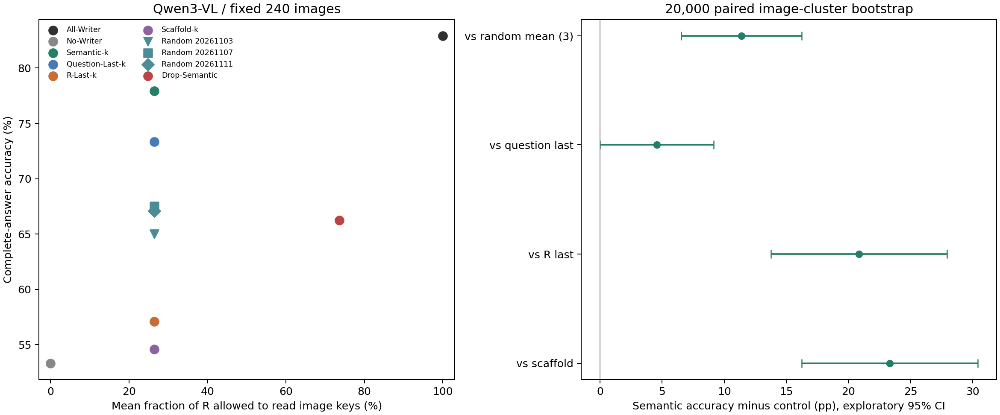
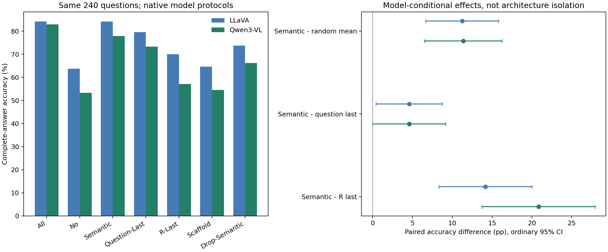
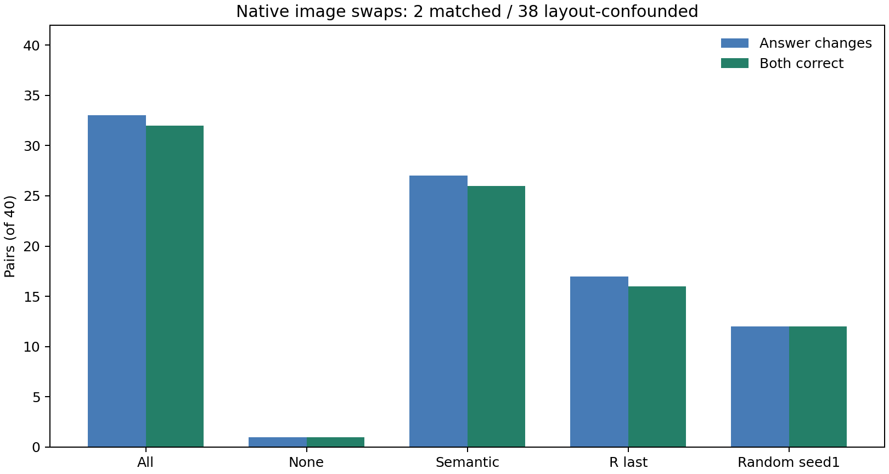
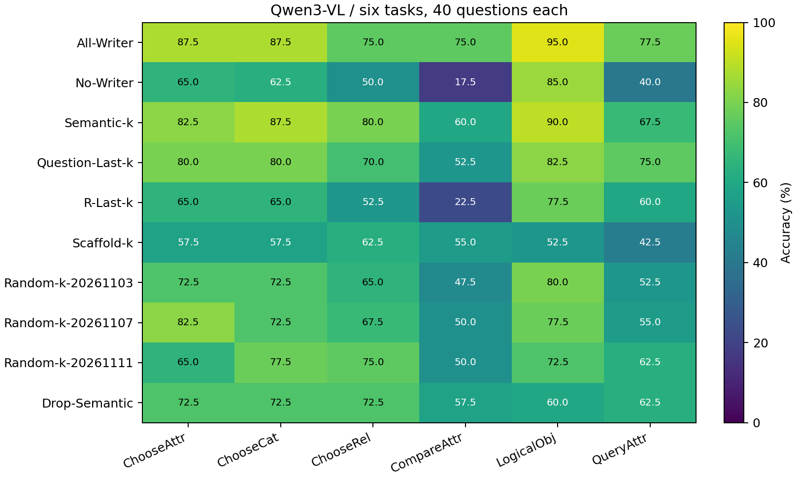

# Qwen3-VL Semantic Visual Writers：跨模型复现

**COMPLETE：240题×10条件共2400条全部新生成；另有40组×2端×5条件共400条换图生成。历史原生Full不充当All-Writer。**

## 直接回答

Qwen Semantic-k为187/240（77.917%），平均开放6.96个R Token（平均逐题R比例26.42%）。All-Writer为199/240，No-Writer为128/240。

**是否只需要少量特定文本Token读图？** Semantic−All为-5.000 pp，普通95%CI [-9.167, -1.250]，校正区间[-10.417, +0.417]；相对All原对变错18题、原错变对6题。Semantic−No为+24.583 pp，七项校正后仍支持正向差异。是否保留足够预测能力只能依这些数值及换图结果判断；没有预声明非劣效界限，不能由接近或CI跨0宣称无损。

**语义优势是否跨模型成立？** Qwen Semantic−三个随机种子逐题平均为+11.389 pp，普通95%CI [+6.528, +16.250]，校正区间[+4.722, +17.997]，七项校正后仍支持正向差异。LLaVA对应效应为+11.250 pp，校正区间[+5.000,+17.500]。应区分方向一致、两模型各自证据强度与真正的模型交互；不能用显著/不显著之差替代交互检验。

Semantic−Question-Last为+4.583 pp，七项校正区间包含0，尚不能确立差异，也不是等价证明；Semantic−R-Last为+20.833 pp，七项校正后仍支持正向差异。这两个末端对照不同，不能合并后宣称语义普遍胜出。

Drop-Semantic−All为-16.667 pp，普通95%CI [-22.917, -10.417]，校正区间[-25.417, -7.917]，七项校正后仍支持负向差异。这是移除最终选定集合读图权限的条件必要性实验，不等于视觉信息唯一储存在它们。

**综合判定：** Qwen的语义启发式优势在预声明校正后仍成立，与LLaVA的选择性方向一致；这支持原生协议下的跨模型复现，而不是少量任意Token都等效。少量选定文本的直接读图确实比完全关闭写入保留更多正确答案，支持部分间接读取的功能充分性线索；相对All的真实损害仍必须保留。没有预先声明非劣效或等价界限，任何接近的净Accuracy都不是严格无损证明。

## 冻结规则与跨模型边界

模型revision `0c351dd01ed87e9c1b53cbc748cba10e6187ff3b`，历史原生BF16/Eager、Transformers4.57.6、Processor默认图像分辨率、DeepStack和mRoPE不变。显式logits_to_keep=1，Greedy最多32 Token，真实独立KV及前缀。240题及图片SHA完全复用，未重采样。源码冻结Commit `469fc64790a9745e74c73c4f08c0a55924411298`。
只改变36层Softmax前Query→原始Image Key的Hard Mask。全部条件P−1及每个真实Decode Query（包括EOS预测）均不能直接读图；仅选定Prefill R Query开放。其他来源、原因果/Pad Mask、MLP、Residual、Attention输出与KV更新均原生。
**R包括最后一个实际Image Token之后、P−1之前全部原始位置，包括`vision_end`及模板特殊Token。** 历史Qwen的o_proj角色实验排除了vision_end，但本轮若不管控它，会留下未受控的文本视觉中继。该边界在GPU前冻结，且没有改动原Token或位置。
Image来自实际Processor的image-pad IDs，不是576固定Token；本批范围128–1024。Question由原生offset映射识别；输入映射逐题与历史Qwen240题完全一致。

词法选择器原文件SHA256 `bdfeea43befd9c59cf373e6972d550ee6340416c7550b8ce3a395989a9492e22`，与LLaVA逐字节相同，包括STOP、完整Subword词、同预算DP和三个随机种子。Qwen重新分词后k为3–14，9/240题存在整词末端预算约束缩减，Scaffold不足0题。缩减和不足均记录，不删除题。
Semantic是输入词法启发式，不是验证过的语义标注器。Drop-Semantic取最终Semantic-k集合的补集。Random为整词组随机排列后的精确预算DP，不是独立均匀子词抽样。选词不读取Gold、历史正确性、图片内容或模型输出。
两模型选中相同Question词出现位置集合的题数为205/240，平均词集合Jaccard为0.9683。LLaVA Semantic平均写入7.89Token，Qwen为6.96；同规则不等于同绝对Token预算。

## 主实验十条件

|条件|正确/240|Accuracy|平均写入Token / R比例|ΔAll pp (95%CI)|All损害/纠正|首Token翻转|
|---|---:|---:|---:|---|---:|---:|
|All-Writer|199|82.917%|25.69 / 100.00%|+0.000 [+0.000, +0.000]|0/0|0|
|No-Writer|128|53.333%|0.00 / 0.00%|-29.583 [-37.083, -22.083]|86/15|111|
|Semantic-k|187|77.917%|6.96 / 26.42%|-5.000 [-9.167, -1.250]|18/6|27|
|Question-Last-k|176|73.333%|6.96 / 26.42%|-9.583 [-14.167, -5.000]|29/6|39|
|R-Last-k|137|57.083%|6.96 / 26.42%|-25.833 [-32.917, -18.750]|77/15|101|
|Scaffold-k|131|54.583%|6.96 / 26.42%|-28.333 [-35.417, -21.250]|80/12|94|
|Random-k-20261103|156|65.000%|6.96 / 26.42%|-17.917 [-23.750, -12.083]|52/9|67|
|Random-k-20261107|162|67.500%|6.96 / 26.42%|-15.417 [-21.250, -9.583]|48/11|63|
|Random-k-20261111|161|67.083%|6.96 / 26.42%|-15.833 [-22.083, -9.583]|50/12|67|
|Drop-Semantic|159|66.250%|18.73 / 73.58%|-16.667 [-22.917, -10.417]|53/13|67|

各条件相对No的损益和CI、signed首Token LogP Loss、EOS/空/截断/重复见accuracy_summary.csv；六任务各40题见task_accuracy.csv；全部答案和预算见per_question.csv。

## 预声明比较

20,000次Image SHA256整簇配对Bootstrap，固定seed20261103。七项主要对比给出普通95%和Bonferroni7区间；单随机种子补充比较只有普通区间。随机平均在每题内完成，不当成720张独立图片。随机平均的损害/纠正为种子平均数，不作整数二项翻转或McNemar。

|比较|Δpp|普通95%CI|七项校正区间|
|---|---:|---|---|
|Semantic-k minus Random-mean(3)|+11.389|[+6.528, +16.250]|[+4.722, +17.997]|
|Semantic-k minus Question-Last-k|+4.583|[+0.000, +9.167]|[-1.250, +10.417]|
|Semantic-k minus R-Last-k|+20.833|[+13.750, +27.917]|[+10.833, +30.833]|
|Semantic-k minus Scaffold-k|+23.333|[+16.250, +30.417]|[+13.750, +32.740]|
|Semantic-k minus All-Writer|-5.000|[-9.167, -1.250]|[-10.417, +0.417]|
|Semantic-k minus No-Writer|+24.583|[+17.500, +31.667]|[+15.000, +34.167]|
|Drop-Semantic minus All-Writer|-16.667|[-22.917, -10.417]|[-25.417, -7.917]|
|Semantic-k minus Random-k-20261103|+12.917|[+7.083, +18.750]||
|Semantic-k minus Random-k-20261107|+10.417|[+4.583, +16.667]||
|Semantic-k minus Random-k-20261111|+10.833|[+5.000, +16.667]||

## 图像交换与位置混杂

冻结40组中，2组原始Token布局、视觉网格与mRoPE完全一致，38组布局不一致。未改变图片分辨率来制造匹配，也未丢弃不匹配配对。No-Writer只在匹配布局组要求所有有效步骤全词表Logits严格一致；不匹配组的差异单独标注为位置编码/布局混杂，不能单凭非零差异判为视觉泄漏。

|条件|布局组|对数|答案随图改变|两端均正确|端点正确|平均首分布JS|平均TV|
|---|---|---:|---:|---:|---:|---:|---:|
|All-Writer|all|40|33|32|71|0.491847|0.771341|
|All-Writer|same_layout|2|2|2|4|0.677993|0.994505|
|All-Writer|different_layout|38|31|30|67|0.482050|0.759595|
|No-Writer|all|40|1|1|41|0.000165|0.004787|
|No-Writer|same_layout|2|0|0|2|0.000000|0.000000|
|No-Writer|different_layout|38|1|1|39|0.000174|0.005039|
|Semantic-k|all|40|27|26|65|0.337276|0.616285|
|Semantic-k|same_layout|2|1|1|3|0.388689|0.611536|
|Semantic-k|different_layout|38|26|25|62|0.334570|0.616535|
|R-Last-k|all|40|17|16|55|0.119330|0.315019|
|R-Last-k|same_layout|2|1|1|3|0.202216|0.401903|
|R-Last-k|different_layout|38|16|15|52|0.114968|0.310446|
|Random-k-20261103|all|40|12|12|52|0.112771|0.268227|
|Random-k-20261103|same_layout|2|0|0|2|0.003135|0.021461|
|Random-k-20261103|different_layout|38|12|12|50|0.118541|0.281214|

分布指标为固定首答案预测位置全词表JS（自然对数）及TV，非仅Top1或候选排序。答案改变不等于正确依赖图片；要同时看两端都正确。匹配布局No-Writer逐步精确不变性由image_independence_validation.json与原始数组校验。布局不匹配时No-Writer即使两端都正确，也可能来自布局先验，不能称为图像内容理解。

## 跨模型表述与负面案例

cross_model_accuracy.csv及跨模型图采用同240题、同词法算法，但保留各自Tokenizer、原Prompt、原图像处理及FP16/BF16。结果是模型原生协议下的复现，不隔离纯架构效应。不能声称所有VLM或其他数据集都成立。
negative_cases.csv保留所有错误和相对All/No的真实损害；swap_negative_cases.csv保留未能两端都正确的案例。净Accuracy不抵消逐题风险。没有根据输出挑Token、改k、挑随机种子或改层。
低预算保留表现只支持所定义路径的条件功能充分性线索。它不证明唯一存储、不可替代、真正信息瓶颈或严格无损，更没有实现/测得物理加速。

## 验证与资源

先CPU测试，再三道按原生输入长度冻结的真实GPU Smoke。原生Full/No-op所有有效Logits同形状torch.equal；十条件Mask概率严格为0、非目标Mask不变、前缀/Self合法、独立真实Cache及父Cache不变、DeepStack特征与原生BF16残差/MLP、mRoPE和正常/异常Hook清理均审计。原生Full首Logits和完整Token另与历史Qwen Full核对，但不复用为All。
Logits不使用近似容差。概率行和采用预先固定的BF16 dtype eps舍入口径；这是概率量化审计，非放宽Logits一致性。模型文件在冻结、GPU加载前和采集后校验全量SHA256。
单物理GPU0 UUID `GPU-a63c6362-dcfd-4a26-c44b-014b40127c89`，只加载一份模型，其他GPU任务不干预；结束正常退出并保存gpu_release.json。原始词表数组存服务器外部资源目录，Git保存路径和哈希，不上传模型/图像或大缓存。

所有2400主记录、400交换记录及原始数组重放后才标记COMPLETE。最终只读--check再次复算表格、Bootstrap和文件哈希，不覆盖完成记录。

本轮到此停止：不扩样、不训练、不搜索写入层、不做Activation Patching、Router或加速实现。

