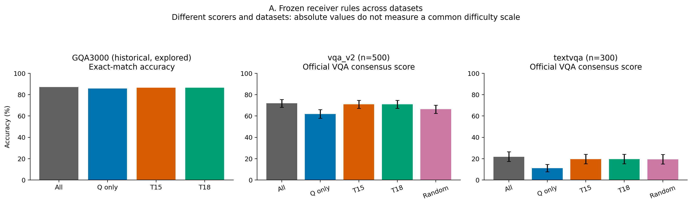
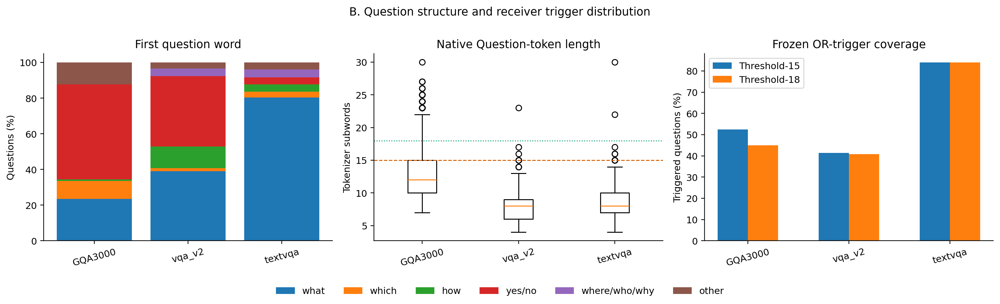
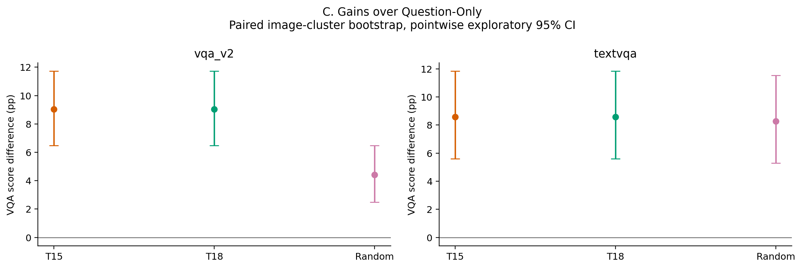
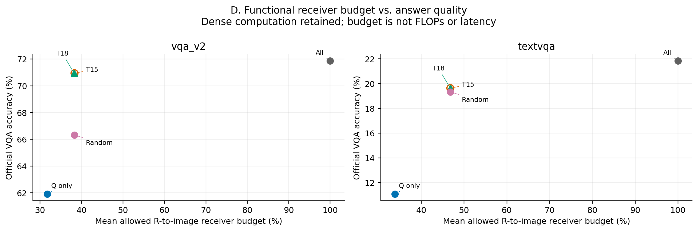

# 固定Question-Conditional Assistant规则的跨数据集验证

执行源码基线：`644834d3e22194b4982758dabd59d3e479ef8ce3`。本轮仅用LLaVA-1.5-7B、单张RTX3090（UUID `GPU-b08489af-0a8a-eb48-55ba-8346733af417`），没有训练、调阈值或修改Prompt。15/18阈值来自反复探索的GQA3000，本轮仅在冻结的新问题上验证。

## 协议和数据

所有32层P−1与真实Decode都禁止直接读取原始Image Key；Question始终开放，触发时额外开放原生ASSISTANT的4个完整Subword。原生Full与这里All-Writer不同。五个条件标签完整保留；同题仅输入哈希与接收位置完全相同者共享生成，缓存均由该唯一生成从空开始独立构建。

VQAv2使用官方VQAEval归一化与10人留一共识，TextVQA使用固定MMF/EvalAI评分器。主要指标是平均VQA软分数，不是单Gold字符串正确率；1/2/3人匹配得0.3/0.6/0.9分。GQA历史87.0333%、85.8333%、86.6000%、86.5333%为Exact Match，不能跨评分协议直接比较绝对能力。

数据按固定SHA顺序选取，每图一道；优先排除VG→COCO/Flickr已知历史GQA3000图片及字节SHA重叠。未匹配不能排除重新编码、缺失元数据或预训练重叠。详细来源、图像SHA与下载记录见dataset_sources、sample_manifest和dataset_overlap_audit。

随机触发对照在完全相同Question Token长度与R长度分层内置换T15标签，种子20261104，触发题数、额外4-Token数量、平均k/R及合并k/R均匹配。某些分层没有可置换的触发差异，须以changed_labels判断实际控制对比强度。

## 结果

### vqa_v2（500题）

| 条件 | VQA Accuracy % | 相对All pp | 平均R预算 % | 合并R预算 % |
|---|---:|---:|---:|---:|
| All-Writer | 71.860 | +0.000 | 100.000 | 100.000 |
| Question-Only | 61.900 | -9.960 | 31.679 | 32.233 |
| Threshold-15 | 70.940 | -0.920 | 38.291 | 38.834 |
| Threshold-18 | 70.940 | -0.920 | 38.219 | 38.739 |
| Budget-Matched Random | 66.320 | -5.540 | 38.291 | 38.834 |

| 配对比较 | 差值pp [普通95%CI] | Score升/降/不变 | Holm p |
|---|---:|---:|---:|
| Threshold-15 − Question-Only | +9.040 [+6.480, +11.720] | 56/6/438 | 0.0003 |
| Threshold-18 − Question-Only | +9.040 [+6.480, +11.720] | 56/6/438 | 0.0003 |
| Threshold-15 − All-Writer | -0.920 [-2.580, +0.720] | 14/17/469 | 0.5816 |
| Threshold-18 − All-Writer | -0.920 [-2.580, +0.720] | 14/17/469 | 0.5816 |
| Threshold-15 − Budget-Matched Random | +4.620 [+2.580, +6.740] | 32/8/460 | 0.0003 |
| Threshold-18 − Budget-Matched Random | +4.620 [+2.580, +6.740] | 32/8/460 | 0.0003 |

问题结构：what 39.00%，which 1.80%，how 12.00%，yes/no首词 39.60%，where/who/why 4.20%。Question长度均值8.09、中位数8.0，范围4–23；≥15占1.40%，≥18占0.20%。T15/T18触发率41.40%/40.80%。随机与T15实际不同标签228题。

重叠审计：已知元数据重叠0题，字节SHA重叠0题；未发现匹配不等于完全图像独立。输出异常（按五个逻辑条件计数）：{'empty': 0, 'non_EOS': 0, 'repeated': 0, 'truncated': 0}。

各答案类型、首词和触发子组的Score增加/损害完整保存在answer_type_accuracy.csv；全部预设比较的损害例保存在harm_cases.csv。

解释：Threshold-15相对Question-Only点估计提高9.040pp；相对与T15等预算的随机为+4.620pp。点估计优于随机，但仍需结合区间和六比较Holm校正，不能仅据点估计宣布机制成立。

解释：Threshold-18相对Question-Only点估计提高9.040pp；相对T15预算匹配的随机（与T18不保证等预算）为+4.620pp。点估计优于随机，但仍需结合区间和六比较Holm校正，不能仅据点估计宣布机制成立。

### textvqa（300题）

| 条件 | VQA Accuracy % | 相对All pp | 平均R预算 % | 合并R预算 % |
|---|---:|---:|---:|---:|
| All-Writer | 21.833 | +0.000 | 100.000 | 100.000 |
| Question-Only | 11.067 | -10.767 | 33.839 | 34.548 |
| Threshold-15 | 19.633 | -2.200 | 46.793 | 47.485 |
| Threshold-18 | 19.633 | -2.200 | 46.793 | 47.485 |
| Budget-Matched Random | 19.333 | -2.500 | 46.793 | 47.485 |

| 配对比较 | 差值pp [普通95%CI] | Score升/降/不变 | Holm p |
|---|---:|---:|---:|
| Threshold-15 − Question-Only | +8.567 [+5.600, +11.833] | 28/1/271 | 0.0003 |
| Threshold-18 − Question-Only | +8.567 [+5.600, +11.833] | 28/1/271 | 0.0003 |
| Threshold-15 − All-Writer | -2.200 [-4.800, +0.300] | 6/14/280 | 0.3952 |
| Threshold-18 − All-Writer | -2.200 [-4.800, +0.300] | 6/14/280 | 0.3952 |
| Threshold-15 − Budget-Matched Random | +0.300 [-1.100, +1.733] | 5/3/292 | 1.0000 |
| Threshold-18 − Budget-Matched Random | +0.300 [-1.100, +1.733] | 5/3/292 | 1.0000 |

问题结构：what 80.33%，which 3.33%，how 4.00%，yes/no首词 4.00%，where/who/why 4.33%。Question长度均值8.97、中位数8.0，范围4–30；≥15占4.67%，≥18占0.67%。T15/T18触发率84.00%/84.00%。随机与T15实际不同标签68题。

重叠审计：已知元数据重叠0题，字节SHA重叠0题；未发现匹配不等于完全图像独立。输出异常（按五个逻辑条件计数）：{'empty': 0, 'non_EOS': 11, 'repeated': 24, 'truncated': 11}。

各答案类型、首词和触发子组的Score增加/损害完整保存在answer_type_accuracy.csv；全部预设比较的损害例保存在harm_cases.csv。

解释：Threshold-15相对Question-Only点估计提高8.567pp；相对与T15等预算的随机为+0.300pp。点估计优于随机，但仍需结合区间和六比较Holm校正，不能仅据点估计宣布机制成立。

解释：Threshold-18相对Question-Only点估计提高8.567pp；相对T15预算匹配的随机（与T18不保证等预算）为+0.300pp。点估计优于随机，但仍需结合区间和六比较Holm校正，不能仅据点估计宣布机制成立。

## 统计、正确性与边界

两个数据集分别统计，不合并Accuracy。每项20,000次Image SHA整簇配对Bootstrap，保持问题等权，seed20261104；表中为普通点位95%CI。每数据集固定六比较的双侧簇符号翻转p值另做Holm校正。CI跨0不是等效或非劣效证明，本轮未定义/检验质量非劣效界限。数据集规模有限、只一组随机种子，不能把单数据集差异泛化为普适机制。

CPU审计逐题原生Offset、完整词组、R/Q/I/P−1和真实ASSISTANT四Subword，并对历史两条规则各3000题逐位置回归。真实GPU Smoke检查Native/No-op全部有效Logits严格torch.equal、禁止概率严格0、非目标Mask不变、32层MLP、原图特征不变且参与计算、独立KV和异常Hook清理。自由生成使用logits_to_keep=1，保留EOS；冻结输入与源码SHA逐题复核。没有保存冗余全词表Logits归档。

ASSISTANT是LLaVA原生模板中的接收位置，本实验没有换模板或模型，因而任何收益仍可能强烈依赖LLaVA模板；没有证明跨模板或跨模型成立。阈值来自GQA搜索，新数据上的点估计、随机控制及不确定区间共同判断是否存在GQA特化，不能因外部数据集名称不同就排除图像或预训练重叠。

本轮只验证功能性视觉接收者。密集Attention、完整QKV/MLP/Residual/KV都保留，预算不是计算/延迟节省。是否纳入Physical Visual Handoff须以外部质量、随机控制证据与单独工程验证共同决定；本轮不执行加速、训练或追加搜索。

## 图表和复现

cross_dataset/figure_A–D包含PNG及矢量PDF；图A明确区分GQA Exact Match与VQA共识。作图数据来自全部冻结样本，图B仅使用实际GPU样本分布；完整验证集CPU首词统计另存各数据集full_validation_cpu_firstwords.json。完整原始生成、Token IDs、输入/Checkpoint索引及评分保存在各数据集目录。

运行：在vlm_research目录下，依次 `python -m receiver_cross_dataset.prepare`、`python -m receiver_cross_dataset.run`、`python -m receiver_cross_dataset.analyze`。数据准备脚本data_acquisition.py只缓存所需图像；源文件与依赖哈希见source_manifest.json/protocol.json。

官方来源：[VQAv2下载](https://visualqa.org/download.html)、[官方VQA评分](https://visualqa.org/evaluation.html)、[VQAEval实现](https://github.com/GT-Vision-Lab/VQA/blob/master/PythonEvaluationTools/vqaEvaluation/vqaEval.py)、[TextVQA官方数据](https://huggingface.co/datasets/facebook/textvqa)、[MMF评分](https://github.com/facebookresearch/mmf/blob/main/mmf/utils/m4c_evaluators.py)。

## 最终判断：跨数据集迁移、阈值与工程意义

**vqa_v2结构迁移。** what/which占204/500（40.80%）。Question Token长度均值8.09、中位数8.0、四分位数6.0–9.0、范围4–23。仅由长度触发、而非what/which的题数为T15 3、T18 0；两阈值接收集合只在3题不同。

Threshold-15：同时优于Question-Only与随机触发，且均通过预声明六比较Holm校正。相对Q为+9.040pp，相对随机为+4.620pp，相对All为-0.920pp。T18与随机的预算不保证相同，因为随机只匹配T15。

Threshold-18：同时优于Question-Only与随机触发，且均通过预声明六比较Holm校正。相对Q为+9.040pp，相对随机为+4.620pp，相对All为-0.920pp。T18与随机的预算不保证相同，因为随机只匹配T15。

**textvqa结构迁移。** what/which占251/300（83.67%）。Question Token长度均值8.97、中位数8.0、四分位数7.0–10.0、范围4–30。仅由长度触发、而非what/which的题数为T15 1、T18 1；两阈值接收集合只在0题不同。

Threshold-15：尚未同时取得超越Question-Only与随机触发的校正后证据。相对Q为+8.567pp，相对随机为+0.300pp，相对All为-2.200pp。T18与随机的预算不保证相同，因为随机只匹配T15。

Threshold-18：尚未同时取得超越Question-Only与随机触发的校正后证据。相对Q为+8.567pp，相对随机为+0.300pp，相对All为-2.200pp。T18与随机的预算不保证相同，因为随机只匹配T15。

TextVQA原标注没有VQAv2的官方yes/no、number、other字段；表中统一标为textvqa，另按真实首词和触发类型分组，未臆造官方答案类型。

外部迁移证据需要区分数据集和控制条件：并非所有数据集/阈值都同时通过相对Question-Only及随机的校正后检验，因而不能把两条规则概括为已验证的普适语义机制。具体正负结果均完整保留。

**15是否最优或过拟合？** 本轮没有搜索阈值。两条阈值在新数据上仅有少数接收集合差异；即便Accuracy接近或相同，也不能证明15是唯一最优阈值，更不能用本轮数据重新选择阈值。表中所有CIs为点位探索性区间；没有检验非劣效。

**模板与因果边界。** 干预确认的是开放既有接收位置会改变模型输出，以及固定策略在这些问题上的配对效果。原生ASSISTANT四Subword和其余Prompt完全保留；没有改变模板、换模型或操纵问题首词，故不能证明what/which本身导致必要性，也不能宣称跨模板、跨模型成立。随机对照只是一组预先固定种子，且精确长度分层限制了可置换范围。

**Physical Visual Handoff。** VQAv2上值得将这两条规则保留为LLaVA固定模板的功能性候选；TextVQA只支持增加接收位置有益，尚未证明当前语言触发优于随机，因而不能统一锁定为默认策略。本轮结果不足以锁定最优策略，更没有证明密集Attention已减少FLOPs、显存或延迟。全部原生QKV、MLP、Residual和完整KV更新均执行。工程收益及是否保留视觉状态必须另行验证，本轮到此停止。

**执行规模和时间。** 500+300题共4000条逻辑条件记录，精确去重后正式生成2207条，未复用任何GQA答案；Smoke另计。GPU工作进程从启动资源记录至正式验证结束约20.84分钟（含加载、Smoke、两阶段正式生成和核验），数据下载/CPU准备另计。GPU已释放，详见gpu_release.json。

## 输出异常、题型与交付复核

**vqa_v2异常输出。** 按五个条件标签统计：空答案0条，达到32 Token上限0条（0次不同接收集合生成），重复3gram标记0条（0次不同接收集合生成）。全部保留并参与官方评分，没有延长生成、重试或删除。COMPLETE表示全部冻结任务已执行并核验，不表示所有模型输出均正常EOS。逐条见abnormal_outputs.csv。

| VQAv2官方答案类型 | n | All % | Q % | T15 % | T18 % | Random % |
|---|---:|---:|---:|---:|---:|---:|
| number | 64 | 41.406 | 38.438 | 40.000 | 40.000 | 41.406 |
| other | 234 | 63.376 | 43.547 | 62.436 | 62.436 | 52.137 |
| yes/no | 202 | 91.337 | 90.594 | 90.594 | 90.594 | 90.644 |

此表为预先冻结样本的描述性分组，不因题型表现重新选阈值。

**textvqa异常输出。** 按五个条件标签统计：空答案0条，达到32 Token上限11条（7次不同接收集合生成），重复3gram标记24条（14次不同接收集合生成）。全部保留并参与官方评分，没有延长生成、重试或删除。COMPLETE表示全部冻结任务已执行并核验，不表示所有模型输出均正常EOS。逐条见abnormal_outputs.csv。

**独立评分复核。** 所有4000条条件标签均与原始Checkpoint、原输入/图像哈希和接收位置一致。完整官方VQAEval重评最大Score差为2.22e-16（浮点舍入）；TextVQA完整MMF评分路径差为0。模型Native/No-op的Logits验证始终使用严格torch.equal，没有容差替代。

**图像与工程限制。** TextVQA这里的All-Writer也禁止答案位置直接读原图，且不提供额外OCR提示；21.833%不能与不同Prompt/OCR配置的公开Native Full成绩直接比较。未发现历史GQA图片元数据/字节重叠，但重新编码或未映射身份仍有未知可能。

## 图表预览

