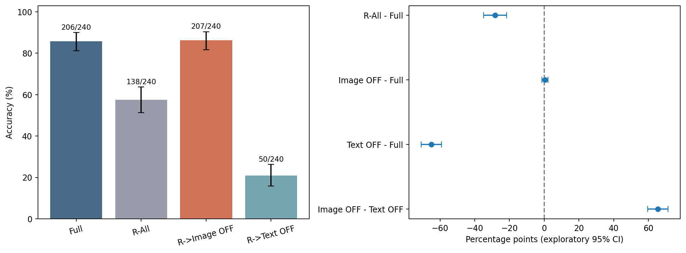
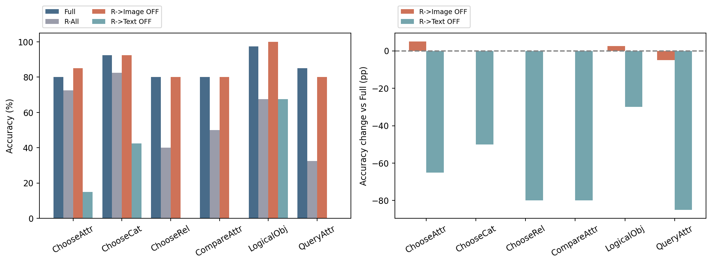
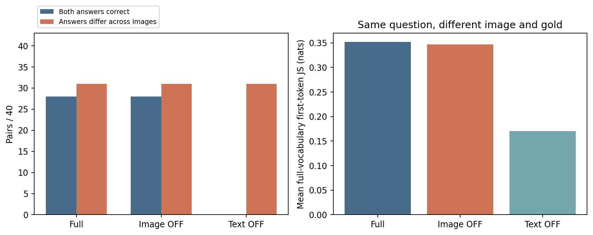

# 实验五：关键文本 Query 的 Attention 是否在直接读取视觉信息？

**COMPLETE：主实验新增 480 条来源 Mask 生成，复用 Full/R-All 各 240 条；换图控制新增 240 条；Question-only 诊断新增 24 条。三者分开统计。**

## 对核心问题的明确回答

**按本轮来源 Mask 定义，在这批固定模型、层段和探索样本上，R 的关键更新更明显依赖非图像历史上下文，而不是 L2–L5 中对原始 Image Key 的直接访问。** Image-OFF 为 207/240（86.250%），相对 Full +0.417 pp，但仍有 2 题受损、3 题纠正；Text-OFF 为 50/240（20.833%），相对 Full −65.000 pp，156 题受损、无纠正。R-All 为 138/240（57.500%）。因此，不能仅凭 R-All 的大损害就将其归因于该层段必须直接读图；结果为保留上下文处理、审视直接来源访问提供了不同的优化线索。

这里的“非图像历史”不是“纯语言”：文本 Key 可能已包含视觉信息，其他层仍可读图。Text-OFF 还会重归一化并保留 Image/BOS/Self，其损害甚至大于 R-All；这说明保留被改变的 Attention 更新可以比完全置零更有害，不能将三种损害当作可加的信息份额。是否主要是一般语言整合、经文本状态转递的视觉证据，或两者共同作用，尚未被本轮完全分离。Question-only 没有可靠 Gold，不能据此宣称视觉专属性已证明。

换图控制强化了“图像条件性不等于正确整合”的区分：Full 和 Image-OFF 均为 28/40 对两端正确，Text-OFF 为 0/40；三条件却都仍有 31/40 对答案随图改变。不能据此说 Text-OFF 已丧失全部视觉信息，也不能把同样的变化计数解释为行为完全相同。主实验 Text-OFF 另有 3 条达到 32 Token 上限的截断，完整输出均保留。

## 核心观察

R-All 为 138/240（57.500%），R→Image-OFF 为 207/240（86.250%），R→Text-OFF 为 50/240（20.833%），Full 为 206/240。目标严格限定为 0-based L2–L5 的原始 Prefill R Query；P−1 和全部 Decode 没有来源 Mask。

|条件|正确/240|Accuracy|ΔFull pp|Full 正确→错误|Full 错误→正确|EOS|空/截断/重复|
|---|---:|---:|---:|---:|---:|---:|---|
|Full|206|85.833%|+0.000|0|0|240|0/0/0|
|R-Bypass|138|57.500%|-28.333|78|10|240|0/0/0|
|R-Image-OFF|207|86.250%|+0.417|2|3|240|0/0/0|
|R-Text-OFF|50|20.833%|-65.000|156|0|237|0/3/0|

## 配对统计

20,000 次 Image SHA256 整簇配对 Bootstrap；seed=20261102；所有比较使用同一抽样；普通探索性双侧 95% 百分位区间。没有等价或非劣效声明。

|比较|差值 pp|95% CI pp|后者正确→前者错误|后者错误→前者正确|
|---|---:|---|---:|---:|
|R-Bypass - Full|-28.333|[-35.000, -21.667]|78|10|
|R-Image-OFF - Full|+0.417|[-1.250, +2.083]|2|3|
|R-Text-OFF - Full|-65.000|[-70.833, -59.167]|156|0|
|R-Image-OFF - R-Text-OFF|+65.417|[+59.583, +71.250]|0|157|

## 六个研究问题

1. **为什么 R-All 损害巨大，来源 Mask 能解释多少？** R-All 相对 Full -28.333 pp，Image-OFF +0.417 pp，Text-OFF -65.000 pp。两种来源 Mask 保留其他来源并重新归一化，整个 o_proj 输出置零则删除全部更新，二者强度和计算效果不等价。可以对比功能敏感性，不能把损害相减或相除当作视觉/文本信息贡献比例；还未分离 BOS、Self、跨来源补偿和一般残差更新作用。
2. **R 是否必须直接读取 Image Key？** Image-OFF 的净差值为 +0.417 pp，CI [-1.250, +2.083]，真实损害 2 题、纠正 3 题。区间没有完全低于零，不能据此确认总体退化或宣称无损；按实际损益判断其敏感性。其他层、此前 Hidden 和非图像 Key 仍可携带视觉信息，低损害不证明视觉信息不存在，也不证明该路径普遍不必要。
3. **对非图像历史 Key 的依赖多强？** Text-OFF 净差值为 -65.000 pp，CI [-70.833, -59.167]，损害 156 题、纠正 0 题。保留 BOS、Self 和全部可见 Image Key，且只遮蔽 k<q 的非图像非 BOS 历史。其损害与上下文整合受影响相容，但非图像 Key 自身可能带有视觉信息，不能等同纯语言贡献。
4. **换图控制是否改变图像条件性回答？** 见下表。两端都正确衡量语义正确性；答案随图改变和完整首 Token 分布 JS 衡量图像条件性，两者分别报告。答案改变不保证正确，不变也可能来自相同预测或模型错误；这些 40 对来自历史冻结、有不同官方 Gold 的子集，不是独立泛化证据。
5. **能否称 R 是关键视觉信息整合位置？** 现有证据至多描述来源特异性功能作用和图像条件性变化。Question-only 只是诊断而非有效的纯文本 QA；不能据此证明视觉专属性。其他层的视觉读取、文本 KV 已携带的视觉信息、一般上下文/模板整合、BOS/Self 以及 Hard Mask 重新归一化仍未被排除。不能称 R 是唯一视觉写入节点。
6. **对 Look Hard, Answer Cheap 与优化设计的意义？** 角色敏感性和来源敏感性是两条不同轴。R-All 的高损害不能直接当作早层 R 读图必要性的证据，也不能仅凭来源 Mask 的低损害删除整个 R Attention。优化候选应先保留有效的上下文更新，再在独立数据上验证源访问限制与生成质量。本轮只是功能控制，未跳过计算、删除视觉 KV 或测得真实加速。

## 图像交换控制

|条件|两端正确/40|答案随图改变/40|Token 序列改变/40|首Token平均JS nat|两端正确相对Full变化|答案变化相对Full变化|
|---|---:|---:|---:|---:|---:|---:|
|Full|28|31|31|0.352230|+0|+0|
|R-Image-OFF|28|31|31|0.346876|+0|+0|
|R-Text-OFF|0|31|31|0.170662|-28|+0|

逐对完整答案、两端评分、完整首 Token 分布的 FP64 JS 及相对 Full 差异保存于 image_swap_per_pair.csv。Full、Image-OFF、Text-OFF 在当前同形状路径各生成 80 条；历史 Handoff Full 未显式 logits_to_keep=1，因此没有直接混用其数值结果。

## Question-only 文本诊断

仓库未定位可审计的现成纯文本 QA；固定取原 Manifest 每任务最前两题，共 12 题，仅移除图像并保持原文本内容。非终止文本 Query 范围重新定义为原始所有非 BOS、严格早于 P−1 的文本位置；只置零其 L2–L5 o_proj 输出，P−1 与 Decode 原生。Native 与 Bypass 有 8/12 条完整输出不同。没有给这些无图问题计算 VQA Accuracy，也没有编造 Gold。该诊断不能与有图 GQA Accuracy 差作因果等价比较，更不能证明一般文本能力或视觉专属性。

## 六任务与负面案例

|任务|Full|R-All|Image OFF|Text OFF|
|---|---:|---:|---:|---:|
|ChooseAttr|80.0%|72.5%|85.0%|15.0%|
|ChooseCat|92.5%|82.5%|92.5%|42.5%|
|ChooseRel|80.0%|40.0%|80.0%|0.0%|
|CompareAttr|80.0%|50.0%|80.0%|0.0%|
|LogicalObj|97.5%|67.5%|100.0%|67.5%|
|QueryAttr|85.0%|32.5%|80.0%|0.0%|

所有 Full 正确而任一干预错误的记录均保存于 negative_cases.csv；未按有利结果筛选。逐题主表保存答案、Token、Gold、损益和输入绑定；检查点保存每层每个 R Query 的真实来源概率质量、禁止概率最大值、Mask 边数与 Cache 位置。

## 主要负面案例

以下是按条件、Question ID 固定排序的展示；完整负面案例均保留于 CSV，不删除失败样本。

|题号|条件|问题|Gold|Full|干预答案|
|---|---|---|---|---|---|
|0691748|R-Image-OFF|On which side is the tray?|right|Right|Left|
|091055212|R-Image-OFF|Which side of the picture is the fork on?|right|Right|Left|
|00150746|R-Text-OFF|On which side is the man?|left|Left|A|
|00271765|R-Text-OFF|Is this a bed or a cabinet?|cabinet|Cabinet|Yes|

## 正确性与执行

基准 `8019c6009bb1d8c9f2dc3ffd8c18bf4dfb8c1fd1`；冻结执行源码 `7ba310460d517fa85e6edd25ed314b5a8921f820`。历史 Full/R-All 的 480 条记录及服务器原始首 Token 数组、输入和评分完整审计；没有复制未经核验的分数。Manifest 原样复制，实际完整 SHA256 为 `258c32d470270829e126ae9abf3a030dbc1485b2f329fdfc326f4d6e9b3e686c`，任务书给出的 59 位字符串沿用历史协议中的抄写差异说明。

CPU 测试 24 项通过，三道固定 GPU Smoke 全通过。HF/Full/No-op 有效 Logits 用 torch.equal 严格一致；显式 logits_to_keep=1。历史 Full/R-All 的首向量与完整 Token 精确匹配。目标层实际 Softmax 后禁止概率严格为零，概率行和沿用既有 0.002 上界；BOS/Self 合法，非目标 Mask 原值精确保留，P−1/Decode 未 Mask。32 层 MLP、独立真实 Cache、绝对位置、输入与权重版本、正常/异常 Hook 清理通过。

单卡物理 GPU2，UUID `GPU-a50cb044-679e-9a05-557d-4ddbd19ac3c6`，只暴露该设备、一份模型串行采集。主实验、40 对换图、12 题诊断分别冻结及计数。模型完整 SHA256 在冻结前和采集后核验；进程退出后记录 GPU 释放状态，未终止其他进程。原始首 Token 数组保留服务器资源目录，GitHub 只含路径和哈希，不包含大型数组。

## 结果图

## 解释边界与未来假说

已完成观察是四条件的完整生成行为、来源 Mask 的真实概率、配对准确率差和换图/诊断结果。机制解释限于被干预路径的功能敏感性；文本状态承载视觉信息、跨来源补偿或一般上下文整合的具体中介机制仍是待检验假说。没有临时调整层集合、样本、Prompt 或评分。未来如需分离更具体的机制，应预声明更强的文本任务与路径控制；本轮不设计或执行追加实验。

## 综合判读与主要负面案例

**这批结果不支持把L2–L5关键R更新的巨大作用直接归因于该层段的直接读图。** 屏蔽R→Image只净变动+0.417个百分点，仍有2题受损、3题纠正；屏蔽非图像历史Key则下降65.000个百分点，156题受损且没有纠正。现有证据更支持“非图像历史上下文访问具有很强的功能作用”，但不能进一步断言这些Key承载的只是纯语言信息，或R没有视觉整合作用。

Text-OFF甚至比整个R输出置零的57.5%更差（20.833%）。这不是“文本贡献超过全部Attention”的比例证据：Hard Mask会重新归一化并保留Image/BOS/Self，而输出置零删除整项更新，两种干预可能产生不同的状态扰动。跨来源补偿、文本状态中已有的视觉信息和格式/指令处理均未被分离。

换图控制中，Text-OFF仍有31/40组答案随图变化，与Full相同，但两端均正确从28/40降至0/40，80个端点只正确2个；平均首Token JS从0.352230降至0.170662 nat。不能把“答案随图片变化”解读为有效利用了视觉语义，也不能把非零JS解读为回答正确。该冻结子集并非六任务均衡，不作为独立泛化估计。

以下为事后列出的说明性错误，不用于重新选样或新增评分。Image-OFF的全部两例损害均属QueryAttr：`091055212`（叉子在哪一侧）和`0691748`（托盘在哪一侧），Gold及Full均为right，干预答Left。Text-OFF的例子包括`00150746`（男人在哪一侧，Gold left，干预A）、`00271765`（bed还是cabinet，Gold cabinet，干预Yes）和`00564361`（left还是right，Gold right，干预Yes）。这些变化也提示答案类型与上下文/指令整合受损，不能将全部准确率损失都解释为视觉语义丢失。

对Look Hard, Answer Cheap的修正是：应保留“Query角色依赖的必要性”结论，但暂不能把“关键文本更新”等同于“该层段直接视觉写入”。后续推理设计必须保护重要的历史上下文访问；本轮没有证明任何来源可安全物理删除，也没有测量实际加速。

## 交付审计补记

正式采集和首次CPU汇总已完成后，一次重复CPU汇总触发了不可覆盖既有`gpu_release.json`的保护检查；其失败日志保留在failures目录。这不是GPU数值、Mask或生成验证失败，没有再次生成或放宽容差。重复汇总未改变CSV或PNG，但重绘了3份PDF；交付阶段保留交付前完成清单快照，并重新绑定最终展示文件及完整只读验证。冻结执行源码、历史产物、全部检查点和原始向量保持不变，详见postprocess_delivery_audit.json。

**到此停止：不跨模型、不扩样、不训练 Router、不实现 Kernel 或 KV 剪枝。**

交付编辑说明：finalize_delivery.py 只补充由已保存结果支持的核心结论和案例展示，不改变冻结源码、统计、检查点或数组。
