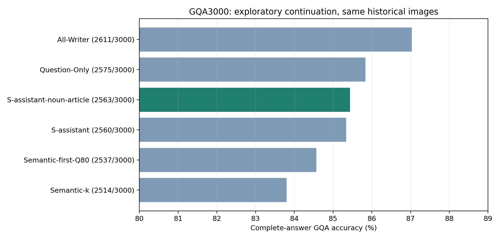
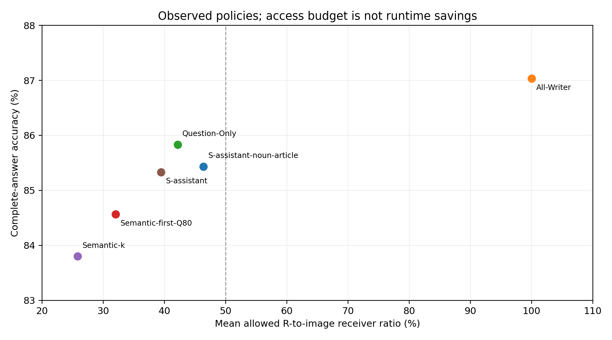
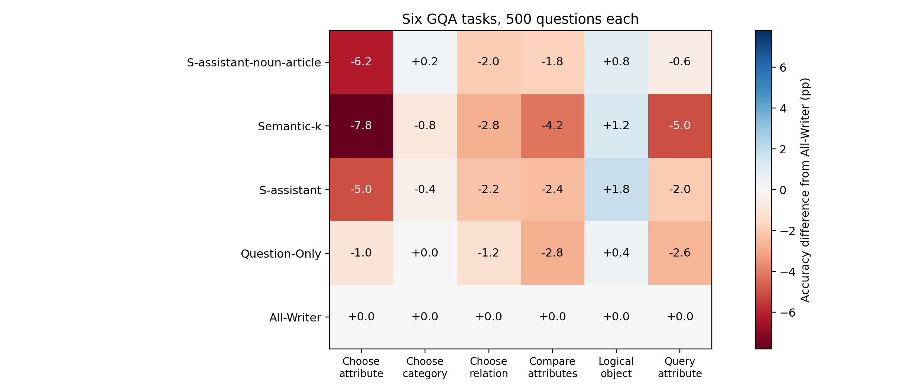

# Semantic 接收者增强：三小时续跑正式记录

本轮固定胜出方案为 **S-assistant-noun-article**：完整3000题 **2563/3000，85.433%**，平均开放R接收位置 **46.336%**。原S全部保留。相较上轮S＋ASSISTANT的2560/3000，净变化为+3题；相较Question-Only的2575/3000，净变化为-12题。尚未达到87%的点估计目标。

## 冻结策略与选择过程

采用原生完整ASSISTANT词组、固定POS名词与依存冠词的输入规则增强原S；具体最终配置为 `{"anchors": ["assistant"], "categories": ["noun", "article"], "family": "S-augmentation"}`。既有Prompt、图像、分词和评分不变，所有32层P−1及真实Decode仍禁止直接读Image Key，只有所选R Query开放读图。无o_proj消融，无训练，无KV剪枝。新增位置增加了预算，不能将相对S的收益全部归因于选择质量。

预先冻结的8个方案先比较DEV180，再选3个比较DEV360、2个比较CHECK600，按正确数优先、预算和ID打破平局，固定一个全局方案后补齐3000题。完整冻结清单、输入SHA、Source SHA、全部阶段负面结果均保留；没有逐题按答案选条件。180题中的等新增预算Instruction4和Question额外4组控制也完整保留。

|阶段|方案|正确/总数|ACC|平均R比例|
|---|---|---|---|---|
|s180|S|162/180|90.000%|25.848%|
|s180|S-article|164/180|91.111%|32.064%|
|s180|S-assistant|167/180|92.778%|39.506%|
|s180|S-assistant-article|166/180|92.222%|45.722%|
|s180|S-assistant-noun-article|167/180|92.778%|46.265%|
|s180|S-instruction4|161/180|89.444%|39.506%|
|s180|S-noun-article|164/180|91.111%|32.607%|
|s180|S-question-extra4-role|166/180|92.222%|38.776%|
|s360|S-assistant-article|324/360|90.000%|45.794%|
|s360|S-assistant-noun-article|325/360|90.278%|46.335%|
|s360|S-question-extra4-role|323/360|89.722%|38.813%|
|check600|S-assistant-article|507/600|84.500%|45.653%|
|check600|S-assistant-noun-article|509/600|84.833%|46.324%|
|all3000|S-assistant-noun-article|2563/3000|85.433%|46.336%|

## 同3000题配对结果

|对照|正确/3000|ACC|平均R比例|
|---|---|---|---|
|S-assistant-noun-article|2563|85.433%|46.336%|
|All-Writer|2611|87.033%|100.000%|
|Question-Only|2575|85.833%|42.143%|
|Semantic-first-Q80|2537|84.567%|31.997%|
|Semantic-k|2514|83.800%|25.795%|
|S-assistant|2560|85.333%|39.408%|

|新方案−对照|ΔACC pp|普通95%CI pp|原对→错|原错→对|Holm p|
|---|---|---|---|---|---|
|All-Writer|-1.600|[-2.492, -0.731]|113|65|0.00140|
|Question-Only|-0.400|[-1.276, +0.476]|96|84|0.82456|
|Semantic-first-Q80|+0.867|[-0.066, +1.805]|91|117|0.25139|
|Semantic-k|+1.633|[+0.805, +2.475]|55|104|0.00075|
|S-assistant|+0.100|[-0.536, +0.749]|47|50|0.84086|

按Image SHA256整簇配对Bootstrap 20,000次，seed=20261104；随机化检验也以完整图片簇交换条件。五个最终对照的p值作Holm校正，表中CI为普通点位区间。该校正不覆盖先前及本轮自适应策略筛选，不能据此宣称新的确认性发现、非劣效或外部泛化。

## 任务、失败与解释

所有六任务每类500题见task_accuracy.csv。harm_cases.csv保留相对任一对照的全部损害，recovered_cases.csv保留全部纠正；per_question.csv保留Gold、真实完整答案、Token IDs、所有配对基线及首Token翻转。全体3000题有2409张不同图片，不能按3000个独立图片处理。

这些结果仅衡量功能性视觉写入稀疏。较高ACC不能证明新增位置唯一存储视觉信息；平均R比例不是FLOPs、显存或延迟收益。原S与S增强的预算不同，无法隔离位置作用与预算作用。All-Writer也是答案阶段禁读图的基线，与原生Full不同。

## 审计与时间

CPU五项测试、两卡各三道真实7B Smoke通过。原生与No-op全部有效logits逐位torch.equal，原S/Q80/Q100的历史答案和首向量严格复现；每次新生成均验证实际禁止概率为0、非目标Mask不变、32层MLP、真实独立Cache、输入/权重/Hook和EOS。原生首向量校验后不保留大Logits归档。

本轮新增唯一生成 **2948** 次；每个条件标签、复用来源和SHA均记录。此前60题记录、初轮结果及原历史基线只读按SHA复用，不重新生成。FP16、Eager和模型协议保持冻结；完整原始compact NPZ位于服务器资源目录，Git仅保存路径和SHA，不能宣称GitHub包含这些数组。

启动时间（UTC）：2026-11-04T08:48:56.824321+00:00。分析完成时已用约18.4分钟；最终交付耗时另由服务器资源目录delivery_receipt.json记录，含提交和推送。本轮模型自动随流水线结束立即退出，无等待人工决策的模型常驻。资源释放详情见gpu_release.json。

## 范围与停止

全部原3000题历史结果已看过。DEV、CHECK名称只表示开发分片，600题并非新的盲测或外部确认集。本轮不新增数据，不回改历史结果，不修改main，不追加词表搜索或GPU条件。最终3000题结果完成后停止。

## 直接回答与选择器解释

1. 相较上轮S＋ASSISTANT，新方案净+3题；相较Question-Only净-12题。当前本报告所有完整3000题实测、平均R<50%的方法中，最高点估计为 **Question-Only：2575/3000，85.833%，R=42.143%**。没有用180/360题高分替代3000题结论。
新方案在ACC和R预算两个点估计上均被Question-Only支配。相比S＋ASSISTANT，继续补名词和冠词只增加3题，同时平均R预算从39.408%增至46.336%；其配对区间跨0，不能认为获得可靠改进。若坚持从S出发，S＋ASSISTANT仍是本报告中更节省预算的实测选择。
2. 本轮新方案以完整词组保护原S，额外开放原生ASSISTANT的4个Subword，以及Question中固定POS的NOUN/PROPN和dep=det的a/an/the。没有修改STOP词表、Prompt或模型。token_changes.csv逐题列出新增词组、POS、依存、位置、预算和真实答案；没有根据当前题Gold选择接收者。
3. DEV180中，S＋ASSISTANT为167/180，等新增4 Token的S＋instruction4为161/180；这是同预算下位置有作用的小样本证据，但不足以推出所有模板Token或冠词的普遍必要性。加入名词/冠词与S、S＋ASSISTANT的比较又改变了预算；不能将其解释为纯词类效应。
4. 原预算≤35%的主目标已由后续授权放宽为平均R<50%。本轮不重新宣称解决35%目标；≤30%、≤35%、≤42%的历史结果和失败策略见初轮a1c9d81与续轮1df71f4报告。本次不再训练风险模型或新增Question剪枝。
5. 所有3000题此前已查看，不能判断本轮改进能否迁移到未参与研究的问题，也不能再把CHECK600称为盲测Holdout。结果支持接收位置对功能有影响，但不证明获得了可泛化最优策略。若后续另获授权，最小有价值的下一步是固定当前单一规则后在未研究图片上评估；本轮按要求不新增数据、不执行该建议。

## 复现与交付审计

最终完整性索引为本目录artifact_index.csv，完成标记为completion.json；reporting_pass1/2仅保存CPU报告修订的历史元数据。补充报告首次尝试更新只写一次的元数据时被保护逻辑拒绝，未涉及推理或数值验证失败；保留日志并归档原记录后完成修订，所有答案、Token集合及统计数值不变。

重新生成3000题接收集合（只读CPU，不生成答案）：

```sh
CUDA_VISIBLE_DEVICES='' PYTHONPATH=./vlm_research:/data1/likai/ATE-worktrees/gqa5h-adaptive-token-receiver-search/vlm_research:/data/lk/ATE-worktrees/gqa360-structural-receiver-selection/vlm_research /data/lk/深度学习/.envs/ate-vlm-research/bin/python -m semantic_article_resume180.reproduce
```






