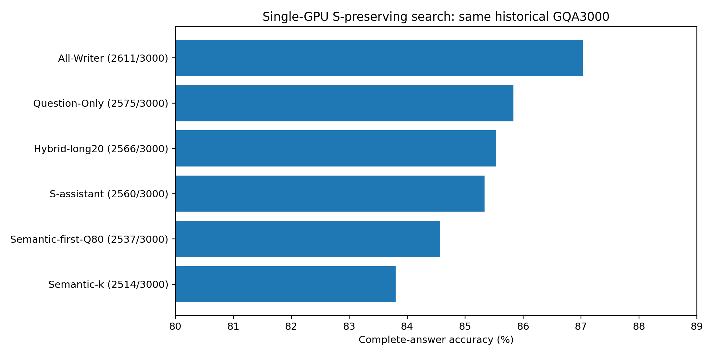
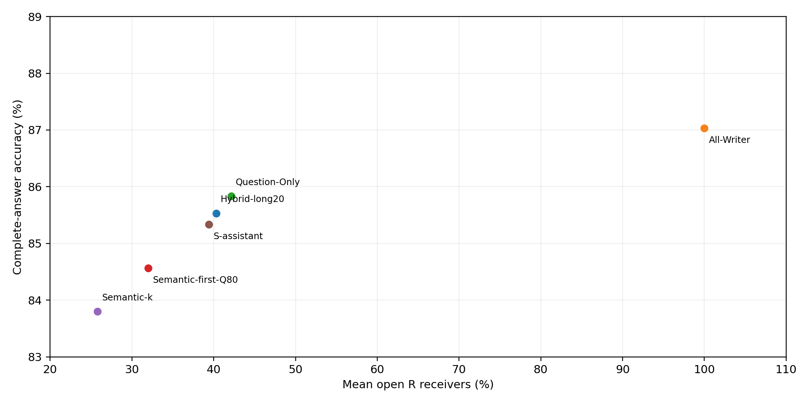

# 单GPU三小时：基于原S的接收者搜索

冻结后3000题方案 **Hybrid-long20**：**2566/3000，85.533%**，平均R预算 **40.291%**。本轮所有完整3000题实测方法中，预算<50%的最高点估计为Question-Only（85.833%）。未达到87%的点估计目标。

## 冻结与筛选

原S逐题保留；仅改变原生Prefill R Query读取Image Key的权限。ASSISTANT为原Prompt完整4 Subword词组，不改Prompt。全部32层P−1及真实Decode禁读Image Key；FP16/Eager、Transformers4.49.0、原模型revision、Greedy32、logits_to_keep=1保持原样。只有物理GPU1加载一份模型，其他卡和进程不干预。

预先冻结的候选包括S基线、S＋ASSISTANT、上轮名词冠词增强、46%/49%目标预算下的整词补位排序及按Question结构选择补齐。所有候选先只读CPU核对完整3000题的平均预算，超50%者保留排除记录但不运行GPU。实际完整集合与预算见CPU_candidate_budget.csv。依次60→180→360→600逐级筛选，最后冻结一个全局规则后扩展原3000题；排名按正确数、较低预算、固定ID决定，不逐题挑答案。

最终配置：`{"anchors": [], "base": "conditional", "rule": "long20"}`。逐题接收位置见winner_freeze.json；源码与SHA见candidates/。cap仅为完整词组可行目标，不保证每题恰好49%或46%。完整预算定义为逐题k/R再平均。

|阶段|候选|正确/总数|平均R|
|---|---|---|---|
|s60|Hybrid-long20|57/60|40.038%|
|s60|Hybrid-long20-period|57/60|40.152%|
|s60|Hybrid-long20-phrase|57/60|40.152%|
|s60|Hybrid-long20-postQ|57/60|40.152%|
|s60|Hybrid-notyesno|57/60|40.919%|
|s60|Hybrid-notyesno-period|57/60|42.575%|
|s60|Hybrid-notyesno-phrase|57/60|42.575%|
|s60|Hybrid-notyesno-postQ|57/60|42.575%|
|s60|Hybrid-short10|57/60|39.165%|
|s60|Hybrid-short10-period|57/60|40.320%|
|s60|Hybrid-short10-phrase|57/60|40.320%|
|s60|Hybrid-short10-postQ|57/60|40.320%|
|s60|Hybrid-whatwhich|57/60|40.575%|
|s60|Hybrid-whatwhich-period|57/60|41.744%|
|s60|Hybrid-whatwhich-phrase|57/60|41.744%|
|s60|Hybrid-whatwhich-postQ|57/60|41.744%|
|s60|Q|57/60|42.406%|
|s60|Q-or|57/60|45.794%|
|s60|Q-or-phrase|57/60|49.182%|
|s60|Q-period|57/60|45.794%|
|s60|Q-period-phrase|57/60|49.182%|
|s60|Q-period-word|57/60|49.182%|
|s60|Q-phrase|57/60|45.794%|
|s60|Q-postQ|57/60|45.794%|
|s60|Q-postQ-period|57/60|49.182%|
|s60|Q-postQ-phrase|57/60|49.182%|
|s60|Q-single|57/60|45.794%|
|s60|Q-single-word|57/60|49.182%|
|s60|Q-space|56/60|45.794%|
|s60|Q-space-period|56/60|49.182%|
|s60|Q-space-phrase|56/60|49.182%|
|s60|Q-word|57/60|45.794%|
|s60|Q-word-phrase|57/60|49.182%|
|s60|S|55/60|25.957%|
|s60|S-assistant|57/60|39.509%|
|s180|Hybrid-long20|168/180|40.413%|
|s180|Hybrid-long20-period|168/180|40.641%|
|s180|Hybrid-long20-phrase|168/180|40.641%|
|s180|Hybrid-long20-postQ|168/180|40.641%|
|s180|Hybrid-short10|166/180|39.109%|
|s180|Hybrid-short10-period|165/180|40.236%|
|s180|Hybrid-short10-phrase|166/180|40.236%|
|s180|S-assistant|167/180|39.506%|
|s360|Hybrid-long20|327/360|40.550%|
|s360|Hybrid-long20-period|327/360|40.786%|
|s360|Hybrid-long20-phrase|327/360|40.786%|
|s360|Hybrid-long20-postQ|326/360|40.786%|
|check600|Hybrid-long20|506/600|40.165%|
|check600|Hybrid-long20-period|506/600|40.363%|
|s180b|Hybrid-long20|168/180|40.413%|
|s180b|Hybrid-long20-period|168/180|40.641%|
|s180b|Hybrid-long20-phrase|168/180|40.641%|
|s180b|Hybrid-long20-postQ|168/180|40.641%|
|s180b|Hybrid-notyesno|165/180|40.477%|
|s180b|Hybrid-notyesno-period|165/180|42.139%|
|s180b|Hybrid-notyesno-phrase|165/180|42.139%|
|s180b|Hybrid-notyesno-postQ|165/180|42.139%|
|s180b|Hybrid-short10|166/180|39.109%|
|s180b|Hybrid-short10-period|165/180|40.236%|
|s180b|Hybrid-short10-phrase|166/180|40.236%|
|s180b|Hybrid-short10-postQ|167/180|40.236%|
|s180b|Hybrid-whatwhich|167/180|40.363%|
|s180b|Hybrid-whatwhich-period|167/180|41.564%|
|s180b|Hybrid-whatwhich-phrase|167/180|41.564%|
|s180b|Hybrid-whatwhich-postQ|167/180|41.564%|
|s180b|Q|165/180|41.952%|
|s180b|Q-or|165/180|45.367%|
|s180b|Q-or-phrase|165/180|48.781%|
|s180b|Q-period|164/180|45.367%|
|s180b|Q-period-phrase|164/180|48.781%|
|s180b|Q-period-word|164/180|48.781%|
|s180b|Q-phrase|165/180|45.367%|
|s180b|Q-postQ|167/180|45.367%|
|s180b|Q-postQ-period|165/180|48.781%|
|s180b|Q-postQ-phrase|166/180|48.781%|
|s180b|Q-single|165/180|45.367%|
|s180b|Q-single-word|164/180|48.781%|
|s180b|Q-word|164/180|45.367%|
|s180b|Q-word-phrase|164/180|48.781%|
|s180b|S-assistant|167/180|39.506%|
|s360b|Hybrid-long20|327/360|40.550%|
|s360b|Hybrid-long20-period|327/360|40.786%|
|s360b|Hybrid-long20-phrase|327/360|40.786%|
|s360b|Hybrid-long20-postQ|326/360|40.786%|
|s360b|Hybrid-short10-postQ|324/360|40.285%|
|s360b|Hybrid-whatwhich|323/360|40.514%|
|s360b|Hybrid-whatwhich-period|323/360|41.696%|
|s360b|S-assistant|325/360|39.553%|
|check600b|Hybrid-long20|506/600|40.165%|
|check600b|Hybrid-long20-period|506/600|40.363%|
|check600b|Hybrid-long20-phrase|506/600|40.363%|
|all3000|Hybrid-long20|2566/3000|40.291%|

## 完整3000题ACC

|条件|正确/3000|ACC|平均R|
|---|---|---|---|
|Hybrid-long20|2566|85.533%|40.291%|
|All-Writer|2611|87.033%|100.000%|
|Question-Only|2575|85.833%|42.143%|
|Semantic-first-Q80|2537|84.567%|31.997%|
|Semantic-k|2514|83.800%|25.795%|
|S-assistant|2560|85.333%|39.408%|

|新方案−对照|ΔACC pp|95%CI pp|原对→错|原错→对|Holm p|
|---|---|---|---|---|---|
|All-Writer|-1.500|[-2.401, -0.597]|118|73|0.00680|
|Question-Only|-0.300|[-1.148, +0.558]|91|82|0.78866|
|Semantic-first-Q80|+0.967|[+0.067, +1.869]|83|112|0.12419|
|Semantic-k|+1.733|[+0.981, +2.477]|39|91|0.00025|
|S-assistant|+0.200|[-0.168, +0.593]|13|19|0.78866|

3000题包含重复图片，以Image SHA256整簇配对Bootstrap 20,000次，seed20261104。p值用图片簇配对条件符号交换、20,000次并对最终五个比较作Holm校正。CI为普通探索性区间，未校正自适应搜索选择；CI跨0不是非劣效证明。所有3000题的历史结果已看过，600题不是新盲测，不能声称独立外部确认。

## 审计、负面结果与边界

五项CPU测试、单卡三道7B Smoke通过；Native/No-op全部有效Logits逐位torch.equal，历史S/Q80/Q100答案与首向量严格复现。新增2353次唯一生成，全部逐项复核Mask实际禁止概率为0、非目标Mask不变、32层MLP、输入/权重/Hook及独立KV。所有原始Checkpoint、Token IDs、负面案例和来源SHA保留。compact NPZ只在服务器资源目录，Git保存路径及SHA，不宣称GitHub含数组。模型在正式矩阵结束后自动退出。

从首次任务时间2026-11-04T09:20:25+00:00计时，CPU分析结束约60.9分钟；包含推送的最终耗时记录在资源目录delivery_receipt.json。硬限3小时，单卡GPU边界160分钟，预留交付时间，不重置时钟。

完整问题、真实答案及全部对照见per_question.csv，所有损害见harm_cases.csv。新增预算与位置变化混合，不能将相对S的增益全部归因于某一词类。Hard Mask只是功能性稀疏，不是物理加速。All-Writer也不是Native Full。新策略如未在ACC和预算上超过已有基线，应保留基线，不以小样本高分掩盖完整3000题负面结果。

## 停止

完成一个冻结方案的3000题后停止，不据其结果继续改规则，不新增数据、训练VLM或开发Kernel。

