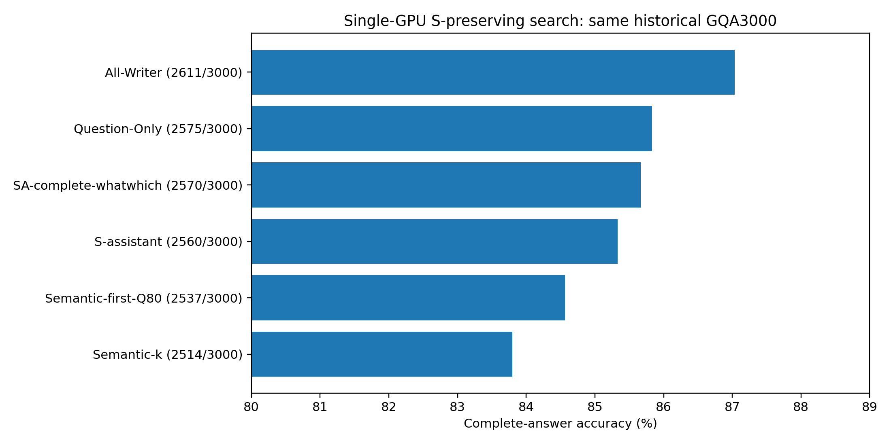
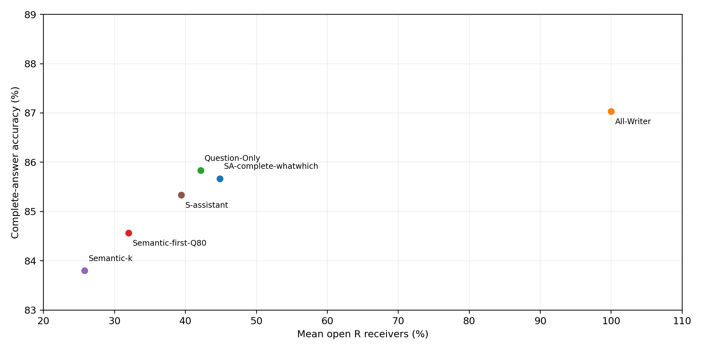

# 单GPU三小时：基于原S的接收者搜索

冻结后3000题方案 **SA-complete-whatwhich**：**2570/3000，85.667%**，平均R预算 **44.852%**。本轮所有完整3000题实测方法中，预算<50%的最高点估计为Question-Only（85.833%）。未达到87%的点估计目标。

## 冻结与筛选

原S逐题保留；仅改变原生Prefill R Query读取Image Key的权限。ASSISTANT为原Prompt完整4 Subword词组，不改Prompt。全部32层P−1及真实Decode禁读Image Key；FP16/Eager、Transformers4.49.0、原模型revision、Greedy32、logits_to_keep=1保持原样。只有物理GPU1加载一份模型，其他卡和进程不干预。

预先冻结的候选包括S基线、S＋ASSISTANT、上轮名词冠词增强、46%/49%目标预算下的整词补位排序及按Question结构选择补齐。所有候选先只读CPU核对完整3000题的平均预算，超50%者保留排除记录但不运行GPU。实际完整集合与预算见CPU_candidate_budget.csv。依次60→180→360→600逐级筛选，最后冻结一个全局规则后扩展原3000题；排名按正确数、较低预算、固定ID决定，不逐题挑答案。

最终配置：`{"mode": "conditional", "rule": "whatwhich"}`。逐题接收位置见winner_freeze.json；源码与SHA见candidates/。cap仅为完整词组可行目标，不保证每题恰好49%或46%。完整预算定义为逐题k/R再平均。

|阶段|候选|正确/总数|平均R|
|---|---|---|---|
|s60|S|55/60|25.957%|
|s60|S-assistant|57/60|39.509%|
|s60|S-assistant-noun-article|58/60|46.600%|
|s60|SA-cap46-attribute|57/60|44.432%|
|s60|SA-cap46-early|57/60|44.432%|
|s60|SA-cap46-function|57/60|44.432%|
|s60|SA-cap46-late|57/60|44.432%|
|s60|SA-cap46-logic|57/60|44.432%|
|s60|SA-cap46-middle|57/60|44.432%|
|s60|SA-cap46-noun|57/60|44.432%|
|s60|SA-cap46-relation|57/60|44.432%|
|s60|SA-cap46-syntax|58/60|44.432%|
|s60|SA-cap49-attribute|57/60|47.590%|
|s60|SA-cap49-early|57/60|47.590%|
|s60|SA-cap49-function|58/60|47.590%|
|s60|SA-cap49-late|57/60|47.590%|
|s60|SA-cap49-logic|57/60|47.590%|
|s60|SA-cap49-middle|57/60|47.590%|
|s60|SA-cap49-noun|57/60|47.590%|
|s60|SA-cap49-relation|57/60|47.590%|
|s60|SA-cap49-syntax|57/60|47.590%|
|s60|SA-complete-long15|57/60|44.476%|
|s60|SA-complete-long20|57/60|40.494%|
|s60|SA-complete-short10|57/60|43.787%|
|s60|SA-complete-whatwhich|58/60|45.252%|
|s60|SA-complete-yesno|57/60|47.924%|
|s60|SA-space-cap49-function|57/60|47.750%|
|s60|SA-space-cap49-late|57/60|47.750%|
|s60|SA-space-cap49-relation|57/60|47.750%|
|s60|SA-tail-cap49-function|57/60|47.750%|
|s60|SA-tail-cap49-late|57/60|47.750%|
|s60|SA-tail-cap49-relation|57/60|47.750%|
|s180|S-assistant|167/180|39.506%|
|s180|S-assistant-noun-article|167/180|46.265%|
|s180|SA-cap46-attribute|165/180|44.607%|
|s180|SA-cap46-syntax|166/180|44.607%|
|s180|SA-cap49-function|166/180|47.550%|
|s180|SA-complete-long20|168/180|41.325%|
|s180|SA-complete-short10|167/180|43.616%|
|s180|SA-complete-whatwhich|168/180|45.168%|
|s360|S-assistant|325/360|39.553%|
|s360|SA-complete-long20|326/360|41.494%|
|s360|SA-complete-short10|325/360|43.519%|
|s360|SA-complete-whatwhich|326/360|45.242%|
|check600|SA-complete-long20|508/600|40.957%|
|check600|SA-complete-whatwhich|509/600|44.884%|
|all3000|SA-complete-whatwhich|2570/3000|44.852%|

## 完整3000题ACC

|条件|正确/3000|ACC|平均R|
|---|---|---|---|
|SA-complete-whatwhich|2570|85.667%|44.852%|
|All-Writer|2611|87.033%|100.000%|
|Question-Only|2575|85.833%|42.143%|
|Semantic-first-Q80|2537|84.567%|31.997%|
|Semantic-k|2514|83.800%|25.795%|
|S-assistant|2560|85.333%|39.408%|

|新方案−对照|ΔACC pp|95%CI pp|原对→错|原错→对|Holm p|
|---|---|---|---|---|---|
|All-Writer|-1.367|[-2.241, -0.498]|107|66|0.00960|
|Question-Only|-0.167|[-1.063, +0.726]|96|91|0.77151|
|Semantic-first-Q80|+1.100|[+0.199, +2.028]|84|117|0.06450|
|Semantic-k|+1.867|[+1.097, +2.627]|41|97|0.00025|
|S-assistant|+0.333|[+0.000, +0.675]|9|19|0.17859|

3000题包含重复图片，以Image SHA256整簇配对Bootstrap 20,000次，seed20261104。p值用图片簇配对条件符号交换、20,000次并对最终五个比较作Holm校正。CI为普通探索性区间，未校正自适应搜索选择；CI跨0不是非劣效证明。所有3000题的历史结果已看过，600题不是新盲测，不能声称独立外部确认。

## 审计、负面结果与边界

五项CPU测试、单卡三道7B Smoke通过；Native/No-op全部有效Logits逐位torch.equal，历史S/Q80/Q100答案与首向量严格复现。新增1651次唯一生成，全部逐项复核Mask实际禁止概率为0、非目标Mask不变、32层MLP、输入/权重/Hook及独立KV。所有原始Checkpoint、Token IDs、负面案例和来源SHA保留。compact NPZ只在服务器资源目录，Git保存路径及SHA，不宣称GitHub含数组。模型在正式矩阵结束后自动退出。

从首次任务时间2026-11-04T09:20:25+00:00计时，CPU分析结束约33.5分钟；包含推送的最终耗时记录在资源目录delivery_receipt.json。硬限3小时，单卡GPU边界160分钟，预留交付时间，不重置时钟。

完整问题、真实答案及全部对照见per_question.csv，所有损害见harm_cases.csv。新增预算与位置变化混合，不能将相对S的增益全部归因于某一词类。Hard Mask只是功能性稀疏，不是物理加速。All-Writer也不是Native Full。新策略如未在ACC和预算上超过已有基线，应保留基线，不以小样本高分掩盖完整3000题负面结果。

## 停止

完成一个冻结方案的3000题后停止，不据其结果继续改规则，不新增数据、训练VLM或开发Kernel。

