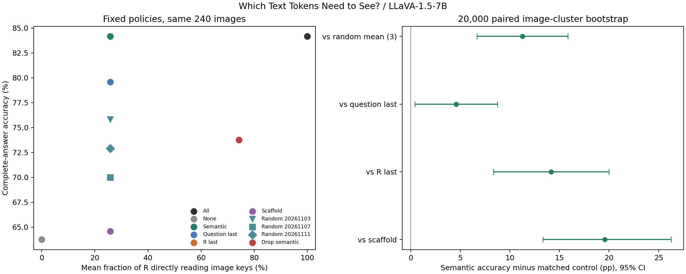
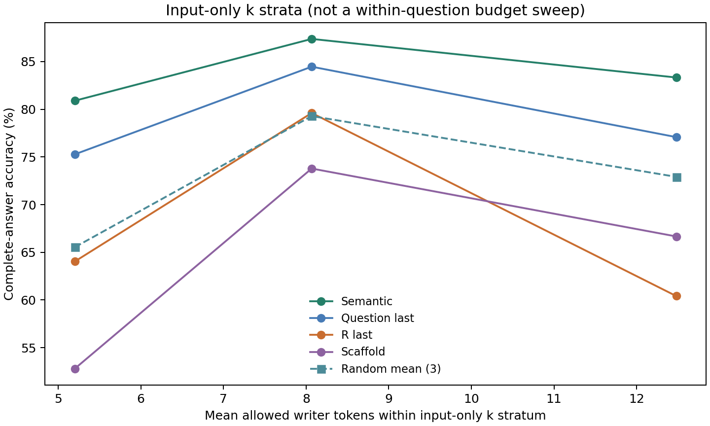
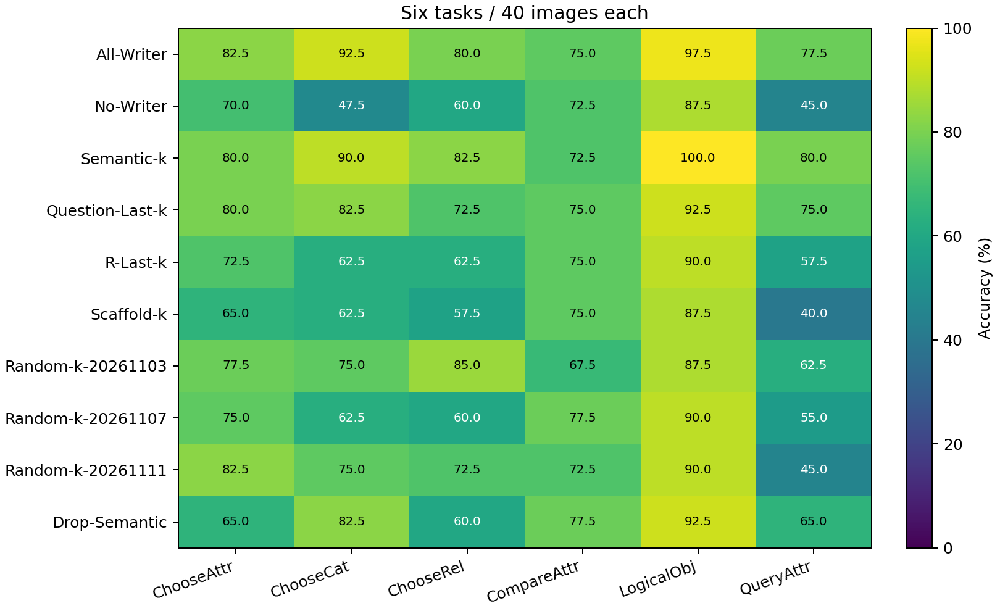
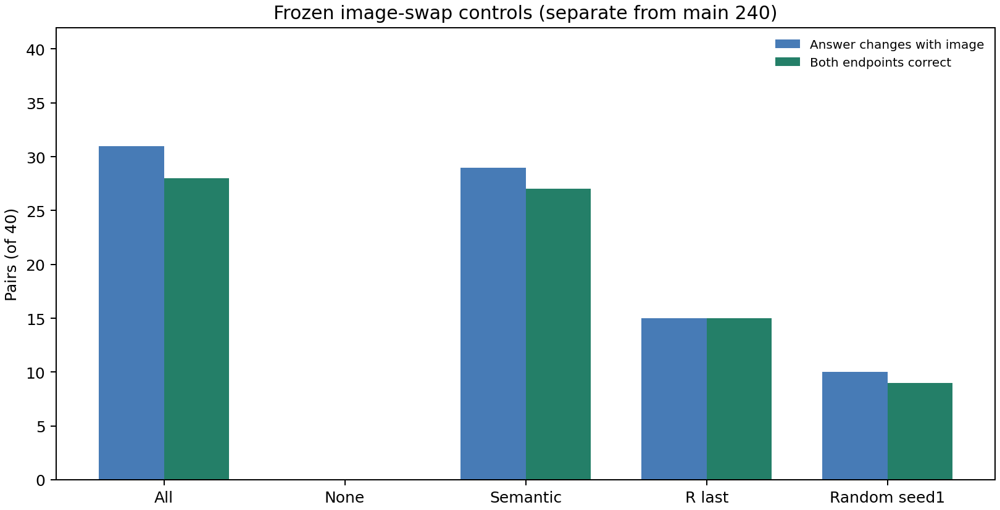

# Which Text Tokens Need to See?：稀疏视觉写入位置探索

**COMPLETE：固定240题×10条件共2400条主记录，其中240条All-Writer经严格审计复用，新生成2160条；另有40组×2端×5条件共400条换图生成，分开统计。**

## 核心回答

Semantic-k为202/240（84.167%），平均开放7.89个R Token（平均R比例25.78%）。All-Writer为202/240，No-Writer为153/240。

**1. 语义是否优于任意同预算Token？** 三个预定随机种子平均Accuracy为72.917%；Semantic−Random平均为+11.250 pp，95%CI [+6.667, +15.833]，普通95%CI支持正向差异。不挑最佳随机种子，不将三个种子视为720张独立图片。

**2. 语义还是末端汇总？** Semantic−Question-Last为+4.583 pp，CI [+0.417, +8.750]；Semantic−R-Last为+14.167 pp，CI [+8.333, +20.000]。前者普通95%CI支持正向差异；后者普通95%CI支持正向差异。位置效应与词汇效应只能按这些直接配对结果判断，不能预设语义优势。

**3. 稀疏写入是否足够？** Semantic−All为+0.000 pp，CI [-3.750, +3.750]，原对变错10题、原错变对10题；Semantic−No为+20.417 pp，CI [+14.167, +26.667]。前一差值衡量是否接近全开放，后一差值检验是否确有写入功能贡献。未预声明非劣效界限，不能由Accuracy接近或CI跨0宣称无损。

**4. 核心Token是否不可替代？** Drop-Semantic−All为-10.417 pp，CI [-15.833, -5.000]，普通95%CI支持负向差异。这是移除最终Semantic-k集合直接读图权限的条件必要性检验，不排除其他文本Token或层间传播替代它们。

总体证据只支持本批固定候选策略在所定义路径上的相对功能贡献。即使少数Token支持较多正确答案，也不能说视觉信息唯一储存在这些Token，或任意Token普遍足够。所有稀疏策略都保持其余文本传播和32层MLP正常。本实验没有实现或测得实际加速。

## 条件、范围与词法定义

全部条件均在0-based L0–L31禁止P−1及每一步真实Decode（包括EOS预测）直接读原始576个Image Key。Prefill仅选中的R Query在全部32层开放Image Key；其他R Query封闭。只修改Softmax前Query→Key Hard Mask；BOS/Self、原因果性、其余来源、Attention输出、MLP、Residual及真实KV更新不变。Mask会重归一化剩余来源。
R为原图像结束后、P−1之前的全部文本位置，包括真实Question、指令、模板和空白，不仅是Question。原Prompt、图像、Tokenizer和输入映射完全保留。

Semantic是预先冻结的**词法启发式**，不是经过验证的语义标注器：排除封闭功能词表后保留Question中的核心候选整词，包括对象/属性词、数字、关系词、疑问类型、逻辑运算和指代锚点。选择器函数只接收文本及Tokenizer映射，不接收Gold、图像、历史正确性或模型输出。不要将未检出优势外推为真实语义不重要。
为同时满足完整Subword词和精确末端k-Token对照，取候选核心整词中最大可行预算；Semantic按固定从左到右子集规则破同分。39/240题的最终集合少于全部词法候选，k范围4–18，均非空。候选集、最终集及减少数量都保存在Manifest/逐题CSV。Drop-Semantic严格取**最终Semantic-k集合的补集**，并不是额外剥夺未入选候选词的读图权限。
Question-Last和R-Last确为对应序列最后k个Tokenizer Token，且不切开任何整词组。Random按三个固定种子打乱R整词组，用可达预算DP选精确k，属于整词约束随机对照，不声称对子词独立均匀采样。随机键仅使用问题文本和seed，换图两端集合相同。
Scaffold仅从非核心候选组按位置取最大不超过k的可行预算，本批不足预算为0题。规则仍会记录不足而不删除题。

## 十条件完整答案结果

|条件|正确/240|Accuracy|平均写入Token / R比例|ΔAll pp (95%CI)|ΔNo pp (95%CI)|All损害/纠正|首Token翻转vsAll|
|---|---:|---:|---:|---|---|---:|---:|
|All-Writer|202|84.167%|29.79 / 100.00%|+0.000 [+0.000, +0.000]|+20.417 [+13.750, +27.083]|0/0|0|
|No-Writer|153|63.750%|0.00 / 0.00%|-20.417 [-27.083, -13.750]|+0.000 [+0.000, +0.000]|64/15|79|
|Semantic-k|202|84.167%|7.89 / 25.78%|+0.000 [-3.750, +3.750]|+20.417 [+14.167, +26.667]|10/10|20|
|Question-Last-k|191|79.583%|7.89 / 25.78%|-4.583 [-9.583, +0.000]|+15.833 [+9.583, +22.083]|23/12|35|
|R-Last-k|168|70.000%|7.89 / 25.78%|-14.167 [-20.417, -7.917]|+6.250 [+2.083, +10.417]|48/14|62|
|Scaffold-k|155|64.583%|7.89 / 25.78%|-19.583 [-26.250, -12.917]|+0.833 [-5.000, +6.667]|62/15|77|
|Random-k-20261103|182|75.833%|7.89 / 25.78%|-8.333 [-13.760, -2.917]|+12.083 [+7.083, +17.500]|34/14|48|
|Random-k-20261107|168|70.000%|7.89 / 25.78%|-14.167 [-20.417, -8.333]|+6.250 [+0.833, +11.667]|47/13|61|
|Random-k-20261111|175|72.917%|7.89 / 25.78%|-11.250 [-17.083, -5.417]|+9.167 [+3.750, +14.583]|41/14|55|
|Drop-Semantic|177|73.750%|21.90 / 74.22%|-10.417 [-15.833, -5.000]|+10.000 [+3.333, +16.667]|36/11|47|

## 同预算主要配对

20,000次Image SHA256整簇配对Bootstrap，seed=20261103，240张不同图片各一题，所有条件复用同一抽样。随机平均先在每题内合并三个seed，再按图像抽样。全部为探索性普通95%CI，另列七项预先声明主要对照的Bonferroni区间；单seed对照仅给普通区间。任务与预算分层描述性分析不用于事后选择策略。

|比较|ΔAccuracy pp|普通95%CI|七项校正区间|
|---|---:|---|---|
|Semantic-k minus Random-mean(3)|+11.250|[+6.667, +15.833]|[+5.000, +17.500]|
|Semantic-k minus Question-Last-k|+4.583|[+0.417, +8.750]|[-0.833, +10.417]|
|Semantic-k minus R-Last-k|+14.167|[+8.333, +20.000]|[+6.667, +22.083]|
|Semantic-k minus Scaffold-k|+19.583|[+13.333, +26.250]|[+10.833, +28.333]|
|Semantic-k minus All-Writer|+0.000|[-3.750, +3.750]|[-5.000, +5.000]|
|Semantic-k minus No-Writer|+20.417|[+14.167, +26.667]|[+11.667, +29.167]|
|Drop-Semantic minus All-Writer|-10.417|[-15.833, -5.000]|[-17.917, -2.917]|
|Semantic-k minus Random-k-20261103|+8.333|[+3.333, +13.333]||
|Semantic-k minus Random-k-20261107|+14.167|[+8.333, +20.000]||
|Semantic-k minus Random-k-20261111|+11.250|[+5.833, +17.083]||

## 六类GQA

|条件|ChooseAttr|ChooseCat|ChooseRel|CompareAttr|LogicalObj|QueryAttr|
|---|---:|---:|---:|---:|---:|---:|
|All-Writer|82.5%|92.5%|80.0%|75.0%|97.5%|77.5%|
|No-Writer|70.0%|47.5%|60.0%|72.5%|87.5%|45.0%|
|Semantic-k|80.0%|90.0%|82.5%|72.5%|100.0%|80.0%|
|Question-Last-k|80.0%|82.5%|72.5%|75.0%|92.5%|75.0%|
|R-Last-k|72.5%|62.5%|62.5%|75.0%|90.0%|57.5%|
|Scaffold-k|65.0%|62.5%|57.5%|75.0%|87.5%|40.0%|
|Random-k-20261103|77.5%|75.0%|85.0%|67.5%|87.5%|62.5%|
|Random-k-20261107|75.0%|62.5%|60.0%|77.5%|90.0%|55.0%|
|Random-k-20261111|82.5%|75.0%|72.5%|72.5%|90.0%|45.0%|
|Drop-Semantic|65.0%|82.5%|60.0%|77.5%|92.5%|65.0%|

每类40题，不按任务结果过滤样本或调规则。逐题全部答案、首Token翻转、signed LogP Loss、Token预算与损益见per_question.csv；No参考的损害/纠正及各任务细节见accuracy_summary.csv、task_accuracy.csv。

## 图像交换控制

复用历史冻结40组同Question、异图像、异Gold配对，主240题之外单独计数，不重选对模型有利的案例。五条件共400条完整生成。No-Writer在主矩阵前完成所有40组逐步Logits严格torch.equal门控；失败则停止并排查图像路径。其他条件的分布差异是固定首Token全词表分布的JS散度（自然对数）和TV距离，不是仅二候选排序。

|条件|答案随图改变/40|两端均正确/40|端点正确/80|首Token改变/40|平均JS|平均TV|
|---|---:|---:|---:|---:|---:|---:|
|All-Writer|31|28|65|31|0.317010|0.618645|
|No-Writer|0|0|40|0|0.000000|0.000000|
|Semantic-k|29|27|65|29|0.211293|0.489581|
|R-Last-k|15|15|55|15|0.027337|0.170995|
|Random-k-20261103|10|9|48|10|0.037004|0.146472|

No-Writer全部有效Logits严格相同，首Token JS/TV和最大绝对差异均为0；不同Gold的两端不可能同时正确。它的主实验正确题应解释为语言先验等非图像来源，而不能冒充视觉理解。答案变化不等于正确使用图像，因此必须同时看两端都正确及端点正确率。

## 验证、复用与资源

固定LLaVA-1.5-7B revision `b234b804b114d9e37bb655e11cbbb5f5e971b7a9`，原FP16/eager，Transformers4.49.0，Greedy、最多32 Token、显式logits_to_keep=1。源码冻结Commit `6d5aafb285368ba503f1d191f0fea011c8161f0d`。
15项新增CPU测试及历史回归覆盖：Mask方向、BOS/Self、合法行非空、禁止Softmax概率严格为0、原因果性、整词分组、精确预算、固定随机种子及清理。三道固定真实GPU Smoke覆盖十条件，HF原生Full与No-op全部返回有效Logits同形状torch.equal；独立Cache真实存储、父Cache不变、32层MLP、绝对位置、正常/异常Hook清理、输入及权重版本均验证。未放宽容差；概率行和沿用历史0.002 FP16口径。
历史All-Writer来自同协议visual_write_window_240，CPU逐题验证240检查点、输入/图像哈希、来源Mask事件、词表原始Logits、绑定与模型版本，GPU三题再次首向量及完整Token严格一致后复用。原生Full允许答案读图，绝不当作All-Writer。新主实验2160条、交换400条，没有重复跑240条All。
Manifest逐字节复用SHA256 `258c32d470270829e126ae9abf3a030dbc1485b2f329fdfc326f4d6e9b3e686c`；物理GPU2 UUID `GPU-a50cb044-679e-9a05-557d-4ddbd19ac3c6`，只加载一份模型、单卡串行，未抢占或终止其他GPU进程。资源释放快照单独保存。
所有2800主/交换记录逐条审计，检查点保留每层每步实际禁止概率、Mask作用范围和Cache；模型权重文件在冻结前与采集后全量SHA256复核。原始词表数组只保存在服务器资源目录，Git保存路径和哈希，避免上传大缓存。

## 负面案例及解释边界

negative_cases.csv包含每个条件下全部错误/空/截断/重复以及相对All或No的损害；swap_negative_cases.csv保留未能两端都正确的配对。没有删除反例。精确相同生成序列的first_divergence_all写空字段，不将None字符串误判为失败。
质量—预算总图比较实际冻结策略，不是逐题预算扫描。预算分层图使用输入预先确定的k区间1–6、7–10、≥11；不同分层题目不同，不能从曲线斜率推出增加预算的因果收益。
“允许直接读图”是路径权限的操作定义；开放某Token后预测较好不证明视觉信息只存于该Token。其他R和答案可通过文本来源间接读取信息；图像KV也已历经此前层计算。稀疏集合能恢复部分任务，最多支持特定条件下的功能充分性线索，不等于严格无损、唯一存储或普遍不可替代。
本轮到此停止：不扩样，不做层×Token联合搜索、Activation Patching、Router训练、Kernel或真实加速实现。

