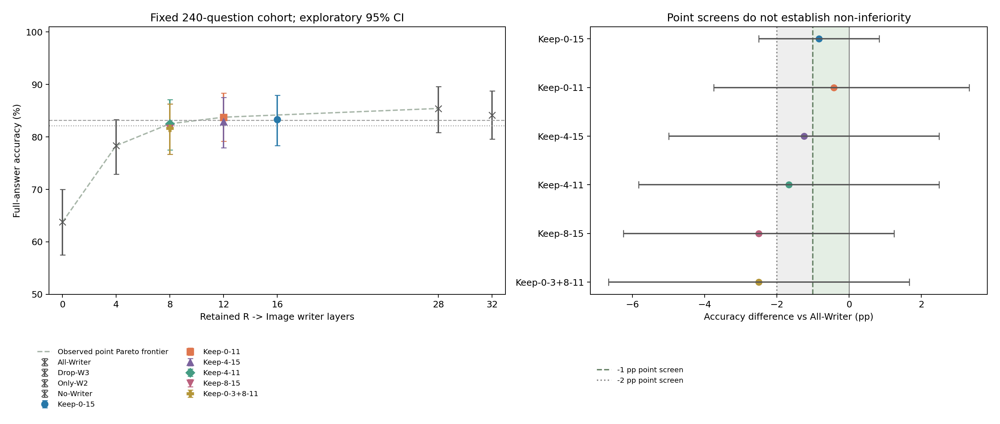
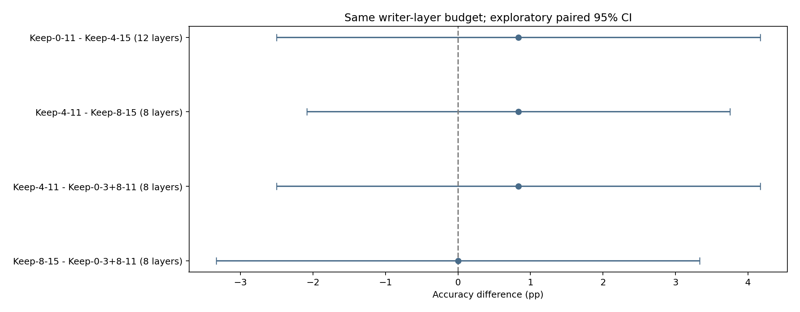
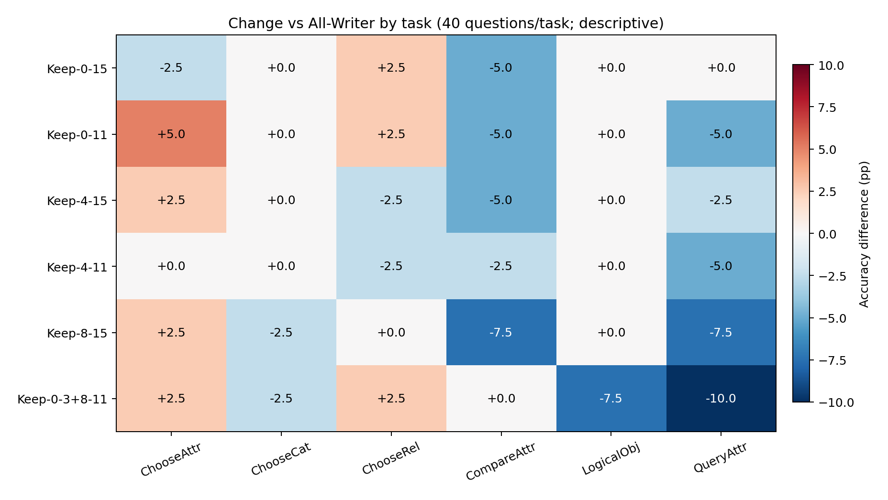

# Sparse Visual Writing Frontier：稀疏视觉写入前沿

**COMPLETE：新增6条件×240题＝1440条完整答案；严格复用四组历史基线960条；原生Full另列240条，不混入前沿。**

## 核心回答

All-Writer（32层）为202/240（84.167%）。新增条件最高点估计为Keep-0-11（12层）：201/240（83.750%），相对All -0.417 pp，探索性95%CI [-3.750, +3.333]。

预设-1pp点估计界限的新增候选：Keep-0-15（16层，83.333%）；Keep-0-11（12层，83.750%）。
在已测试新增组合中，达到该点估计要求的最少保留层数为12，即最多关闭20层的R→Image直接访问；这不是已证明的安全关闭上限。
预设-2pp点估计界限的新增候选：Keep-0-15（16层，83.333%）；Keep-0-11（12层，83.750%）；Keep-4-15（12层，82.917%）；Keep-4-11（8层，82.500%）。
在已测试新增组合中，达到该点估计要求的最少保留层数为8，即最多关闭24层的R→Image直接访问；这不是已证明的安全关闭上限。

质量候选只依赖预先声明的点估计规则。CI跨0不证明非劣效；本轮未进行确认性非劣效、等价或多重校正检验。所有条件来自已复用历史探索样本，候选必须留待独立数据验证。

## 完成后的研究判读

**在这六个新增组合中，8层和12层均出现接近All-Writer的点估计候选，但尚未证明它们满足非劣效界限。** 采用−1pp点估计标准，最少保留12层（Keep-0-11，201/240，83.750%），即关闭其余20层R→Image直接访问。采用−2pp标准，最少保留8层（Keep-4-11，198/240，82.500%），即关闭24层。结论只覆盖本轮测试集合，不是全部层子集的最优解或已验证的安全关闭上限。

Keep-0-11相对All为−0.417 pp，95%CI [−3.750, +3.333]；Keep-4-11为−1.667 pp，CI [−5.833, +2.500]。16层Keep-0-15也达到−1pp点估计标准：200/240（83.333%），差−0.833 pp，CI [−2.500, +0.833]。12层Keep-4-15只达到−2pp标准；另两组8层Keep-8-15和Keep-0-3+8-11均为196/240（81.667%），差−2.500 pp，未达到两项点估计界限。**所有新增条件的95%CI下界均低于−2pp，当前证据尚不能排除超出质量界限的损害。** 所有界限都相对答案阶段已屏蔽直接视觉访问的All-Writer 202/240，而不是原生Full 206/240。

在“保留层数—净Accuracy”两维点估计前沿上，8层Keep-4-11与12层Keep-0-11最值得保留。16层Keep-0-15被12层条件在这两维上点支配，但其逐题行为更接近All：仅3题原对变错、1题原错变对，4条完整Token序列改变；12层Keep-0-11则有10题损害、9题纠正、19条序列改变；8层Keep-4-11有15题损害、11题纠正、26条序列改变。因此，“几乎相同的净Accuracy”不代表保留了同一批正确答案，点Pareto前沿也不概括全部质量稳定性。16层条件仍可作为后续独立验证时的稳定性候选，不能从本批少数变化直接外推鲁棒性。

同预算比较目前只能给出方向性线索。12层Keep-0-11比Keep-4-15高0.833 pp，CI [−2.500, +4.167]；8层Keep-4-11分别比Keep-8-15和Keep-0-3+8-11高0.833 pp，CI [−2.083, +3.750]、[−2.500, +4.167]。另两组8层点估计相同，但互有8题损害和8题纠正。四组直接比较的区间全部跨0，尚不能确定某个邻近窗口组合总体更优，更不能据此证明某种特定协同或补偿机制。

任务结果显示净质量仍有结构性代价。Keep-4-11在ChooseAttr、ChooseCat、LogicalObj的净Accuracy与All相同，但ChooseRel、CompareAttr分别−2.5pp，QueryAttr为−5.0pp。Keep-0-11在ChooseAttr为+5.0pp、ChooseRel为+2.5pp，同时CompareAttr和QueryAttr各−5.0pp。每类仅40题，均属描述性观察，不能将总体−0.417pp理解成各任务均无损。

反例包括：`02813015`问男人在哪一侧，Gold与All为Right，8层Keep-4-11及12层Keep-0-11均答Left，而16层Keep-0-15仍答Right；`0213048`问未站立的是斑马还是长颈鹿，Gold与All为Zebras，12层条件答Giraffes，而16层仍答Zebras。这些例子只说明本批个体损害，全部错误和纠正均已保留，没有据此重选样本或追加搜索。

机制层面，本轮把上一轮的单窗口不足推进到多窗口功能稀疏候选：L8–L11与邻近窗口组合，能在关闭大量R→Image直接连接后维持较接近All的点估计表现。不过，保留8或12个“写入层”不等于模型只在这些层处理视觉：Image Query和全部KV在32层仍正常计算，写入非图像状态的视觉信息也可跨层继续传播。这里的候选是功能性来源访问限制，不是已实现的低计算推理。高质量候选留待独立数据验证；本轮没有执行新的搜索、联合消融、训练或加速实现。

## 协议与复用

所有前沿条件均在32层禁止P−1及全部真实Decode（含EOS预测）直接访问原始576个Image Key。仅Prefill R可读图的层集合不同；R为图像后、P−1前的全部非视觉Query，包括问题、指令、模板。Image Query、其他连接、MLP、Residual、RoPE和KV保持原生。每个条件从空Cache独立生成，无o_proj消融。
模型revision `b234b804b114d9e37bb655e11cbbb5f5e971b7a9`；FP16/Eager，Transformers4.49.0，Greedy，max_new_tokens=32，显式logits_to_keep=1。冻结源码 `0ef85f2ca07115641c76945e414607965b316a71`。原样复用Manifest SHA256 `258c32d470270829e126ae9abf3a030dbc1485b2f329fdfc326f4d6e9b3e686c` 及原Prompt IDs、Pixel Tensor哈希、Gold和Image SHA。
六个新条件逐层调用历史visual_write_window.engine.apply_mask：保留层选择All-Writer规则，其他层选择No-Writer规则。没有修改历史函数、检查点或结果。审计960条基线的Token解码、评分、真实概率、Cache、原始向量和输入绑定；GPU Smoke进一步检验旧/新入口全部有效Logits及历史保存首向量和完整Token严格一致。
复用All-Writer 202、Drop-W3 205、Only-W2 188、No-Writer 153。原生Full另经审计为206/240（85.833%），其答案阶段可以直接读图，与All-Writer协议不同，单独保存native_full_reference.csv；不把它当作32层All-Writer，也不混合评分。

## 总体结果与质量筛选

|条件|保留/关闭层|正确/240|Accuracy|ΔAll pp [95%CI]|原对→错/错→对|−1pp候选|−2pp候选|点Pareto前沿|
|---|---|---:|---:|---|---|---|---|---|
|All-Writer|32/0|202|84.167%|+0.000 [+0.000, +0.000]|0/0|是|是|否|
|Drop-W3|28/4|205|85.417%|+1.250 [-1.667, +4.583]|6/9|是|是|是|
|Only-W2|4/28|188|78.333%|-5.833 [-10.833, -0.833]|25/11|否|否|是|
|No-Writer|0/32|153|63.750%|-20.417 [-27.083, -13.333]|64/15|否|否|是|
|Keep-0-15|16/16|200|83.333%|-0.833 [-2.500, +0.833]|3/1|是|是|否|
|Keep-0-11|12/20|201|83.750%|-0.417 [-3.750, +3.333]|10/9|是|是|是|
|Keep-4-15|12/20|199|82.917%|-1.250 [-5.000, +2.500]|12/9|否|是|否|
|Keep-4-11|8/24|198|82.500%|-1.667 [-5.833, +2.500]|15/11|否|是|是|
|Keep-8-15|8/24|196|81.667%|-2.500 [-6.250, +1.250]|14/8|否|否|否|
|Keep-0-3+8-11|8/24|196|81.667%|-2.500 [-6.667, +1.667]|17/11|否|否|否|

点Pareto前沿（只在这十个已测试条件内）：No-Writer（0层，63.750%）；Only-W2（4层，78.333%）；Keep-4-11（8层，82.500%）；Keep-0-11（12层，83.750%）；Drop-W3（28层，85.417%）。相同预算与准确率的并列组合全部保留。前沿基于点估计，受抽样不确定性和历史复用影响；少数题的净优势不证明总体支配。

## 8、12、16层与邻近窗口协作

|比较（前者−后者）|保留层数|ΔAccuracy pp [95%CI]|后者对→前者错/后者错→前者对|
|---|---:|---|---|
|Keep-0-11 - Keep-4-15|12|+0.833 [-2.500, +4.167]|7/9|
|Keep-4-11 - Keep-8-15|8|+0.833 [-2.083, +3.750]|6/8|
|Keep-4-11 - Keep-0-3+8-11|8|+0.833 [-2.500, +4.167]|8/10|
|Keep-8-15 - Keep-0-3+8-11|8|+0.000 [-3.333, +3.333]|8/8|

12层的直接比较以共同L4–L11为基础，将L0–L3与L12–L15两种额外窗口相比较；8层的三组都保留L8–L11，比较搭配W0、W1或W3的效果。这些背景固定的比较检验组合的功能差异，并不等于对单个窗口信息贡献的可加分解，也未额外估计未经预声明的交互量。

全部总体与组合比较使用同一组20,000次Image SHA256整簇配对Bootstrap，seed=20261102，双侧百分位探索性95%CI。240题对应240个图像簇。完整比较见paired_comparisons.csv；首Token变化和signed LogP loss不等于完整答案Accuracy。

## 六任务差异

|条件|ChooseAttr|ChooseCat|ChooseRel|CompareAttr|LogicalObj|QueryAttr|
|---|---:|---:|---:|---:|---:|---:|
|All-Writer|82.5%|92.5%|80.0%|75.0%|97.5%|77.5%|
|Drop-W3|90.0%|95.0%|85.0%|72.5%|97.5%|72.5%|
|Only-W2|82.5%|87.5%|82.5%|67.5%|95.0%|55.0%|
|No-Writer|70.0%|47.5%|60.0%|72.5%|87.5%|45.0%|
|Keep-0-15|80.0%|92.5%|82.5%|70.0%|97.5%|77.5%|
|Keep-0-11|87.5%|92.5%|82.5%|70.0%|97.5%|72.5%|
|Keep-4-15|85.0%|92.5%|77.5%|70.0%|97.5%|75.0%|
|Keep-4-11|82.5%|92.5%|77.5%|72.5%|97.5%|72.5%|
|Keep-8-15|85.0%|90.0%|80.0%|67.5%|97.5%|70.0%|
|Keep-0-3+8-11|85.0%|90.0%|82.5%|75.0%|90.0%|67.5%|

每任务40题，任务分析为描述性。完整逐题损益、全部错误答案和相对All损害分别保存在per_question.csv、incorrect_answers.csv、negative_cases.csv。未按输出筛选样本或删除失败案例。

## 全部负面案例与生成质量

|新增条件|原对→错|原错→对|首Token翻转|EOS/截断/空/重复|
|---|---:|---:|---:|---|
|Keep-0-15|3|1|4|240/0/0/0|
|Keep-0-11|10|9|19|240/0/0/0|
|Keep-4-15|12|9|21|240/0/0/0|
|Keep-4-11|15|11|26|240/0/0/0|
|Keep-8-15|14|8|22|240/0/0/0|
|Keep-0-3+8-11|17|11|28|240/0/0/0|

按每个新增条件、题号排序各展示最前两例损害；此处只作说明，不改变样本、评分或窗口选择。

|条件|题号|问题|Gold|All-Writer|条件答案|
|---|---|---|---|---|---|
|Keep-0-15|09937720|Is the bag that is black closed or open?|closed|Closed|Open|
|Keep-0-15|12624151|What is common to the sign and the pole?|material|Material|Color|
|Keep-0-11|0213048|Which animals are not standing, the zebras or the giraffes?|zebras|Zebras|Giraffes|
|Keep-0-11|02813015|Which side is the man on?|right|Right|Left|
|Keep-4-15|001020372|Is the zebra to the left of the bench black or white?|white|White|Black|
|Keep-4-15|01938770|Which side of the picture is the man on?|left|Left|Right|
|Keep-4-11|001020372|Is the zebra to the left of the bench black or white?|white|White|Black|
|Keep-4-11|02813015|Which side is the man on?|right|Right|Left|
|Keep-8-15|001020372|Is the zebra to the left of the bench black or white?|white|White|Black|
|Keep-8-15|01938770|Which side of the picture is the man on?|left|Left|Right|
|Keep-0-3+8-11|001020372|Is the zebra to the left of the bench black or white?|white|White|Black|
|Keep-0-3+8-11|02813015|Which side is the man on?|right|Right|Left|

## 验证、资源与限制

CPU测试、三道固定真实7B GPU Smoke、六个新条件和四个历史基线兼容性均通过。HF/Native/六种No-op使用匹配LM Head形状，全部有效Logits保持torch.equal；禁止连接实际Softmax概率严格为0，概率行和沿用0.002界限，非目标Mask原值不变，BOS/Self合法。32层MLP、独立Cache存储、父Cache指纹、每步绝对位置、输入/权重版本以及正常/异常Hook清理均经过检查。
仅物理GPU0，UUID `GPU-a63c6362-dcfd-4a26-c44b-014b40127c89`；启动前重新确认空闲，只暴露该设备，一份模型串行。没有抢占或终止其他进程。GPU进程退出后的资源记录见gpu_release.json。原始大数组保留服务器资源目录，检查点记录路径和SHA256；GitHub不包含这些数组。
采集后完整核对模型文件SHA256、检查点和原始向量；CSV按标准序列化逐单元格精确复核，None按标准CSV空字段处理。冻结执行源码与所有历史文件保持不变。
Hard Mask会重归一化其余连接，层数不是单位Query贡献或实际FLOPs。图像KV、全部层和Attention计算仍执行，本轮只探索功能性层稀疏，未减少实际计算，也没有速度或显存收益证据。稀疏点估计前沿不证明普遍安全性、唯一视觉写入通路或跨模型泛化。

## 图表

## 停止边界

高质量候选只留待独立数据验证。本轮不追加逐层贪心搜索、Token联合消融、Router训练、Kernel实现或其他条件。
