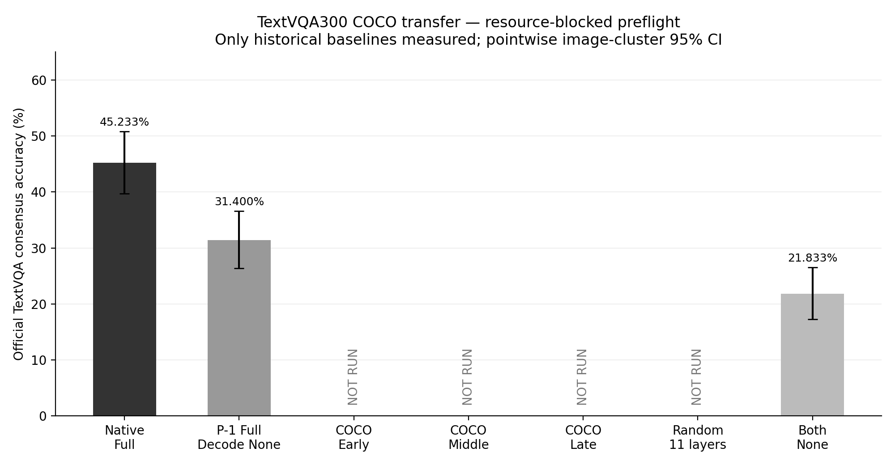

# COCO中层Decode视觉回看迁移至TextVQA：资源阻塞预检

**状态：BLOCKED_NO_FREE_GPU；实验未完成。四个新条件均未运行，不能报告COCO-Middle迁移后的Accuracy。**

已创建独立Worktree和分支，完成历史基线、输入、OCR标签和CPU Mask审计。本次GPU检查中4张RTX3090均有其他计算进程，各占约13.5–14.1GiB；没有真正空闲设备。未加载LLaVA，未启动GPU Worker，未创建后台等待/重试任务。按单张真正空闲3090的约束停止在GPU Smoke之前。

## 已核验与未执行范围

复用完全相同TextVQA300，原始Manifest字节SHA不变，逐图SHA核验通过；900条A/F/B历史答案用官方十人共识软评分重算差异为0，全部原检查点SHA、Token、文本和输入哈希一致。没有重复生成历史基线。冻结OCR标签逐字节复用原Commit，不重新分类。

| 条件 | Decode读图层 | n已完成/目标 | ACC | 相对Full Δpp | 来源 |
|---|---|---|---:|---:|---|
| Native Full | 32 | 300/300 | 45.233% | +0.000 | 已审计历史复用 |
| Pminus1 Full / Decode None | 0 | 300/300 | 31.400% | -13.833 | 已审计历史复用 |
| COCO-Early | 11 | 0/300 | 未测 | NA | GPU资源阻塞 |
| COCO-Middle | 11 | 0/300 | 未测 | NA | GPU资源阻塞 |
| COCO-Late | 12 | 0/300 | 未测 | NA | GPU资源阻塞 |
| Random-11 | 11 | 0/300 | 未测 | NA | GPU资源阻塞 |
| Both None | 0 | 300/300 | 21.833% | -23.400 | 已审计历史复用 |

A的Prefill/P−1与Decode全32层读图；F的Prefill/P−1全开放而Decode完全禁读；B的P−1/Decode均禁读。四个新增条件的整个Prefill保持原生，包括P−1；只在真实增量Decode按层Hard Mask原始Image Key。保留全部KV、其他文本Attention、MLP、Residual和RoPE，不做o_proj消融。

Random-11预先固定seed=20261105，Python random.Random(seed).sample(range(1,32),10)，另保留L0，具体层为`[0, 4, 5, 14, 20, 21, 22, 26, 28, 30, 31]`。不依据Accuracy选择种子。Middle/Early/Random各11层，Late12层，后者多一层的预算差必须保留。

历史COCO的层集合与本轮C/D/E逐项严格相同；COCO的Caption生成上限96 Token，本轮TextVQA冻结32 Token，不能复用COCO指标或把COCO结果当TextVQA结果。

## 冻结OCR分组

| 类别 | n | Native A | Decode None F | Both None B | 新条件 |
|---|---:|---:|---:|---:|---|
| OCR-Direct | 230 | 40.783% | 24.261% | 15.391% | 未运行 |
| OCR-Reasoning | 12 | 77.500% | 69.167% | 69.167% | 未运行 |
| Non-OCR Visual | 18 | 38.333% | 38.333% | 36.667% | 未运行 |
| Ambiguous | 40 | 64.250% | 58.000% | 38.000% | 未运行 |

标签是上轮输入屏蔽式AI复核标签，非独立人类真值；Reasoning仅12题、Non-OCR仅18题，均需保持小样本与分类误差限制。Middle在OCR-Direct的恢复尚无观测，不能用COCO或历史Both预算条件代替。

## 正确性与统计预设

10项CPU测试通过：C/D/E精确层集合、Random预算复现、所有新条件完整Prefill Mask逐位不变、Decode只修改Image边、实际CPU Softmax禁止概率严格0、保留层Mask逐位原生、No-op不改变Mask、A/F/B阶段语义、位置边界/文本连接保护以及CUDA未初始化。这些是Mask策略/张量测试，不是7B GPU Smoke。

真实GPU的Native/No-op有效Logits torch.equal、每个新条件首位置与Native严格一致、模型实际禁止Attention概率0、允许层实际读图、独立KV、32层MLP、输入/视觉特征/参数哈希、位置与Hook清理、完整EOS检查均未执行，validation.json明确标记NOT_RUN，不能将历史Smoke借作本轮通过证明。

冻结Image SHA整簇配对Bootstrap 20,000次，seed=20261105，普通95%CI；C−A、C−F、C−D、C−R、C−E五项作为主要比较，用整簇配对sign-flip的加一修正p后Holm控制。OCR组分析为描述性区间，不做未经校正的显著性宣称；没有观察结果前不进行层集合调整或另选种子。新比较均留空而非填0，不能将缺失视作无损。

## 对六个研究问题的当前回答

1. COCO-Middle的TextVQA Accuracy：未测。
2. 相对Decode None恢复：未测；已核验F=31.400%，A=45.233%，两者相差13.833pp。
3. 与Native Full缺口：未测。
4. 是否优于Early和Random-11：未测，不能判断。
5. OCR-Direct是否明显恢复：未测，不能判断。
6. 是否值得实现物理视觉KV加速：本轮尚无迁移结果，不能据此支持开发；Hard Mask本身也没有减少实际KV存储或证明加速。

## 资源现场

```text
0, NVIDIA GeForce RTX 3090, GPU-a63c6362-dcfd-4a26-c44b-014b40127c89, 24576 MiB, 13539 MiB, 99 %
1, NVIDIA GeForce RTX 3090, GPU-b08489af-0a8a-eb48-55ba-8346733af417, 24576 MiB, 13539 MiB, 100 %
2, NVIDIA GeForce RTX 3090, GPU-a50cb044-679e-9a05-557d-4ddbd19ac3c6, 24576 MiB, 14113 MiB, 29 %
3, NVIDIA GeForce RTX 3090, GPU-96bc853f-ceea-2404-c704-c48a3d1ca185, 24576 MiB, 14161 MiB, 29 %

GPU UUID / PID / 显存：
GPU-a63c6362-dcfd-4a26-c44b-014b40127c89, 3620369, 13502 MiB
GPU-b08489af-0a8a-eb48-55ba-8346733af417, 3620370, 13502 MiB
GPU-a50cb044-679e-9a05-557d-4ddbd19ac3c6, 3640743, 14080 MiB
GPU-96bc853f-ceea-2404-c704-c48a3d1ca185, 3640750, 14128 MiB
```

/data预检可用空间64.59GiB，空间足够；阻塞原因是GPU占用。没有抢占、杀进程或跨卡加载，没有本轮GPU显存需要释放。

## 文件与恢复边界

accuracy_summary.csv、ocr_group_accuracy.csv中已测项是历史复用，新项明确NOT_RUN_NO_FREE_GPU；per_question.csv仅含900条已核验A/F/B记录，不伪造1200条新答案。paired_comparisons.csv保留5项冻结比较及缺失状态。图中的NOT RUN不表示Accuracy为0。



新条件尚无检查点或真实Smoke，不得标记COMPLETE。恢复时需重新检查实际GPU占用，取得一张空闲3090后运行真实Smoke，再按冻结层集合单卡串行完成1200条；本次未设置自动恢复。新包engine.py只为复用已验证Mask函数绑定本轮策略，尚未交付或验收正式GPU采集入口。

历史与main不修改；本次仅提交资源阻塞下的预检、协议、可审阅CPU策略源码及历史审计，不声称完成迁移实验。
