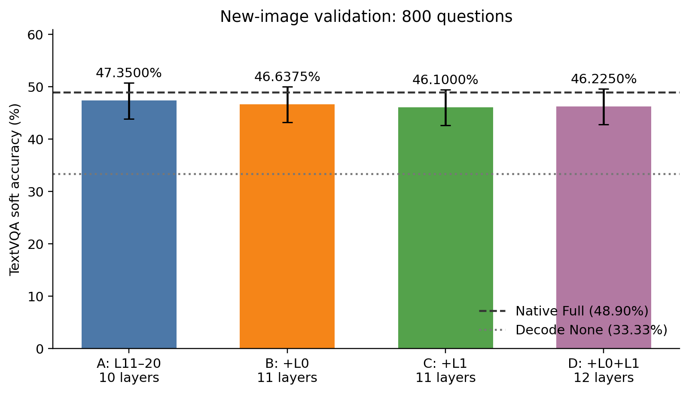
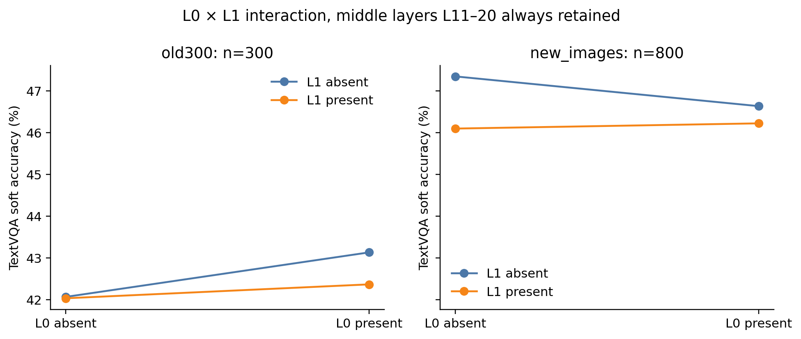
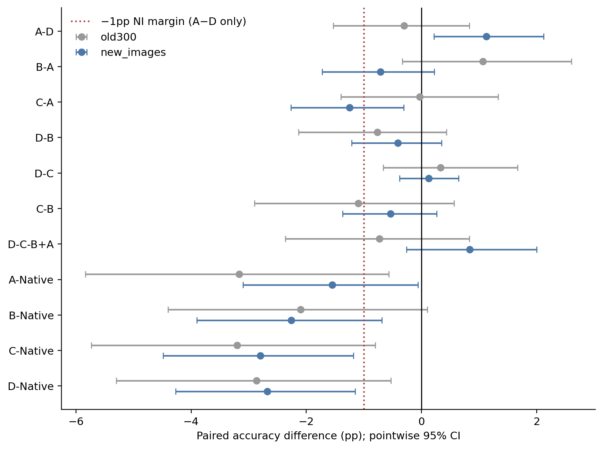
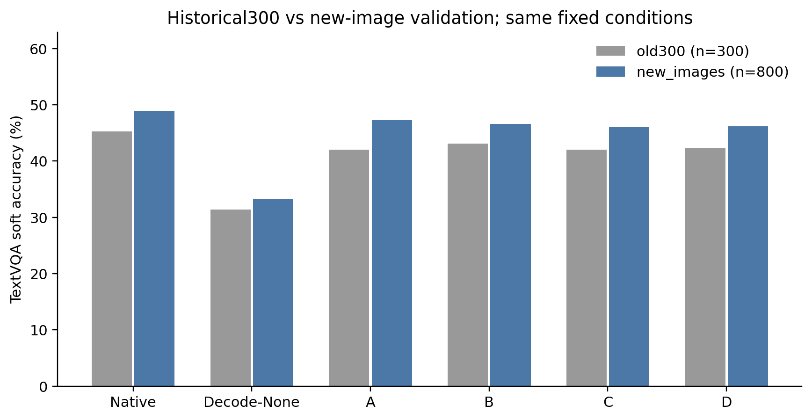

# TextVQA：L0/L1是否是中层视觉回看的必要补充？

**主结果：新800题上，仅L11–L20的A为47.350%，D为46.225%；A−D=+1.125pp，单侧95%下界=+0.349pp，达到预声明的−1pp非劣效标准。A相对Native仍有-1.550pp的点估计差距。**

本轮固定旧300题探索与新800题（531张图片）验证。所有六条件整个Prefill及P−1均原生；仅在真实增量Decode用Softmax前−inf屏蔽关闭层的576个原始Image Key，完整视觉KV始终保留。

| 条件 | Decode开放层 | 层数 | 旧300软ACC | 新800软ACC | 新集相对Native |
|---|---|---:|---:|---:|---:|
| Native | L0–L31 | 32 | 45.2333% | 48.9000% | +0.0000pp |
| Decode-None | 无 | 0 | 31.4000% | 33.3250% | -15.5750pp |
| A | L11–L20 | 10 | 42.0667% | 47.3500% | -1.5500pp |
| B | L0 + L11–L20 | 11 | 43.1333% | 46.6375% | -2.2625pp |
| C | L1 + L11–L20 | 11 | 42.0333% | 46.1000% | -2.8000pp |
| D | L0、L1 + L11–L20 | 12 | 42.3667% | 46.2250% | -2.6750pp |

## 预声明主检验

新图片A−D=+1.125pp，按图片SHA整簇20,000次配对Bootstrap的单侧95%下界=+0.349pp。只有下界严格大于−1.000pp才支持非劣。本轮达到预声明的−1pp非劣效标准。相对D的结论不能代替相对Native的质量判断。

## 直接回答研究问题

**Q1：仅L11–L20是否足够？** A的新集ACC=47.350%，相对Native -1.550pp。达到预声明的−1pp非劣效标准，不称其相对Native无损。

**Q2：L0增益能否由L1替代？** 无L1时加L0（B−A）：-0.713pp，95%CI [-1.726, +0.222]；提高/下降/不变 6/13/781，Holm p=0.7462126893655318。无L0时加L1（C−A）：-1.250pp，95%CI [-2.269, -0.310]；提高/下降/不变 5/17/778，Holm p=0.0871456427178641。同预算C−B：-0.537pp，95%CI [-1.369, +0.262]；提高/下降/不变 5/10/785，Holm p=0.7462126893655318。这组固定比较限定了可支持的替代程度，不能由区间跨0声称等价。

**Q3：同时保留L0/L1是否有额外收益？** D−B：-0.413pp，95%CI [-1.210, +0.350]；提高/下降/不变 5/9/786，Holm p=0.7462126893655318。D−C：+0.125pp，95%CI [-0.382, +0.642]；提高/下降/不变 3/2/795，Holm p=1.0。交互D−C−B+A：+0.838pp，95%CI [-0.258, +2.000]；提高/下降/不变 16/8/776，Holm p=0.7462126893655318。

**Q4：同11层预算哪个更好？** B=46.637%，C=46.100%；点估计较高者为L0版本B；显著性与不确定性见上面的C−B及Holm校正。

**Q5：新图片是否复现？** 两个队列的全部配对效应和区间均保留在paired_comparisons.csv及对照图中；旧300是机制探索，新800在预测前冻结且与发现到的历史图片ID及字节SHA均不重叠。按具体效应的方向和区间判断复现，不将同源公开验证集称为外部独立数据集。

## 数据、绑定与正确性

官方TextVQA v0.5.1验证集5000题。先审计所有可用工作区冻结样本及实际历史检查点身份：历史候选池中的未推理图片不自动视为已使用，候选清单另行保留；历史TextVQA与TextCaps已执行图片均排除。按冻结SHA规则取整张图片的全部问题，得到531图800题；不读取新预测来挑题。完整排除来源和SHA在image_overlap_audit.json及historical_image_inventory.json。无法排除未公开历史或重新编码的近重复。

旧300的A/B/Native/Decode-None共1200份记录精确复用：输入、图片SHA、官方评分、协议/源码绑定及基础Commit文件字节逐一核验。新增旧300 C/D=600条；新800×6=4800条，共5400条新正式生成。两卡Smoke额外回放单独审计，拥有分片的有效Smoke可保留为正式记录。

8项CPU测试；两卡各4道真实7B Smoke，Native/HF/No-op全部有效Logits严格torch.equal。A/B与冻结历史引擎同输入全部有效Logits严格一致，同时与历史完整Token及首向量SHA匹配。历史文件仅保存首Logits SHA，未保存全步向量，不能把引擎回放等同于已归档全步历史向量。六条件首预测向量均与Native逐位一致；实际禁用概率严格0、非目标Mask原样、位置与独立Cache、完整32层MLP/Norm/Block、视觉特征与权重版本及正常/异常Hook清理均验证。

所有6600条条件标签完整，复用1200，新增5400。EOS=6588，截断=12，空答案=0，重复3gram=35。异常不按答案剔除。

## 统计与解释边界

采用官方十答案共识软Accuracy；提高/下降是逐题软分的变化，不等价于简单正确题数。按Image SHA整簇有放回Bootstrap20000次，seed20261105；每次保留同图全部问题，并以重抽到的问题总数为分母，保持题均权。所有普通95%CI是点位探索性区间。主NI为新集A−D一项；辅助10项比较每个队列独立固定家族，用20000次整图配对符号翻转双侧Monte Carlo p及Holm校正。交互是D−C−B+A，不把单项显著与否代替交互检验。

negative_cases.csv保留全部配对软分变化，包括增加开放层却下降的非单调例，不只展示支持中层故事的题。完整原始输出、Token与每请求Cache/Mask审计位于检查点，SHA索引绑定来源。此实验只衡量功能依赖，未删除KV、未减少实际计算，不从层数或Mask比例推出加速收益；物理算法可行性需另行验证。

## 图表

执行协议、源码冻结Commit、GPU预检、两卡Smoke、Checkpoint索引及释放记录均保留。本轮完成后停止，不开展新层搜索或物理加速实现。

## 复现判定与非单调案例

旧300题中，四个稀疏集合的最高点是B（43.133%），L0相对A增加1.067pp；新800题的最高点变为A（47.350%），B−A反而为−0.713pp。因此旧样本中“L0有正收益”的方向未得到新图片复现。新集也没有建立L1可替代L0的证据：C−B为−0.538pp，普通95%CI跨0，Holm p=0.746。

同时保留L0/L1的D在新集低于A和B，D−B为−0.413pp；D−C仅+0.125pp。辅助校正后没有证据支持额外L0/L1是中层回看的必要补充。交互为+0.838pp，95%CI [−0.258,+2.000]，Holm p=0.746，不能确立非加性交互。

新集主比较A−D逐题软分提高16题、下降5题、不变779题；68题完整答案改变。也就是说，额外开放L0和L1可使部分问题变好，也可使更多问题变差，性能不随开放层数单调增加。完整变化、非单调例及所有非满分输出分别保留在negative_cases.csv、nonmonotonic_cases.csv、all_error_outputs.csv。

相对Native的A−Native普通95%CI为[−3.100,−0.062]pp；该辅助比较Holm p=0.307，既不能从未显著推导无损，也不能把相对D的非劣效结论转移到Native。旧/新队列来自不同图片分布，不通过直接比较两个队列的绝对ACC来评价泛化提升。

下表仅描述预定效应的方向，不是新增检验族：

| 配对效应 | 旧300 Δpp | 新800 Δpp | 点估计方向 |
|---|---:|---:|---|
| A-D | -0.300 | +1.125 | 不同向 |
| B-A | +1.067 | -0.713 | 不同向 |
| C-A | -0.033 | -1.250 | 同向 |
| D-B | -0.767 | -0.413 | 同向 |
| D-C | +0.333 | +0.125 | 同向 |
| C-B | -1.100 | -0.537 | 同向 |
| D-C-B+A | -0.733 | +0.838 | 不同向 |

该表是固定效应的复现对照，不是额外确认性假设族。证据强弱应结合新集配对CI及预声明校正；方向相同不等于效应大小已得到确认。
