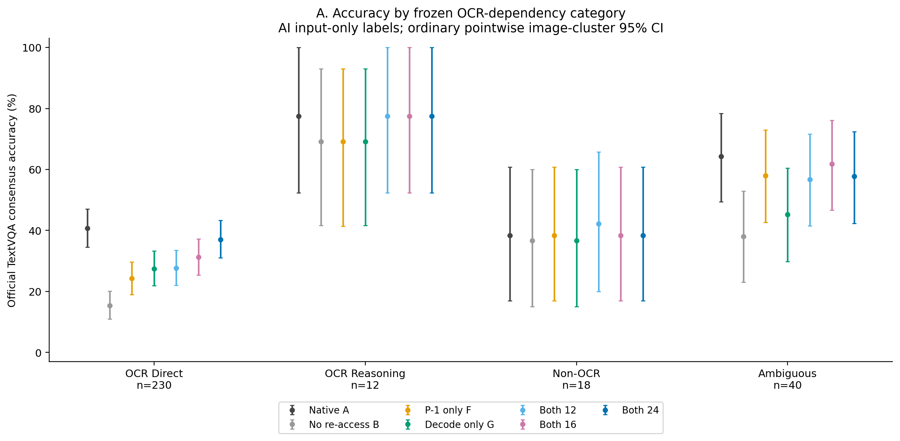
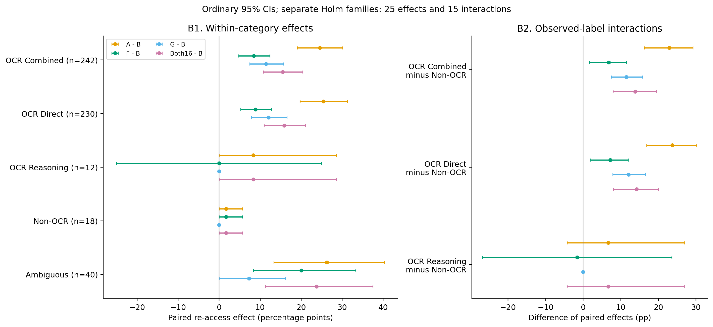
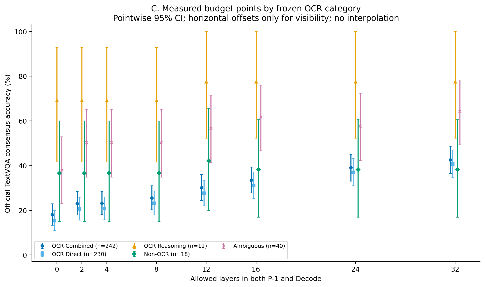
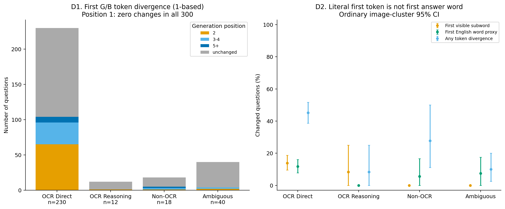

# TextVQA的OCR依赖性与视觉回看机制分析

本轮复用冻结TextVQA300和5040条历史记录，未加载LLaVA、未启动GPU、未生成任何新答案。官方TextVQA十人共识软评分重算差异为0。分类标签在逐题效应统计前冻结，全部300题保留。

本批结果支持**精确文字读取依赖与视觉回看收益相关**：OCR-Combined的A−B为24.545pp，Non-OCR为1.667pp，交互为22.879pp，普通95%CI [16.265,29.159]，15项Holm p=0.000750。Direct驱动了主要差异；Reasoning仅12题，证据不足。该关联基于单次AI输入复核标签，不能视为OCR本身的因果效应。

## 标签、证据与限制

按冻结协议，本次单Agent图像/问题复核标注：OCR-Direct 230题，OCR-Reasoning 12题，Non-OCR Visual 18题，Ambiguous 40题。Combined为前两类共242题。每题对应一张不同图片。不能将这些AI标注称为已确证的人类真值；`human_review_queue.csv`保留高优先级复核项，全部标签均需要独立人类核验。

先前总体成绩和旧报告中的少数案例已在本对话可见，所以不是完全独立盲审。此次300题分类界面移除了Gold、模型回答、评分及Attention；分类依据为冻结原图、原问题及随后准确对齐的公开OCR文字。先冻结规则，再完成全部图像复核和标签SHA，之后读取逐题结果统计；标签未因收益修改。没有训练分类器或调用新的OCR/视觉模型。

模拟时钟的指针读时、颜色和可见计数等可不依赖文字；具体数字/字母转录属于OCR。纯字母品牌标识按文字处理，具有独立图形Logo或外观识别路径者保留不确定性。空间定位后照抄文字属于Direct；读字后比较、计数、条件判断、双核转数量等属于Reasoning。40道Ambiguous不并入主OCR或Non-OCR；不能把TextVQA数据集名称当逐题OCR证明。

官方TextOCR验证JSON为40,028,022字节，SHA256 `0d04c1c9f5ba99e90be5b0df9ab34f6237b3fbc55443f263133d5c49b6435918`；292/300张图片在官方集合内。逐图检查Image ID、文件名stem、尺寸和标注image_id；原TextVQA图片字节按冻结SHA验证，没有下载任何图像归档。未核验独立TextOCR图像归档的字节同一性。8张不匹配不影响原图复核，OCR词面辅助指标标记未知。官方OCR中的`.`表示不可读/非英文，不是没有文字。来源：[TextOCR官方数据说明](https://textvqa.org/textocr/dataset/)、[官方验证标注](https://dl.fbaipublicfiles.com/textvqa/data/textocr/TextOCR_0.1_val.json)。

## 分组成绩与配对效应

| 组别 | n | A | B | F | G | Both12 | Both16 | Both24 |
|---|---:|---:|---:|---:|---:|---:|---:|---:|
| All300 | 300 | 45.233% | 21.833% | 31.400% | 32.033% | 34.433% | 37.600% | 41.500% |
| OCR-Direct | 230 | 40.783% | 15.391% | 24.261% | 27.435% | 27.696% | 31.261% | 37.043% |
| OCR-Reasoning | 12 | 77.500% | 69.167% | 69.167% | 69.167% | 77.500% | 77.500% | 77.500% |
| OCR-Combined | 242 | 42.603% | 18.058% | 26.488% | 29.504% | 30.165% | 33.554% | 39.050% |
| Non-OCR Visual | 18 | 38.333% | 36.667% | 38.333% | 36.667% | 42.222% | 38.333% | 38.333% |
| Ambiguous | 40 | 64.250% | 38.000% | 58.000% | 45.250% | 56.750% | 61.750% | 57.750% |

每组所有12个300题条件及120子集条件分别保存在`ocr_group_accuracy.csv`、`stage2_group_accuracy.csv`，完整答案/Token/首内容子词变化、EOS/截断/重复数量一并保留。120题结果不与300题混算。

| 组别 | A−B | F−B | G−B | Both16−B |
|---|---|---|---|---|
| OCR-Direct | +25.391pp [+19.689, +31.212]；Holm p=0.0012 | +8.870pp [+5.219, +12.795]；Holm p=0.0012 | +12.043pp [+7.851, +16.511]；Holm p=0.0012 | +15.870pp [+10.937, +20.979]；Holm p=0.0012 |
| OCR-Reasoning | +8.333pp [+0.000, +28.571]；Holm p=1.0000 | +0.000pp [-25.000, +25.000]；Holm p=1.0000 | +0.000pp [+0.000, +0.000]；Holm p=1.0000 | +8.333pp [+0.000, +28.571]；Holm p=1.0000 |
| OCR-Combined | +24.545pp [+19.068, +30.121]；Holm p=0.0012 | +8.430pp [+4.768, +12.358]；Holm p=0.0012 | +11.446pp [+7.449, +15.703]；Holm p=0.0012 | +15.496pp [+10.753, +20.410]；Holm p=0.0012 |
| Non-OCR Visual | +1.667pp [+0.000, +5.625]；Holm p=1.0000 | +1.667pp [+0.000, +5.625]；Holm p=1.0000 | +0.000pp [+0.000, +0.000]；Holm p=1.0000 | +1.667pp [+0.000, +5.625]；Holm p=1.0000 |
| Ambiguous | +26.250pp [+13.333, +40.294]；Holm p=0.0110 | +20.000pp [+8.333, +33.333]；Holm p=0.1095 | +7.250pp [+0.000, +16.216]；Holm p=1.0000 | +23.750pp [+11.281, +37.500]；Holm p=0.0200 |

区间单位均为百分点，20,000次Image SHA整簇配对Bootstrap，固定seed=20261105。CI为普通点位95%区间，不是同时区间；组内25项检验、交互15项检验各自Holm控制。组内p为整簇sign-flip加一修正，交互p为中心化整簇Bootstrap零假设近似，不是随机化OCR标签试验。Direct、Combined重叠，不能当独立重复证据。小组与分层存在宽区间/低功效。

## OCR是否解释更大的回看收益？

| OCR组−NonOCR | 效应 | 交互pp [95%CI] | Holm p |
|---|---|---|---:|
| OCR-Combined | Full_reaccess_effect | +22.879 [+16.265, +29.159] | 0.0007 |
| OCR-Combined | Pminus1_effect | +6.763 [+1.561, +11.472] | 0.0752 |
| OCR-Combined | Decode_effect | +11.446 [+7.449, +15.703] | 0.0007 |
| OCR-Combined | Both16_effect | +13.829 [+7.899, +19.474] | 0.0007 |
| OCR-Combined | Pminus1_minus_Decode | -4.683 [-11.010, +1.103] | 0.8596 |
| OCR-Direct | Full_reaccess_effect | +23.725 [+16.911, +30.212] | 0.0007 |
| OCR-Direct | Pminus1_effect | +7.203 [+1.956, +11.915] | 0.0580 |
| OCR-Direct | Decode_effect | +12.043 [+7.851, +16.511] | 0.0007 |
| OCR-Direct | Both16_effect | +14.203 [+8.072, +20.043] | 0.0007 |
| OCR-Direct | Pminus1_minus_Decode | -4.841 [-11.283, +1.107] | 0.8596 |
| OCR-Reasoning | Full_reaccess_effect | +6.667 [-4.286, +26.842] | 1.0000 |
| OCR-Reasoning | Pminus1_effect | -1.667 [-26.765, +23.571] | 1.0000 |
| OCR-Reasoning | Decode_effect | +0.000 [+0.000, +0.000] | 1.0000 |
| OCR-Reasoning | Both16_effect | +6.667 [-4.286, +26.842] | 1.0000 |
| OCR-Reasoning | Pminus1_minus_Decode | -1.667 [-26.765, +23.571] | 1.0000 |

OCR-Combined的A−B效应减Non-OCR为+22.879pp，95%CI [+16.265, +29.159]，Holm p=0.0007。区间支持本批观察标签下存在效应差异，但不是OCR依赖性的独立因果识别。

按分组加总，Combined题贡献了全体A−B净软分差的84.62%（净贡献、可能被负贡献抵消，不是机制解释率）。但Combined本来占80.67%样本。贡献占比与组间效应交互必须分开看，不能仅因大多数收益出现在大多数OCR样本就宣称OCR驱动全部23.4pp。

## Decode分叉、首内容子词与长度

G/B的300题首位置原始Logits SHA及首Token ID全部一致；完整Token轨迹改变114/300，第一个可见内容子词改变33/300，首个英文词文本代理改变31/300。分叉位置为包含EOS的1-based生成位置；EOS分叉和严格前缀延伸单独记录。首个Tokenizer位置、非空白内容子词和首英文词不是同一对象；首英文词只取保存输出中的连续ASCII字母代理，不能保证是完整语义答案词（特别是URL、数字、截断）。

逐题`decode_divergence.csv`保留B/G实际文本、Token、首处分叉、EOS及分叉处词面。是否处于OCR片段只按与官方OCR词的规范化精确重叠做描述性代理，不能把无匹配解释为非OCR或OCR失效；没有建立字符级视觉指向。

| 组别 | Gold长度划分 | 短/长n | G−B长−短pp [95%CI] |
|---|---|---|---|
| OCR-Direct | reference_length_group | 167/63 | -9.591 [-17.139, -1.687] |
| OCR-Direct | reference_token_group | 24/206 | +8.794 [-1.955, +16.745] |
| OCR-Reasoning | reference_length_group | 11/1 | +0.000 [+0.000, +0.000] |
| OCR-Reasoning | reference_token_group | 6/6 | +0.000 [+0.000, +0.000] |
| OCR-Combined | reference_length_group | 178/64 | -8.764 [-16.026, -1.137] |
| OCR-Combined | reference_token_group | 30/212 | +9.261 [+0.297, +16.313] |
| Non-OCR Visual | reference_length_group | 14/4 | +0.000 [+0.000, +0.000] |
| Non-OCR Visual | reference_token_group | 7/11 | +0.000 [+0.000, +0.000] |
| Ambiguous | reference_length_group | 35/5 | +14.571 [-11.600, +61.667] |
| Ambiguous | reference_token_group | 9/31 | -4.982 [-31.167, +13.043] |
| All300 | reference_length_group | 227/73 | -5.877 [-12.387, +1.205] |
| All300 | reference_token_group | 46/254 | +6.912 [-0.846, +13.381] |

长度分组使用10个官方Gold的modal原文（并列取首次）及原Tokenizer无special的CPU编码，绝不按生成成败或生成长度分组。原Tokenizer SHA见analysis_validation。`answer_length_analysis.csv`含单词/多词和单Token/多Token全部组的A/B/F/G成绩及效应；`length_distributions.csv`保留各输出长度分布。长度关联不等于Decode对每个新增答案Token的因果收益。

F−G分组比较如下；P−1只有一个Query而Decode有可变多个真实Query，差异不能解释为单位Query贡献：

- OCR-Direct：-3.174pp [-8.445, +2.110]；Holm p=1.0000
- OCR-Reasoning：+0.000pp [-25.000, +25.000]；Holm p=1.0000
- OCR-Combined：-3.017pp [-8.174, +2.114]；Holm p=1.0000
- Non-OCR Visual：+1.667pp [+0.000, +5.625]；Holm p=1.0000
- Ambiguous：+12.750pp [-1.396, +27.073]；Holm p=1.0000

## 混杂、反例与解释边界

预设短/长问题、modal参考单/多词、单/多Token、含数字/无数字、what/非what及公开可读文字数量均完整分层报告，含空组，见confound_stratified_effects.csv。它们是形式代理，非OCR真值。图像复杂度、任务难度、模型OCR能力没有被控制；未拟合回归、Router或分类器，不挑选显著分层。小Non-OCR/Reasoning组使条件分层更稀疏。

所有预定配对中的负差记录677条（同题不同配对可重复，不能当不同题数）。案例按冻结QuestionID规则选择，见case_studies.md及离线case_gallery.html；每类无符合条件者如实标记。增加层数造成逐题损害并未删除，异常输出仍计入官方评分。

关于GQA：这批Non-OCR标签下的表现可作为同模型的描述性参照，但没有按问题难度、输出长度、图像分布对齐GQA，不能从18道Non-OCR题证明与GQA机制一致。

在固定计算图内，A/B/F/G的Mask干预支持直接视觉回看会改变部分问题的完整答案；OCR类别是事后观察标签，其与干预效应的关联不能识别“OCR导致回看必要性”。还不能排除其他信息保留机制替代反复访问原视觉KV。Attention Mass不是此轮分类依据，也不等于必要性。本轮未证明最优动态策略、跨模型普适、质量非劣效或实际加速。

## 对十二个问题的回答

1–4. 本复核标注Direct 230、Reasoning 12、Combined 242、Non-OCR 18（6.00%）、Ambiguous 40；均为需独立复核的AI标签，不称确证OCR题数。

5–6. 直接看上表的A−B组间交互及区间，不能用组内显著/不显著相互比较替代交互检验。

7. 单/多Token及单/多词的G−B长短交互已全部报告；是否支持更强收益由区间判断，不预设长答案更受益。

8. 以分组F−G配对差及区间判断，不从各自点估计排名；样本量不足的组不能给阶段重要性排序。

9. OCR各组的8个真实Both预算点、相对B提升和相对A缺口见figure_C_plot_data.csv；最小观察预算只针对预设路径，不是全局最小层集合。

10. Non-OCR与GQA仅可描述性讨论，不能证明相同机制。

11. B仍答对的OCR题、F/G方向不同、Non-OCR回看改善及高预算损害均按规则保存，不隐藏反例。

12. 结论属于固定Mask干预下的观察性效应异质性分析，尚不能把23.4pp收益归因为OCR本身，更不能推导必须反复读取原视觉KV。

## 图表与复现

全部图同时提供矢量PDF、PNG和绘图CSV，无平滑、无插值。运行本目录`analysis.py`后运行`plots_report.py`，最后`validate.py`，只读历史记录与本地Tokenizer；不运行准备Worktree脚本以避免重建分类冻结。`classification_freeze.json`与`preclassification_freeze.json`分别记录标签及规则冻结SHA。公开标注子集及原图受控引用均已保存；完整40MB官方JSON留在/data资源目录，其URL及SHA供重取。

本轮未请求、占用或释放任何GPU；resource_audit.json保留CPU环境和当前进程快照，仅供审计。main与旧结果未修改。

## OCR分组的实际预算恢复

| 组别 | k=2 | k=4 | k=8 | k=12 | k=16 | k=24 | k=32 |
|---|---:|---:|---:|---:|---:|---:|---:|
| OCR-Direct | 20.7% | 21.2% | 31.0% | 48.5% | 62.5% | 85.3% | 100.0% |
| OCR-Reasoning | 0.0% | 0.0% | 0.0% | 100.0% | 100.0% | 100.0% | 100.0% |
| OCR-Combined | 20.4% | 20.9% | 30.5% | 49.3% | 63.1% | 85.5% | 100.0% |
| Non-OCR Visual | 0.0% | 0.0% | 0.0% | 333.3% | 100.0% | 100.0% | 100.0% |
| Ambiguous | 46.7% | 46.7% | 46.7% | 71.4% | 90.5% | 75.2% | 100.0% |

以上是(A−B)缺口恢复比例的描述性点估计，不是Accuracy。Non-OCR仅1.667pp缺口，个别条件可超过100%，不代表质量更稳定；Reasoning与Non-OCR重采样时存在零/负分母，故不提供伪稳定的ratio CI，抽样次数记录于group_budget_recovery.csv。各条件Accuracy本身的普通CI仍完整提供。

OCR-Combined在12/16/24层为30.165%/33.554%/39.050%，分别比Native 42.603%低12.438/9.050/3.554pp；24层尚未达到Full−2pp点估计目标。Direct 24层37.043%相对Full40.783%仍低3.739pp。

多Token与多词不可混同：Combined按原Tokenizer分组，多Token的G−B增益比单Token高9.261pp，普通CI [0.297,16.313]；按空格词数分组，多词反而比单词低8.764pp，CI [−16.026,−1.137]。这些均为描述性、未做长度分层多重校正，且单Token仅30题，不能挑其中一种宣称通用长答案机制。

Reasoning和Non-OCR的G−B逐题软分差均为0，Bootstrap退化成[0,0]，只反映本样本没有观察到分差，不证明总体Decode无效。Non-OCR的A−B仅一题有+0.3软分，经验Bootstrap不能覆盖未观察到的失败类型；需结合18题规模解读。

分类准备脚本和原始300条观察保存在`classification_sources/`。`classification_code_provenance.json`记录源文件时间及交付时SHA；它不是事前登记的源码哈希，不能替代独立预注册。原规则、标签与证据的冻结记录未改写。当前结果可从已冻结标签直接CPU复算。
