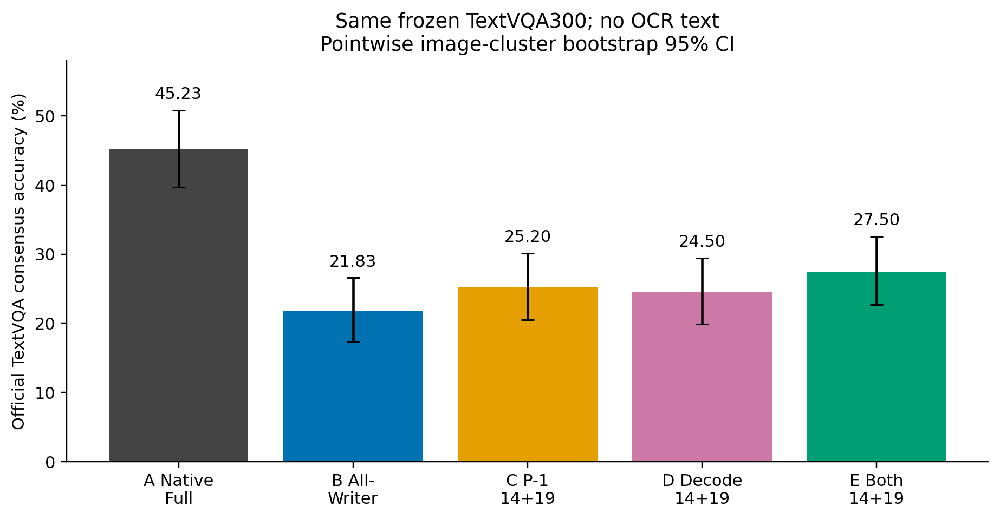
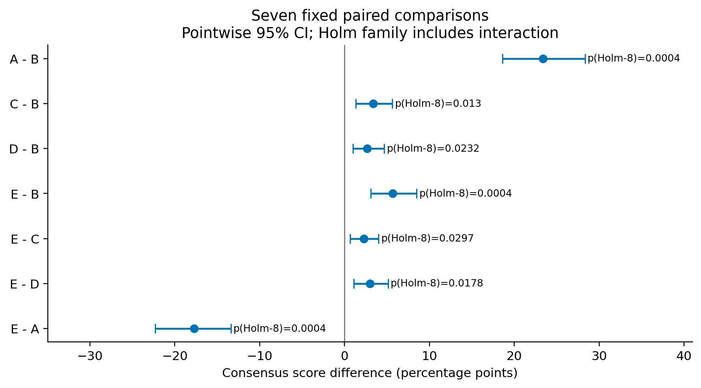
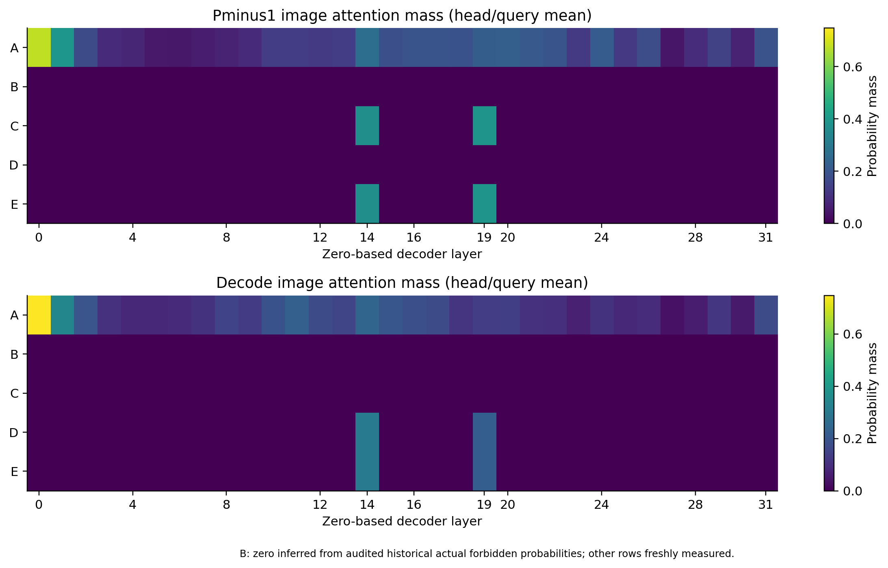
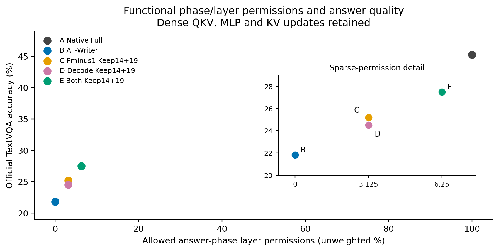

# TextVQA部分视觉层恢复：固定L14/L19

基线Commit：`b483cdc524ce568fdcff5a871b1608b4aeecb322`。相同300题、相同图片字节、相同无OCR Prompt、相同LLaVA-1.5-7B冻结权重。主指标是官方TextVQA/MMF十人留一共识软评分，不是单个Gold的字符串准确率。未训练、未重新选层、未筛题。

## 同题结果

| 条件 | P−1开放层 | Decode开放层 | Accuracy % | 相对B pp | 截断 | 重复3gram |
|---|---|---|---:|---:|---:|---:|
| A Native Full | 全部32 | 全部32 | 45.233 | +23.400 | 0 | 3 |
| B All-Writer | 无 | 无 | 21.833 | +0.000 | 3 | 5 |
| C Pminus1 Keep14+19 | 14、19 | 无 | 25.200 | +3.367 | 2 | 5 |
| D Decode Keep14+19 | 无 | 14、19 | 24.500 | +2.667 | 4 | 5 |
| E Both Keep14+19 | 14、19 | 14、19 | 27.500 | +5.667 | 2 | 6 |

A是完全原生Full，取消所有本实验的视觉限制；B为严格审计复用的历史All-Writer（300条）。C/D/E仅恢复对应阶段的原始Image Key连接。全部R（含ASSISTANT四个Subword）在五条件均开放，Image Query、非图像边、MLP、Residual和完整真实KV更新保持原生。A/C/D/E共1200条新生成，Smoke通过后复用其中32条，所有1500个条件标签保留。

## 预声明配对统计

| 比较 | Δpp [普通95%CI] | Score升/降/不变 | 回答/Token序列改变 | Holm-8 p |
|---|---:|---:|---:|---:|
| A−B | +23.400 [+18.600, +28.333] | 78/4/218 | 194/194 | 0.00040 |
| C−B | +3.367 [+1.300, +5.633] | 14/2/284 | 70/70 | 0.01300 |
| D−B | +2.667 [+1.000, +4.667] | 8/0/292 | 64/64 | 0.02325 |
| E−B | +5.667 [+3.067, +8.500] | 21/2/277 | 115/115 | 0.00040 |
| E−C | +2.300 [+0.667, +4.000] | 7/0/293 | 60/60 | 0.02970 |
| E−D | +3.000 [+1.067, +5.133] | 13/2/285 | 63/63 | 0.01780 |
| E−A | -17.733 [-22.300, -13.400] | 3/59/238 | 173/173 | 0.00040 |

交互项E−C−D+B：-0.367pp，95%CI [-1.667, +0.600]，Holm-8 p=0.50337。这仅表示当前软评分和干预定义下的非加性，不证明物理协同机制。

300题按Image SHA256整簇配对Bootstrap 20,000次，固定seed=20261104；保留题目等权。普通95%CI为逐点区间，不是多重校正区间。双侧整簇符号翻转随机化20,000次、plus-one p；七组比较和交互共八项执行Holm校正，均在GPU运行前冻结。没有定义非劣效界限，不能以CI跨0声明等价或非劣效。

## 结论

同题真正Native Full为45.233%；B为21.833%。仅恢复P−1的L14/L19（C）相对B为+3.367pp；仅恢复Decode（D）为+2.667pp；两阶段联合（E）为+5.667pp。E相对Native Full仍为-17.733pp。
A−B：Holm校正后p<0.05，配对差异获得统计支持。
C−B：Holm校正后p<0.05，配对差异获得统计支持。
D−B：Holm校正后p<0.05，配对差异获得统计支持。
E−B：Holm校正后p<0.05，配对差异获得统计支持。
E−C：Holm校正后p<0.05，配对差异获得统计支持。
E−D：Holm校正后p<0.05，配对差异获得统计支持。
E−A：Holm校正后p<0.05，配对差异获得统计支持。

本轮只能检验GQA提出的固定两层在这批TextVQA、无OCR Prompt、FP16/Eager条件中的效果，不能证明L14/L19优于其他任意两层；未执行随机两层对照。官方常见TextVQA模型成绩使用的OCR输入/完整数据协议不同，不能与本轮直接作差。小样本、历史已研究图片及固定输入限制外推。

## 异常与失败归因

A：EOS 300/300，截断0，重复3gram 3，空答案0，平均生成Token 4.21（含EOS）。
B：EOS 297/300，截断3，重复3gram 5，空答案0，平均生成Token 3.94（含EOS）。
C：EOS 298/300，截断2，重复3gram 5，空答案0，平均生成Token 3.93（含EOS）。
D：EOS 296/300，截断4，重复3gram 5，空答案0，平均生成Token 4.08（含EOS）。
E：EOS 298/300，截断2，重复3gram 6，空答案0，平均生成Token 4.10（含EOS）。

全部异常进入主评分；条件间新增/消失的EOS、截断、重复和长度改变详见paired_comparisons.csv，逐条详见abnormal_outputs.csv。未把正常达到32 Token上限视作资源OOM或删题理由。

descriptive_groups.csv按问题首词、历史B回答长度、标注中是否包含数字及历史异常分组；数字/字母仅是答案形式代理，不是经人工确认的视觉识别需求。E相对B所有改善与损害保存在E_vs_B_cases.csv；全部预声明比较的损害在harm_cases.csv。观察到错误恢复不等于已定位OCR、知识或语言能力的唯一故障。

## 正确性与工程预算

CPU验证重建全部300题原Prompt、Token与FP16图像输入哈希，逐字节对照冻结Git记录，重新核对所有模型文件及图片SHA。8题GPU Smoke包含历史异常：HF原生/No-op和A的全部有效Logits严格torch.equal；B与冻结引擎全部有效Logits严格相等，历史Token和首Token向量SHA匹配。Mask非目标元素不变，禁止实际概率精确为0，P−1随真实Prompt确定、Decode随真实Cache移动。层名映射、32层MLP、视觉特征、参数版本、独立Cache及正常/异常Hook清理均审计。未放宽历史行归一化数值容差。

实际注意力Mass按Head均值/中位数/最大/最小逐层逐真实查询记录；不要求开放层每步Mass必须为正。B未重跑：其Mass为历史实际禁止概率全0所推出的精确零，表中明确标注来源。phase_layer_budget_mass.csv按实际P−1/Decode调用给出Mask比例和Mass。所有条件R开放比例均100%；新恢复的是答案阶段层级权限，不能与R Token稀疏预算混作一个指标。

本轮仍执行完整QKV、Attention、MLP、Residual及KV更新；记录时间和显存属于此实现的运行审计，不证明FLOPs、延迟或显存优化。gpu_run_complete.json给出GPU阶段时间及峰值显存，gpu_release.json给出进程退出后资源。图片和14GB模型保留在服务器资源目录，Git交付不包含这些大文件；Manifest保留原始路径和SHA。

图表PNG/PDF（坐标与文字为矢量，Mass热图嵌入栅格）由analyze.py重现；CSV保存全部绘图数值。推理执行源码哈希在source_manifest.json，结果索引在artifact_index.csv。完成本轮后停止，未追加训练、层搜索或其他GPU实验。

## 实测运行与复用边界

单GPU阶段（含加载、8题Smoke和正式矩阵）共13.99分钟；正式遍历阶段12.61分钟。峰值已分配显存14.23GiB、峰值已保留显存14.45GiB，包含本实现审计和Cache开销，不能作为优化收益。

B的300条全部来自冻结Commit逐字节核验的历史检查点。A/C/D/E新检查点1200条，其中32条来自本轮Smoke并在全部验证通过后复用，正式阶段新增1168条；额外Smoke对照仅用于正确性，不纳入1500个评分标签重复计数。

首Token阶段不变性作为独立交付审计：全部300题D首Token原始FP16 Logits SHA必须与B相同，E必须与C相同。该检查与原始Token/输入/模型一致性一起验证阶段权限，结果见independent_statistics_audit.json。

## 真实改善、损害与残留差距案例

以下仅按冻结Manifest顺序展示各类前3题，不按故事效果挑选。全部负面和异常案例均保留在CSV；软评分升降不能一概写成二元答对/答错。

### E相对B改善：共21题

| ID / 问题 | 标注前三项（原始顺序） | A答案 / 分数 | B答案 / 分数 | E答案 / 分数 |
|---|---|---|---|---|
| 39460 / what number is on his jersey? | 32 / 32 / 32 | 32 / 1.0 | 33 / 0.0 | 32 / 1.0 |
| 39352 / what is the number of the jersey on the left? | 3 / 3 / 3 | 3 / 1.0 | 1 / 0.0 | 3 / 1.0 |
| 34809 / what does that guy's shirt say? | same same  / same same / same same | Same / 0.6 | Nothing / 0.0 | Same / 0.6 |

### E相对B损害：共2题

| ID / 问题 | 标注前三项（原始顺序） | A答案 / 分数 | B答案 / 分数 | E答案 / 分数 |
|---|---|---|---|---|
| 37380 / waht is the large forst letter on the sign? | a / padaria / a | A / 1.0 | A / 1.0 | P / 0.0 |
| 37011 / what is on the bottom left? | double bonus / industrial area / sign | Tree / 0.0 | Sign / 0.3 | Logo / 0.0 |

### E仍低于Native Full：共59题

| ID / 问题 | 标注前三项（原始顺序） | A答案 / 分数 | B答案 / 分数 | E答案 / 分数 |
|---|---|---|---|---|
| 38985 / what word does it say on the bins in white? | bolton / rita mac brown / bolton | Bolton / 1.0 | Recycle / 0.0 | Recycle / 0.0 |
| 39473 / who is telling stories? | caslon pro / caslon pro / caslon pro | Caslon pro / 1.0 | Author / 0.0 | Author / 0.0 |
| 37492 / what's the title of the book to the very top right? | frozen star / frozen star / frozen star | Frozen star / 1.0 | The book of mormon / 0.0 | Frozen / 0.0 |

恢复两层后仍低于Native Full的题全部另存residual_errors_vs_native.csv。E只在两个固定层开放直接视觉访问，其余30层仍关闭；因此差距与其余层直接读取的整体作用相容，但不能由本轮定位到某一个未恢复层。Native Full本身未达到满分，说明当前无OCR输入、图像分辨率和模型能力仍有限；具体错误来自文字读取、语言生成还是标注分歧，需要另行验证，本轮不据此改层或改Prompt。

实际Attention Mass只描述注意力分配，不等于因果重要性，不能据此在本批数据中重新选层。

图片字节和模型大文件未纳入Git；服务器原路径及SHA在sample_manifest.json和model_manifest.json。CPU/GPU日志、原子检查点和结果SHA随交付保留。

## 阶段作用与迁移判定

两阶段分别恢复都有正向作用：C−B为+3.367pp，D−B为+2.667pp；在另一阶段已恢复的背景下仍有额外增益，E−C为+2.300pp、E−D为+3.000pp。上述七个预声明配对比较的Holm-8 p均小于0.05。不能仅凭C略高于D的点估计宣称P−1比Decode更重要，因为本轮没有预声明C−D的直接检验。

交互项−0.367pp的95%CI跨0（−1.667到+0.600pp），p=0.503，未发现非加性的统计证据；这不证明严格可加。E相对B有21题Score提高、2题降低；相比A则仅3题提高、59题降低。E在B基础上新出现1题截断，同时恢复了B的2题截断；重复3gram新出现3题、消失2题，故不能只看异常净数。

固定L14/L19在本批TextVQA中有可重复审计的恢复作用，但不能承接GQA中接近Full的结论：E仅27.500%，而真正Native Full为45.233%，差距−17.733pp、95%CI [−22.300, −13.400]，Holm-8 p=0.00040。该结果支持“部分恢复有效”，不支持“两层已足够恢复完整TextVQA能力”，也不证明这两层相对其他层具有特殊性。

最终布局由同目录replot_final.py从冻结CSV重现，修正数值标签与误差棒重叠，并在预算图中放大C/D的近邻点；没有更改数据、模型、统计或推理执行源码。

## 结果图

