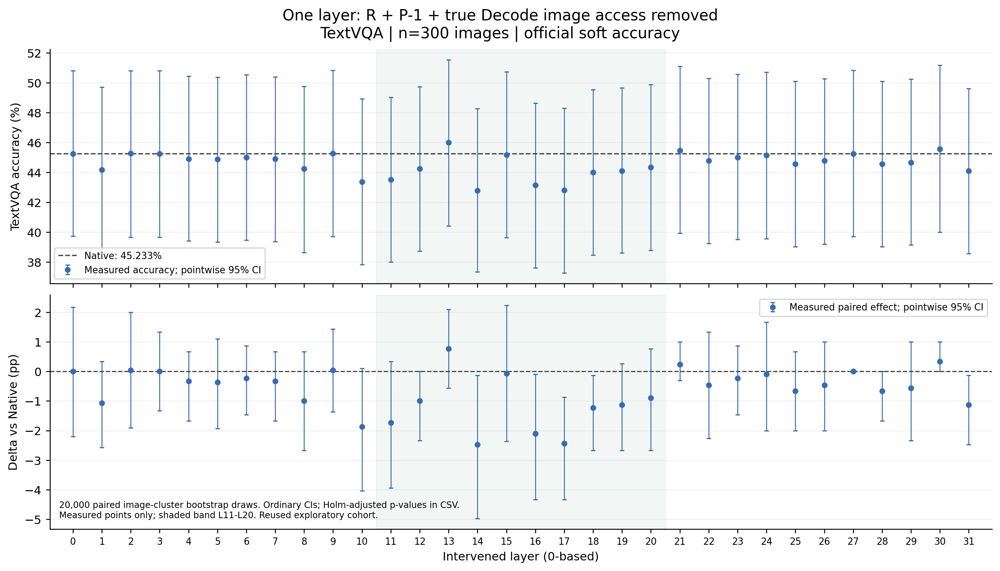
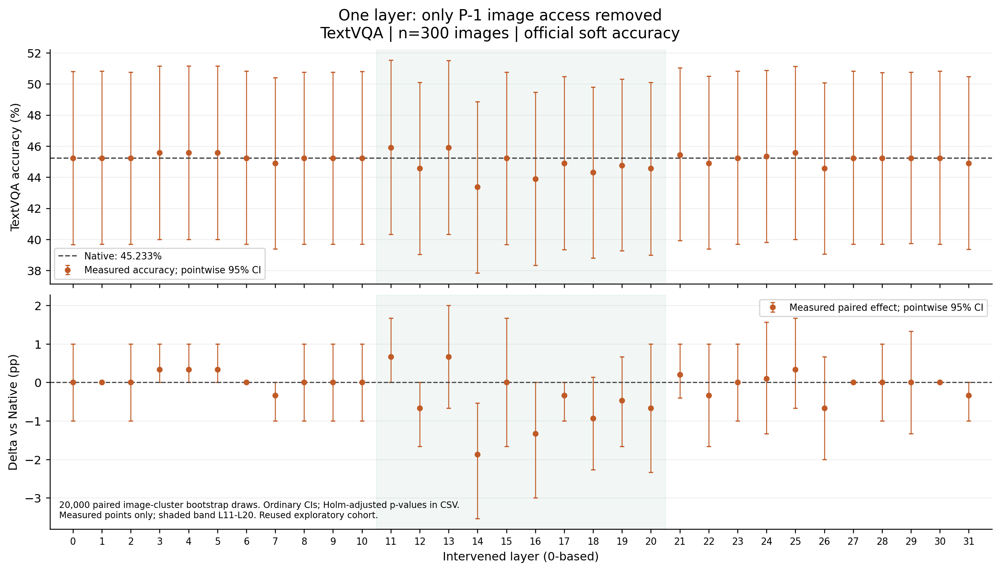
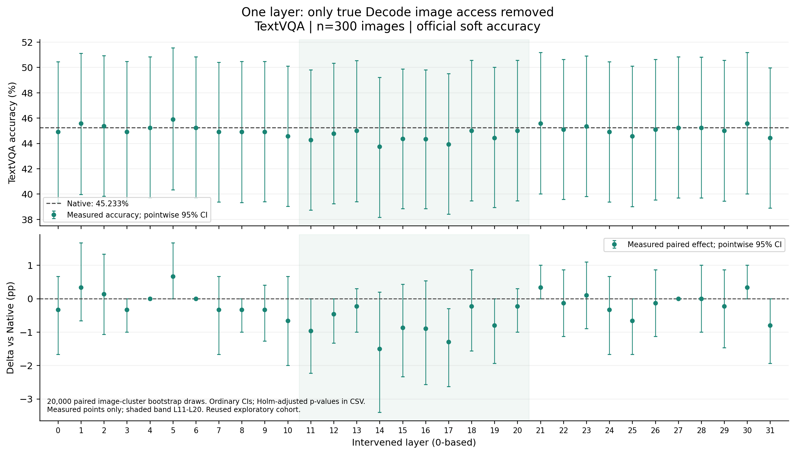
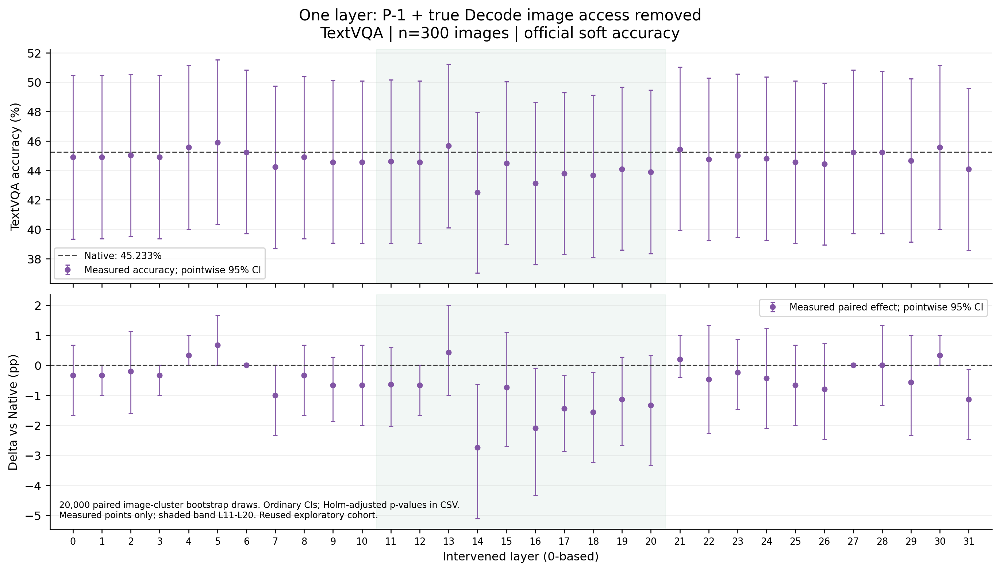
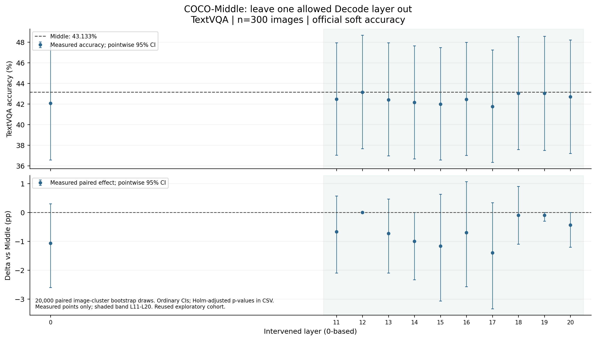
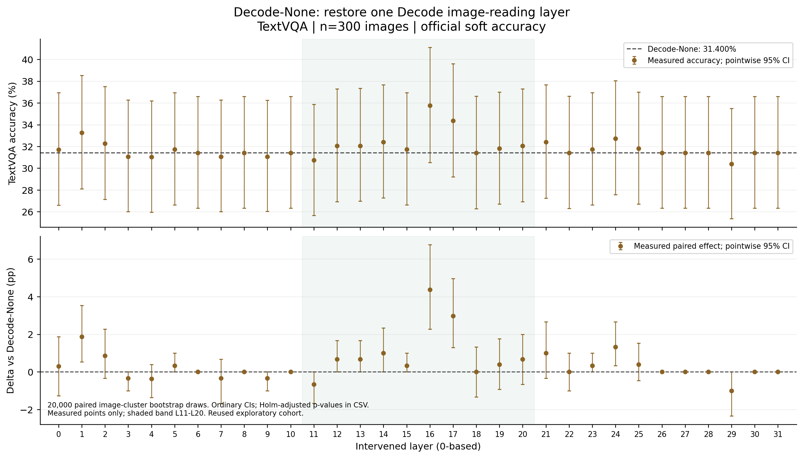
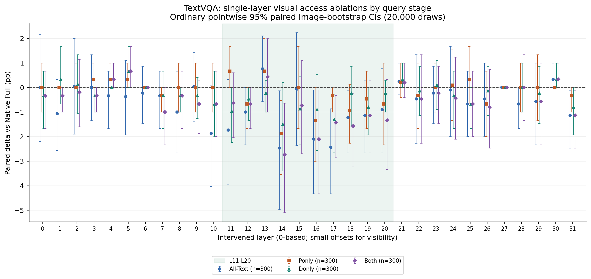
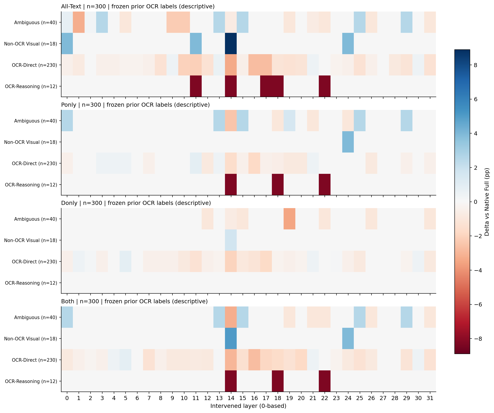

# TextVQA单层视觉读取消融：阶段差异与Middle留一

## 完成范围与直接发现

固定历史TextVQA300（300张不同图片），官方十答案留一共识软评分。新增51300份原子Checkpoint；主矩阵139个条件中139个完成300题；可选单层Add-back中32/32个完成300题。历史1200条Native/Middle/Decode-None/Both-None记录只读审计复用。没有训练、扩样、修改Prompt、筛选不利输出或物理删除KV。

生成计数边界：新增矩阵记录中513条来自通过门禁后保留的Smoke处理轨迹；常规正式新增50787条。双卡Smoke及校验实际执行1086条轨迹，其中未保留为新矩阵记录的重放不增加评分样本数。模型实际生成总轨迹51873条，详见`generation_accounting.json`；双卡相同3题Smoke是明确要求的校验重复，正式矩阵没有重复Question×Condition。

Native Full为45.233%，Middle为43.133%。下列排序仅描述本次反复研究的探索样本，不能当作独立确认或据此宣称一组层可安全联合剪除。

- All-Text：最小Δ的层[14]，ACC 42.767%，Δ-2.467pp；最大Δ的层[13]，Δ+0.767pp。Holm<0.05层：[]。
- Ponly：最小Δ的层[14]，ACC 43.367%，Δ-1.867pp；最大Δ的层[11, 13]，Δ+0.667pp。Holm<0.05层：[]。
- Donly：最小Δ的层[14]，ACC 43.733%，Δ-1.500pp；最大Δ的层[5]，Δ+0.667pp。Holm<0.05层：[]。
- Both：最小Δ的层[14]，ACC 42.500%，Δ-2.733pp；最大Δ的层[5]，Δ+0.667pp。Holm<0.05层：[]。
- Middle-minus：最小Δ的层[17]，ACC 41.733%，Δ-1.400pp；最大Δ的层[12]，Δ+0.000pp。Holm<0.05层：[]。
- Addback：最小Δ的层[29]，ACC 30.400%，Δ-1.000pp；最大Δ的层[16]，Δ+4.367pp。Holm<0.05层：[16]。

## 冻结设计

执行源码先冻结为`f8f6f0550b6b0575ce6eb2f973f37b98c3367280`，继承历史交付`c43f0f075989318c6bc061e411d4d2e703f8e9b8`。模型LLaVA-1.5-7B，revision `b234b804b114d9e37bb655e11cbbb5f5e971b7a9`；FP16/Eager，Transformers4.49.0，Greedy，`logits_to_keep=1`，max_new_tokens32，真实EOS和独立KV Cache。

All-Text仅在目标层关闭R、P−1、全部真实Decode→原始Image Key；Ponly仅P−1；Donly仅真实Decode；Both仅P−1+Decode。其他31层原生；R严格为图像之后至P−2。图像前系统文本保持原生。Middle留一从开放集合[0, 11, 12, 13, 14, 15, 16, 17, 18, 19, 20]中逐次去掉一层，仅作用于Decode，完整Prefill和P−1原生。可选Add-back从Decode-None恢复一层，仅测试充分性。

命名注意：本轮`Ponly-Ll`/`Donly-Ll`表示从Native只关闭一个指定层的指定阶段，绝不是历史预算实验中“只开放k层、另一阶段全关闭”的Ponly-k/Donly-k。新旧条件不混用评分。

所有干预均在Softmax前把指定边置为`−inf`，保留图像Query、其余文本边、完整QKV/KV、MLP、Norm、Residual、RoPE。没有o_proj消融，未实现物理KV裁剪、减少实际计算或测量加速。

300张图片按Image SHA排序后交替分至物理GPU2/3，各150张。120题队列为SHA256(Question ID + `|` + Image SHA)最小120项；不读取Gold、OCR类别、历史正确性或模型分数。其GPU分布54/66，是全300的子集。120题已完成记录按相同源码、协议、输入哈希复用至300，未重新生成。

## 完整层曲线

所有图只画实测点，普通逐点95%CI；不平滑、不插值。绿色带标记L11–L20。上下两图分别为绝对软Accuracy及相对同样本基线的配对ΔAccuracy。样本量在每张图及CSV中注明；若某族仅有120题，绝不会标为300题。



[矢量PDF](figures/all-text_layer_curve.pdf)



[矢量PDF](figures/ponly_layer_curve.pdf)



[矢量PDF](figures/donly_layer_curve.pdf)



[矢量PDF](figures/both_layer_curve.pdf)



[矢量PDF](figures/middle-minus_layer_curve.pdf)



[矢量PDF](figures/addback_layer_curve.pdf)



[矢量PDF](figures/native_stage_overlay.pdf)



[矢量PDF](figures/ocr_group_layer_heatmaps.pdf)

## 全部实测层点与配对结果

普通CI与Holm是两种不同输出：CI未作多重校正；p值是20,000次图片整簇配对符号翻转、加一修正，然后对预声明族做Holm。Native四阶段共128个比较为一族，Middle11个为另一族；可选Add-back32个为独立探索族。120/300分别计算，不能把重复观察当成新确认。区间跨0不是无损或非劣效证据。


### All-Text（n=300，对照Native）

| Layer | ACC% | Δpp | CI低 | CI高 | 软分下降 | 软分上升 | Holm p |
|---|---|---|---|---|---|---|---|
| 0 | 45.233 | 0.000 | -2.200 | 2.167 | 7 | 8 | 1.000 |
| 1 | 44.167 | -1.067 | -2.567 | 0.333 | 5 | 1 | 1.000 |
| 2 | 45.267 | 0.033 | -1.900 | 2.000 | 4 | 4 | 1.000 |
| 3 | 45.233 | 0.000 | -1.333 | 1.333 | 2 | 2 | 1.000 |
| 4 | 44.900 | -0.333 | -1.667 | 0.667 | 2 | 1 | 1.000 |
| 5 | 44.867 | -0.367 | -1.933 | 1.100 | 4 | 3 | 1.000 |
| 6 | 45.000 | -0.233 | -1.467 | 0.867 | 2 | 2 | 1.000 |
| 7 | 44.900 | -0.333 | -1.667 | 0.667 | 2 | 1 | 1.000 |
| 8 | 44.233 | -1.000 | -2.667 | 0.667 | 5 | 2 | 1.000 |
| 9 | 45.267 | 0.033 | -1.367 | 1.433 | 3 | 3 | 1.000 |
| 10 | 43.367 | -1.867 | -4.033 | 0.100 | 8 | 3 | 1.000 |
| 11 | 43.500 | -1.733 | -3.933 | 0.333 | 9 | 4 | 1.000 |
| 12 | 44.233 | -1.000 | -2.333 | 0.000 | 3 | 0 | 1.000 |
| 13 | 46.000 | 0.767 | -0.567 | 2.100 | 1 | 4 | 1.000 |
| 14 | 42.767 | -2.467 | -4.967 | -0.133 | 14 | 7 | 1.000 |
| 15 | 45.167 | -0.067 | -2.367 | 2.233 | 7 | 7 | 1.000 |
| 16 | 43.133 | -2.100 | -4.333 | -0.100 | 9 | 2 | 1.000 |
| 17 | 42.800 | -2.433 | -4.333 | -0.867 | 8 | 0 | 1.000 |
| 18 | 44.000 | -1.233 | -2.667 | -0.133 | 4 | 1 | 1.000 |
| 19 | 44.100 | -1.133 | -2.667 | 0.267 | 5 | 1 | 1.000 |
| 20 | 44.333 | -0.900 | -2.667 | 0.767 | 5 | 3 | 1.000 |
| 21 | 45.467 | 0.233 | -0.300 | 1.000 | 1 | 1 | 1.000 |
| 22 | 44.767 | -0.467 | -2.267 | 1.333 | 5 | 3 | 1.000 |
| 23 | 45.000 | -0.233 | -1.467 | 0.867 | 2 | 2 | 1.000 |
| 24 | 45.133 | -0.100 | -2.000 | 1.667 | 4 | 4 | 1.000 |
| 25 | 44.567 | -0.667 | -2.000 | 0.667 | 3 | 1 | 1.000 |
| 26 | 44.767 | -0.467 | -2.000 | 1.000 | 4 | 2 | 1.000 |
| 27 | 45.233 | 0.000 | 0.000 | 0.000 | 0 | 0 | 1.000 |
| 28 | 44.567 | -0.667 | -1.667 | 0.000 | 2 | 0 | 1.000 |
| 29 | 44.667 | -0.567 | -2.333 | 1.000 | 4 | 3 | 1.000 |
| 30 | 45.567 | 0.333 | 0.000 | 1.000 | 0 | 1 | 1.000 |
| 31 | 44.100 | -1.133 | -2.467 | -0.133 | 4 | 0 | 1.000 |

### Ponly（n=300，对照Native）

| Layer | ACC% | Δpp | CI低 | CI高 | 软分下降 | 软分上升 | Holm p |
|---|---|---|---|---|---|---|---|
| 0 | 45.233 | 0.000 | -1.000 | 1.000 | 1 | 1 | 1.000 |
| 1 | 45.233 | 0.000 | 0.000 | 0.000 | 0 | 0 | 1.000 |
| 2 | 45.233 | 0.000 | -1.000 | 1.000 | 1 | 1 | 1.000 |
| 3 | 45.567 | 0.333 | 0.000 | 1.000 | 0 | 1 | 1.000 |
| 4 | 45.567 | 0.333 | 0.000 | 1.000 | 0 | 1 | 1.000 |
| 5 | 45.567 | 0.333 | 0.000 | 1.000 | 0 | 1 | 1.000 |
| 6 | 45.233 | 0.000 | 0.000 | 0.000 | 0 | 0 | 1.000 |
| 7 | 44.900 | -0.333 | -1.000 | 0.000 | 1 | 0 | 1.000 |
| 8 | 45.233 | 0.000 | -1.000 | 1.000 | 1 | 1 | 1.000 |
| 9 | 45.233 | 0.000 | -1.000 | 1.000 | 1 | 1 | 1.000 |
| 10 | 45.233 | 0.000 | -1.000 | 1.000 | 1 | 1 | 1.000 |
| 11 | 45.900 | 0.667 | 0.000 | 1.667 | 0 | 2 | 1.000 |
| 12 | 44.567 | -0.667 | -1.667 | 0.000 | 2 | 0 | 1.000 |
| 13 | 45.900 | 0.667 | -0.667 | 2.000 | 1 | 3 | 1.000 |
| 14 | 43.367 | -1.867 | -3.533 | -0.533 | 6 | 0 | 1.000 |
| 15 | 45.233 | 0.000 | -1.667 | 1.667 | 3 | 3 | 1.000 |
| 16 | 43.900 | -1.333 | -3.000 | 0.000 | 5 | 1 | 1.000 |
| 17 | 44.900 | -0.333 | -1.000 | 0.000 | 1 | 0 | 1.000 |
| 18 | 44.300 | -0.933 | -2.267 | 0.133 | 4 | 1 | 1.000 |
| 19 | 44.767 | -0.467 | -1.667 | 0.667 | 3 | 1 | 1.000 |
| 20 | 44.567 | -0.667 | -2.333 | 1.000 | 4 | 2 | 1.000 |
| 21 | 45.433 | 0.200 | -0.400 | 1.000 | 1 | 1 | 1.000 |
| 22 | 44.900 | -0.333 | -1.667 | 1.000 | 3 | 2 | 1.000 |
| 23 | 45.233 | 0.000 | -1.000 | 1.000 | 1 | 1 | 1.000 |
| 24 | 45.333 | 0.100 | -1.333 | 1.567 | 3 | 3 | 1.000 |
| 25 | 45.567 | 0.333 | -0.667 | 1.667 | 1 | 2 | 1.000 |
| 26 | 44.567 | -0.667 | -2.000 | 0.667 | 3 | 1 | 1.000 |
| 27 | 45.233 | 0.000 | 0.000 | 0.000 | 0 | 0 | 1.000 |
| 28 | 45.233 | 0.000 | -1.000 | 1.000 | 1 | 1 | 1.000 |
| 29 | 45.233 | 0.000 | -1.333 | 1.333 | 2 | 2 | 1.000 |
| 30 | 45.233 | 0.000 | 0.000 | 0.000 | 0 | 0 | 1.000 |
| 31 | 44.900 | -0.333 | -1.000 | 0.000 | 1 | 0 | 1.000 |

### Donly（n=300，对照Native）

| Layer | ACC% | Δpp | CI低 | CI高 | 软分下降 | 软分上升 | Holm p |
|---|---|---|---|---|---|---|---|
| 0 | 44.900 | -0.333 | -1.667 | 0.667 | 2 | 1 | 1.000 |
| 1 | 45.567 | 0.333 | -0.667 | 1.667 | 1 | 2 | 1.000 |
| 2 | 45.367 | 0.133 | -1.067 | 1.333 | 2 | 2 | 1.000 |
| 3 | 44.900 | -0.333 | -1.000 | 0.000 | 1 | 0 | 1.000 |
| 4 | 45.233 | 0.000 | 0.000 | 0.000 | 0 | 0 | 1.000 |
| 5 | 45.900 | 0.667 | 0.000 | 1.667 | 0 | 2 | 1.000 |
| 6 | 45.233 | 0.000 | 0.000 | 0.000 | 0 | 0 | 1.000 |
| 7 | 44.900 | -0.333 | -1.667 | 0.667 | 2 | 1 | 1.000 |
| 8 | 44.900 | -0.333 | -1.000 | 0.000 | 1 | 0 | 1.000 |
| 9 | 44.900 | -0.333 | -1.267 | 0.400 | 2 | 1 | 1.000 |
| 10 | 44.567 | -0.667 | -2.000 | 0.667 | 3 | 1 | 1.000 |
| 11 | 44.267 | -0.967 | -2.233 | 0.000 | 4 | 1 | 1.000 |
| 12 | 44.767 | -0.467 | -1.333 | 0.000 | 2 | 0 | 1.000 |
| 13 | 45.000 | -0.233 | -1.000 | 0.300 | 1 | 1 | 1.000 |
| 14 | 43.733 | -1.500 | -3.400 | 0.200 | 8 | 5 | 1.000 |
| 15 | 44.367 | -0.867 | -2.333 | 0.433 | 5 | 2 | 1.000 |
| 16 | 44.333 | -0.900 | -2.567 | 0.533 | 5 | 2 | 1.000 |
| 17 | 43.933 | -1.300 | -2.634 | -0.300 | 5 | 0 | 1.000 |
| 18 | 45.000 | -0.233 | -1.567 | 0.867 | 2 | 2 | 1.000 |
| 19 | 44.433 | -0.800 | -1.933 | 0.000 | 3 | 0 | 1.000 |
| 20 | 45.000 | -0.233 | -1.000 | 0.300 | 1 | 1 | 1.000 |
| 21 | 45.567 | 0.333 | 0.000 | 1.000 | 0 | 1 | 1.000 |
| 22 | 45.100 | -0.133 | -1.133 | 0.867 | 2 | 1 | 1.000 |
| 23 | 45.333 | 0.100 | -0.900 | 1.100 | 1 | 2 | 1.000 |
| 24 | 44.900 | -0.333 | -1.667 | 0.667 | 2 | 1 | 1.000 |
| 25 | 44.567 | -0.667 | -1.667 | 0.000 | 2 | 0 | 1.000 |
| 26 | 45.100 | -0.133 | -1.133 | 0.867 | 2 | 1 | 1.000 |
| 27 | 45.233 | 0.000 | 0.000 | 0.000 | 0 | 0 | 1.000 |
| 28 | 45.233 | 0.000 | -1.000 | 1.000 | 1 | 1 | 1.000 |
| 29 | 45.000 | -0.233 | -1.467 | 0.867 | 2 | 2 | 1.000 |
| 30 | 45.567 | 0.333 | 0.000 | 1.000 | 0 | 1 | 1.000 |
| 31 | 44.433 | -0.800 | -1.933 | 0.000 | 3 | 0 | 1.000 |

### Both（n=300，对照Native）

| Layer | ACC% | Δpp | CI低 | CI高 | 软分下降 | 软分上升 | Holm p |
|---|---|---|---|---|---|---|---|
| 0 | 44.900 | -0.333 | -1.667 | 0.667 | 2 | 1 | 1.000 |
| 1 | 44.900 | -0.333 | -1.000 | 0.000 | 1 | 0 | 1.000 |
| 2 | 45.033 | -0.200 | -1.600 | 1.133 | 3 | 2 | 1.000 |
| 3 | 44.900 | -0.333 | -1.000 | 0.000 | 1 | 0 | 1.000 |
| 4 | 45.567 | 0.333 | 0.000 | 1.000 | 0 | 1 | 1.000 |
| 5 | 45.900 | 0.667 | 0.000 | 1.667 | 0 | 2 | 1.000 |
| 6 | 45.233 | 0.000 | 0.000 | 0.000 | 0 | 0 | 1.000 |
| 7 | 44.233 | -1.000 | -2.333 | 0.000 | 3 | 0 | 1.000 |
| 8 | 44.900 | -0.333 | -1.667 | 0.667 | 2 | 1 | 1.000 |
| 9 | 44.567 | -0.667 | -1.867 | 0.267 | 3 | 1 | 1.000 |
| 10 | 44.567 | -0.667 | -2.000 | 0.667 | 3 | 1 | 1.000 |
| 11 | 44.600 | -0.633 | -2.033 | 0.600 | 4 | 2 | 1.000 |
| 12 | 44.567 | -0.667 | -1.667 | 0.000 | 2 | 0 | 1.000 |
| 13 | 45.667 | 0.433 | -1.000 | 2.000 | 2 | 4 | 1.000 |
| 14 | 42.500 | -2.733 | -5.100 | -0.633 | 13 | 6 | 1.000 |
| 15 | 44.500 | -0.733 | -2.700 | 1.100 | 6 | 4 | 1.000 |
| 16 | 43.133 | -2.100 | -4.333 | -0.100 | 9 | 2 | 1.000 |
| 17 | 43.800 | -1.433 | -2.867 | -0.333 | 5 | 0 | 1.000 |
| 18 | 43.667 | -1.567 | -3.233 | -0.233 | 5 | 1 | 1.000 |
| 19 | 44.100 | -1.133 | -2.667 | 0.267 | 5 | 1 | 1.000 |
| 20 | 43.900 | -1.333 | -3.333 | 0.333 | 6 | 2 | 1.000 |
| 21 | 45.433 | 0.200 | -0.400 | 1.000 | 1 | 1 | 1.000 |
| 22 | 44.767 | -0.467 | -2.267 | 1.333 | 5 | 3 | 1.000 |
| 23 | 45.000 | -0.233 | -1.467 | 0.867 | 2 | 2 | 1.000 |
| 24 | 44.800 | -0.433 | -2.100 | 1.233 | 4 | 3 | 1.000 |
| 25 | 44.567 | -0.667 | -2.000 | 0.667 | 3 | 1 | 1.000 |
| 26 | 44.433 | -0.800 | -2.467 | 0.733 | 5 | 2 | 1.000 |
| 27 | 45.233 | 0.000 | 0.000 | 0.000 | 0 | 0 | 1.000 |
| 28 | 45.233 | 0.000 | -1.333 | 1.333 | 2 | 2 | 1.000 |
| 29 | 44.667 | -0.567 | -2.333 | 1.000 | 4 | 3 | 1.000 |
| 30 | 45.567 | 0.333 | 0.000 | 1.000 | 0 | 1 | 1.000 |
| 31 | 44.100 | -1.133 | -2.467 | -0.133 | 4 | 0 | 1.000 |

### Middle-minus（n=300，对照Middle）

| Layer | ACC% | Δpp | CI低 | CI高 | 软分下降 | 软分上升 | Holm p |
|---|---|---|---|---|---|---|---|
| 0 | 42.067 | -1.067 | -2.600 | 0.300 | 5 | 1 | 1.000 |
| 11 | 42.467 | -0.667 | -2.100 | 0.567 | 4 | 2 | 1.000 |
| 12 | 43.133 | 0.000 | 0.000 | 0.000 | 0 | 0 | 1.000 |
| 13 | 42.400 | -0.733 | -2.100 | 0.467 | 4 | 1 | 1.000 |
| 14 | 42.133 | -1.000 | -2.333 | 0.000 | 3 | 0 | 1.000 |
| 15 | 41.967 | -1.167 | -3.067 | 0.633 | 7 | 4 | 1.000 |
| 16 | 42.433 | -0.700 | -2.567 | 1.067 | 6 | 3 | 1.000 |
| 17 | 41.733 | -1.400 | -3.333 | 0.333 | 7 | 2 | 1.000 |
| 18 | 43.033 | -0.100 | -1.100 | 0.900 | 2 | 1 | 1.000 |
| 19 | 43.033 | -0.100 | -0.300 | 0.000 | 1 | 0 | 1.000 |
| 20 | 42.700 | -0.433 | -1.200 | 0.000 | 2 | 0 | 1.000 |

### Addback（n=300，对照Decode-None）

| Layer | ACC% | Δpp | CI低 | CI高 | 软分下降 | 软分上升 | Holm p |
|---|---|---|---|---|---|---|---|
| 0 | 31.700 | 0.300 | -1.267 | 1.867 | 3 | 4 | 1.000 |
| 1 | 33.267 | 1.867 | 0.533 | 3.533 | 0 | 6 | 0.990 |
| 2 | 32.267 | 0.867 | -0.333 | 2.267 | 1 | 4 | 1.000 |
| 3 | 31.067 | -0.333 | -1.000 | 0.000 | 1 | 0 | 1.000 |
| 4 | 31.033 | -0.367 | -1.367 | 0.400 | 2 | 1 | 1.000 |
| 5 | 31.733 | 0.333 | 0.000 | 1.000 | 0 | 1 | 1.000 |
| 6 | 31.400 | 0.000 | 0.000 | 0.000 | 0 | 0 | 1.000 |
| 7 | 31.067 | -0.333 | -1.667 | 0.667 | 2 | 1 | 1.000 |
| 8 | 31.400 | 0.000 | 0.000 | 0.000 | 0 | 0 | 1.000 |
| 9 | 31.067 | -0.333 | -1.000 | 0.000 | 1 | 0 | 1.000 |
| 10 | 31.400 | 0.000 | 0.000 | 0.000 | 0 | 0 | 1.000 |
| 11 | 30.733 | -0.667 | -1.667 | 0.000 | 2 | 0 | 1.000 |
| 12 | 32.067 | 0.667 | 0.000 | 1.667 | 0 | 2 | 1.000 |
| 13 | 32.067 | 0.667 | 0.000 | 1.667 | 0 | 2 | 1.000 |
| 14 | 32.400 | 1.000 | 0.000 | 2.333 | 0 | 3 | 1.000 |
| 15 | 31.733 | 0.333 | 0.000 | 1.000 | 0 | 1 | 1.000 |
| 16 | 35.767 | 4.367 | 2.267 | 6.767 | 0 | 14 | 0.008 |
| 17 | 34.367 | 2.967 | 1.300 | 4.967 | 0 | 9 | 0.138 |
| 18 | 31.400 | 0.000 | -1.333 | 1.333 | 2 | 2 | 1.000 |
| 19 | 31.800 | 0.400 | -0.933 | 1.767 | 2 | 3 | 1.000 |
| 20 | 32.067 | 0.667 | -0.667 | 2.000 | 1 | 3 | 1.000 |
| 21 | 32.400 | 1.000 | -0.333 | 2.667 | 1 | 4 | 1.000 |
| 22 | 31.400 | 0.000 | -1.000 | 1.000 | 1 | 1 | 1.000 |
| 23 | 31.733 | 0.333 | 0.000 | 1.000 | 0 | 1 | 1.000 |
| 24 | 32.733 | 1.333 | 0.333 | 2.667 | 0 | 4 | 1.000 |
| 25 | 31.800 | 0.400 | -0.467 | 1.533 | 1 | 2 | 1.000 |
| 26 | 31.400 | 0.000 | 0.000 | 0.000 | 0 | 0 | 1.000 |
| 27 | 31.400 | 0.000 | 0.000 | 0.000 | 0 | 0 | 1.000 |
| 28 | 31.400 | 0.000 | 0.000 | 0.000 | 0 | 0 | 1.000 |
| 29 | 30.400 | -1.000 | -2.333 | 0.000 | 3 | 0 | 1.000 |
| 30 | 31.400 | 0.000 | 0.000 | 0.000 | 0 | 0 | 1.000 |
| 31 | 31.400 | 0.000 | 0.000 | 0.000 | 0 | 0 | 1.000 |

## 阶段差异与联合效应

`phase_interactions.csv`提供逐层Both−Ponly−Donly+Native的观察性交互对比以及All-Text−Both。后一对比是在同层P−1与Decode均禁图条件下追加R禁图的条件效应，不是独立R-only实验；不能将其直接解释为没有上下文条件的Prefill写入贡献。

Ponly修改P−1的更新，也可能改变其随后层的缓存状态，因此即使首个生成Token仍是相同空格，后续答案仍可能变化；它不只影响可见答案的第一个词。Donly保持完整Prefill和首位置Logits严格一致，测量的则是后续真实增量Query的视觉回看干预。首个生成Token可能只是空格，因此Donly首预测Logits严格不变，并不保证首个可见答案词不变；逐题结果另外保留首个有内容Subword。

`native_vs_middle_leave_one_out.csv`逐层比较Native背景Donly和Middle背景留一。前者只关闭一层、仍有31层Decode可读图；后者其余可读图层只剩10层，干预背景显著不同。单层必要性依赖上下文，不能从Native单层小影响直接推导多层联合删除安全。

按描述阈值Native单层|Δ|≤1pp且Middle留一损失>2pp，本批未观察到符合条件的层。阈值仅用于说明反例，未作为选层或显著性检验。

## 固定OCR分组与案例

`ocr_group_accuracy.csv`保留OCR-Direct230、OCR-Reasoning12、Non-OCR Visual18、Ambiguous40的冻结标签及全部层点。标签来自历史输入盲审AI分类，并非独立人工真值；小组结果只有描述性区间，不进行额外显著性或重新挑层。组间结果不应外推为总体机制比例。

`negative_cases.csv`含全部新增条件相对其基线的软分下降记录；同一道题可在多个条件重复出现。`positive_cases.csv`含全部软分上升记录。`per_question.csv`保留完整原文答案、Token IDs、Gold十答案、官方软分、首Token与首个有内容Subword变化、EOS/截断/空答案/重复及Checkpoint SHA。所有输出异常保留评分，没有因为不利而删题。第一个生成Token可能为空格，故独立报告首个有内容Token。

- Q37195，Addback-L0：is this book about horses?；对照答“Yes”（1.000），干预答“Yes it is”（0.000），Δ软分-1.000。
- Q38313，Addback-L0：what does his nametag say?；对照答“Toms”（1.000），干预答“Tom”（0.000），Δ软分-1.000。
- Q37200，Addback-L11：what year was the wine bottled?；对照答“2010”（1.000），干预答“2012”（0.000），Δ软分-1.000。
- Q39352，Addback-L11：what is the number of the jersey on the left?；对照答“3”（1.000），干预答“11”（0.000），Δ软分-1.000。
- Q38652，Ponly-L9：what is the title of thebook?；对照答“Oktoberfest: The Greatest Beer Festival of the World”（0.000），干预答“Oktoberfest”（1.000），Δ软分+1.000。
- Q38607，Ponly-L29：what tower is that?；对照答“Alamo”（0.000），干预答“Aloha”（1.000），Δ软分+1.000。
- Q34868，Ponly-L28：what brand is the remote control?；对照答“Ikicker”（0.000），干预答“Kicker”（1.000），Δ软分+1.000。
- Q37091，Ponly-L24：what text is in the red box on the athlete's chest?；对照答“Sparek”（0.000），干预答“Spar”（1.000），Δ软分+1.000。


## 正确性与资源

7项CPU测试通过，覆盖全部干预及基线的目标层、阶段、No-op与非目标连接。两卡各自使用同3题（39419、34726、39145）进行真实7B Smoke，Native/No-op全部有效Logits与HF严格`torch.equal`；历史Native、Middle、Decode-None完整Token及首向量逐位复现。Donly全部32层首向量严格等于Native，Ponly与Both同层首向量原始FP16 SHA相同。禁止的真实Attention概率严格0，非目标Mask完全相同，原生图像Query/其余Prefill保持；32层MLP/Norm/Block执行，绝对位置/RoPE/KV长度、独立Cache及父Cache不变、输入/视觉特征/权重版本、正常和异常Hook清理均验证。普通行和仅使用历史冻结ROW_ATOL做FP16归一化检查；该容差从未用于Logits相等或禁止概率为0的要求。

正式生成不保存全层Attention大矩阵，仅保留每层每阶段Mask数量、形状、位置及Cache审计；完整概率审计集中Smoke。全部51300新增Checkpoint和1200历史记录由CPU重算官方分数，最大差异0。`analysis_validation.json`、`validation.json`记录独立复核；`gpu_release_audit.json`记录进程结束后的真实资源状态。原先worktree稀疏检出初始化曾因Git info目录缺失失败，已在CPU准备阶段创建目录后修复，发生在源码冻结和任何GPU加载之前；不涉及科学协议、模型、数值或历史结果修改。

任务总墙钟最多6小时，自2026-11-05 13:17:30北京时间起算，GPU不晚于18:47:30停止启动新生成，最终截止19:17:30。恢复不重置时钟。实际时间与可选实验决策见worker_complete、execution_exit及progress日志。资源只用GPU2/3，外部GPU0/1任务未主动干预；不修改共享环境、不复制权重、不下载图片、不修改main或历史结果。

## 机制解释与最终回答

综合文本视觉访问最敏感的实测层为All-Text L14（Δ-2.467pp，n=300）；P−1最敏感点为L14（-1.867pp），Decode为L14（-1.500pp）。这些排序是本批点估计，是否超出多重比较噪声应结合上表Holm。损失超过2pp的层分别为All-Text [14, 16, 17]、Ponly []、Donly []、Both [14, 16]，应据这些完整分布判断是否集中中层，不能预设“中层最重要”。

All-Text点估计损失>2pp：L11–L20内[14, 16, 17]，区间外[]。该阈值描述和排序均不替代Holm检验。

Ponly点估计损失>2pp：L11–L20内[]，区间外[]。该阈值描述和排序均不替代Holm检验。

Donly点估计损失>2pp：L11–L20内[]，区间外[]。该阈值描述和排序均不替代Holm检验。

Both点估计损失>2pp：L11–L20内[14, 16]，区间外[]。该阈值描述和排序均不替代Holm检验。

本批点估计支持敏感性较集中于中层：四条曲线在L11–L20的平均单层Δ均比早段L0–L10和晚段L21–L31更负。但这是相关的层点之描述，不能证明中层唯一重要；各单层的多重校正结论仍以上表为准。

各固定层段内单层Δ的描述性均值如下（不是联合移除效果，也不将层视为独立样本）：

| 条件 | 层段 | 题数 | 层点平均Δpp | 最小层点Δpp |
|---|---|---|---|---|
| All-Text | Early L0-L10 | 300 | -0.467 | -1.867 |
| All-Text | Middle L11-L20 | 300 | -1.230 | -2.467 |
| All-Text | Late L21-L31 | 300 | -0.339 | -1.133 |
| Ponly | Early L0-L10 | 300 | 0.061 | -0.333 |
| Ponly | Middle L11-L20 | 300 | -0.493 | -1.867 |
| Ponly | Late L21-L31 | 300 | -0.064 | -0.667 |
| Donly | Early L0-L10 | 300 | -0.109 | -0.667 |
| Donly | Middle L11-L20 | 300 | -0.750 | -1.500 |
| Donly | Late L21-L31 | 300 | -0.139 | -0.800 |
| Both | Early L0-L10 | 300 | -0.261 | -1.000 |
| Both | Middle L11-L20 | 300 | -1.190 | -2.733 |
| Both | Late L21-L31 | 300 | -0.342 | -1.133 |

P−1损害最大的五层为[14, 16, 18, 12, 20]，Decode为[14, 17, 11, 16, 15]，交集[14, 16]。32个层点Δ曲线的描述性Pearson相关为0.44342181526803065；层间不是独立样本，因此不附加相关显著性或把它当机制同一性证明。这些完整阶段曲线比单个最坏层更能回答位置依赖是否一致。

Middle留一最损害L17（Δ-1.400pp）。Middle用11层达到43.133%、距Native -2.100pp，说明该冻结组合在本批保留了大部分回答能力；逐层留一揭示的是这个组合内部的条件必要性，不能凭此证明11层的唯一性，也不能把小单层影响累加预测联合剪枝。多层之间可能替代、协作并受生成路径改变影响。P−1与Decode的最损害层与全曲线可不同；即使点估计峰值相同，也不足以证明两阶段机制完全相同。

为什么11层能接近Full：在保持完整Prefill原生时，Middle相对Decode-None恢复11.733pp；留一的最大下降仅1.400pp，且Middle家族的显著层为[]。本批未见某个单层被移除就导致明显崩溃的证据；结果与多个层共同维持视觉回看、存在替代或协作相容，但不能据不显著证明每层冗余。

单层必要性不足以预测联合剪枝：Native背景中，Donly最差单层损失1.500pp；历史同协议全32层Decode禁图却从45.233%降至31.400%（-13.833pp）。两者是实测的不同干预，不能将单层的小效应简单外推为多层一起删除也安全。

Prefill文本接收者的条件性线索：All-Text−Both最负的三个点为L10: -1.200pp，普通95%CI [-2.867, +0.333]；L11: -1.100pp，普通95%CI [-2.767, +0.467]；L5: -1.033pp，普通95%CI [-2.367, -0.033]。这些是事后描述性对比，均是在同层P−1和Decode已禁图的背景下追加关闭R，不能当作Native背景的R-only效应，也未作新的显著性声明。

可选单层充分性（n=300）：在完整Prefill原生、Decode仅一层读图时，最佳实测层为[16]，ACC 35.767%，相对同队列Decode-None +4.367pp，距同队列Native -9.467pp。完整32点及其配对CI、Add-back独立Holm家族见上表；这个最佳点排序不等于独立确认，也不能与Native单层移除的必要性混为一谈。

所有结论是反复使用TextVQA300上的探索性功能干预证据；单层消融不显著不意味着联合删除安全，Accuracy区间跨0不等于无损。到此停止，不根据曲线追加选层、训练或物理KV实验。

## 复现命令

GPU精确恢复只允许相同冻结源码、协议和输入哈希，并需重新核对授权卡资源；已完成记录不覆盖。最终已完成交付不应重复启动。

```bash
cd /data/lk/ATE-worktrees/textvqa-single-layer-visual-ablation/vlm_research
# 原始两卡命令（由launch.py同时启动；不是跨卡切分）
python -m textvqa_single_layer_visual_ablation.launch
# launch.py同时创建worker0和worker1，各自绑定协议中的唯一GPU UUID。
# CPU统计和图表
CUDA_VISIBLE_DEVICES="" python -m textvqa_single_layer_visual_ablation.analysis
CUDA_VISIBLE_DEVICES="" python -m textvqa_single_layer_visual_ablation.report
```

Python固定为`/data/lk/深度学习/.envs/ate-vlm-research/bin/python`。启动时设置PYTHONPATH为当前vlm_research目录，CUBLAS_WORKSPACE_CONFIG=:4096:8，OPENBLAS_NUM_THREADS=1，OMP_NUM_THREADS=1。数据、写入掩码、源码、权重与输入哈希详见protocol/source/model/shards和Checkpoint索引。
