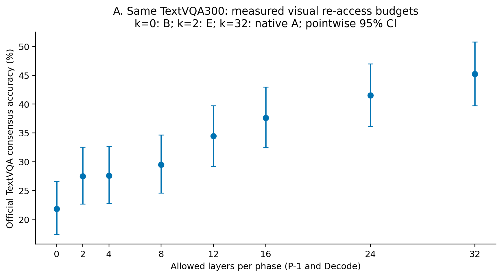
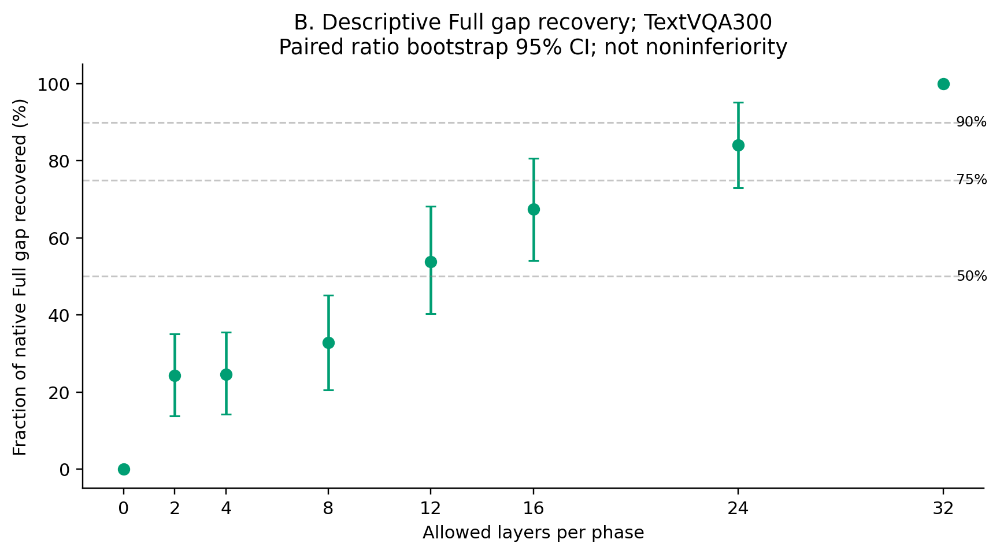
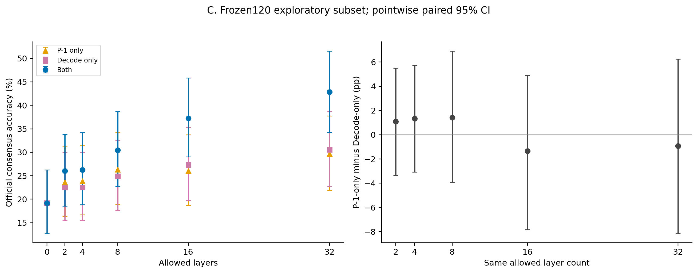
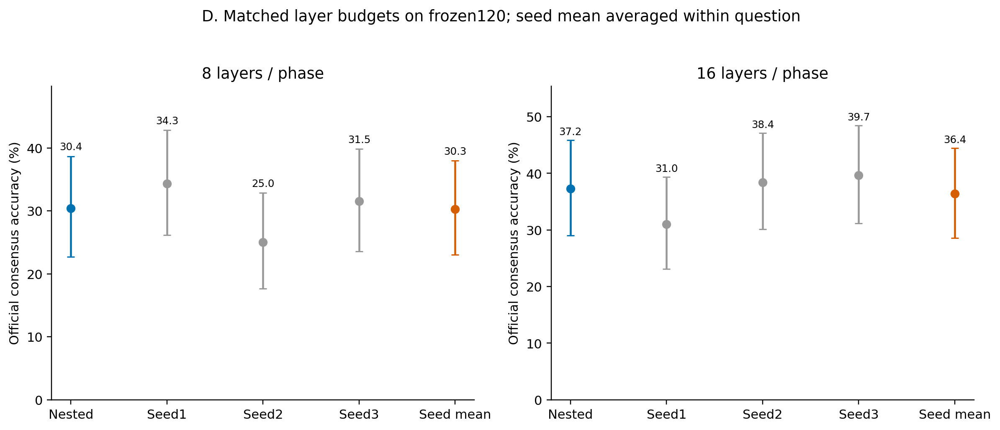
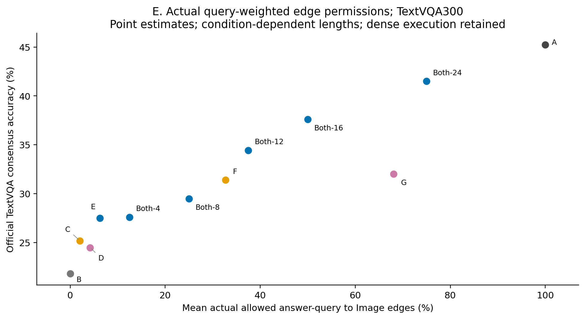
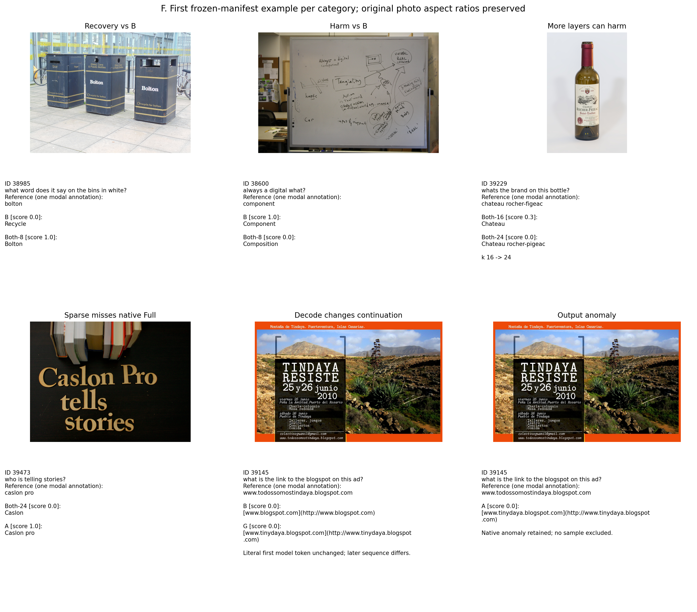

# TextVQA Visual Re-access Budget：探索性质量—回看预算

冻结基线 `a628c042e1e358d619b595f503811692dc27f126`；同一批无OCR TextVQA300，LLaVA-1.5-7B固定revision，FP16/Eager、Greedy32、logits_to_keep=1，官方TextVQA/MMF十人留一共识软评分。原生R和其他非目标路径完全保持原生。本批历史已研究，不能称为独立确认集。

## 第一阶段：完整300题

| 条件 | P−1/Decode开放层数 | Accuracy % | 相对B pp | 相对A pp | 截断/重复 |
|---|---:|---:|---:|---:|---:|
| A | 32/32 | 45.233 | +23.400 | +0.000 | 0/3 |
| B | 0/0 | 21.833 | +0.000 | -23.400 | 3/5 |
| C | 2/0 | 25.200 | +3.367 | -20.033 | 2/5 |
| D | 0/2 | 24.500 | +2.667 | -20.733 | 4/5 |
| E | 2/2 | 27.500 | +5.667 | -17.733 | 2/6 |
| F | 32/0 | 31.400 | +9.567 | -13.833 | 2/5 |
| G | 0/32 | 32.033 | +10.200 | -13.200 | 1/5 |
| Both-4 | 4/4 | 27.600 | +5.767 | -17.633 | 2/6 |
| Both-8 | 8/8 | 29.500 | +7.667 | -15.733 | 1/6 |
| Both-12 | 12/12 | 34.433 | +12.600 | -10.800 | 0/3 |
| Both-16 | 16/16 | 37.600 | +15.767 | -7.633 | 1/3 |
| Both-24 | 24/24 | 41.500 | +19.667 | -3.733 | 0/4 |

仅P−1全32层（F）：31.400%；仅Decode全32层（G）：32.033%。真正Native Full（A）为45.233%。A为无任何实验Mask的原生行为，CPU/GPU均验证32层全开放与A严格一致。

## Both预算曲线与描述性目标

| k | Accuracy % | Full Gap恢复比例 % | 相对A pp |
|---:|---:|---:|---:|
| 0 | 21.833 | 0.00 | -23.400 |
| 2 | 27.500 | 24.22 | -17.733 |
| 4 | 27.600 | 24.64 | -17.633 |
| 8 | 29.500 | 32.76 | -15.733 |
| 12 | 34.433 | 53.85 | -10.800 |
| 16 | 37.600 | 67.38 | -7.633 |
| 24 | 41.500 | 84.05 | -3.733 |
| 32 | 45.233 | 100.00 | +0.000 |

层集合严格按最远距离添加、并列取较小编号，全部嵌套且GPU前冻结；实际集合见layer_sets.json。没有按得分改层，也没有平滑或插值。恢复比例为(条件−B)/(A−B)，不同于Accuracy；恢复比例区间在同一Image簇重采样中联合计算分子和分母，保留超出0–100%的可能取值。
gap_recovery_0.5：最小观察到k=12；仅在本轮测试的离散预算中成立，点估计描述标准，不是非劣效检验。
gap_recovery_0.75：最小观察到k=24；仅在本轮测试的离散预算中成立，点估计描述标准，不是非劣效检验。
gap_recovery_0.9：最小观察到k=32；仅在本轮测试的离散预算中成立，点估计描述标准，不是非劣效检验。
Full_minus_2pp：最小观察到k=32；仅在本轮测试的离散预算中成立，点估计描述标准，不是非劣效检验。

## 第二阶段：冻结120题子集

子集仅用固定seed、Question ID和Image SHA抽取，两卡各60题。所有对照仍是历史300题的一部分。三个随机种子先逐题平均后再统计，不能当成360道独立题。

| k | P−1-only % | Decode-only % | Both % |
|---:|---:|---:|---:|
| 2 | 23.583 | 22.500 | 26.000 |
| 4 | 23.833 | 22.500 | 26.250 |
| 8 | 26.333 | 24.917 | 30.417 |
| 16 | 26.000 | 27.333 | 37.250 |
| 32 | 29.667 | 30.583 | 42.833 |

| k | Nested % | 随机seed1/2/3 % | 随机均值 % | Nested−随机均值 pp [95%CI] / Holm p |
|---:|---:|---:|---:|---|
| 8 | 30.417 | 34.333/25.000/31.500 | 30.278 | +0.139 [-3.139, +3.472] / 1.00000 |
| 16 | 37.250 | 31.000/38.417/39.667 | 36.361 | +0.889 [-3.751, +5.556] / 1.00000 |

这些随机对照只检验8/16层预算下固定嵌套集合的表现；没有随机两层对照，因此不能直接判断L14/L19是否优于随机两层，更不能由三个种子证明最优选择机制。

## 统计与阶段归因

两阶段分别预声明23和68个比较，各自做Holm校正；完整比较而非仅显著项保存在paired_comparisons.csv。Image SHA整簇配对Bootstrap20,000次，seed=20261104，普通逐点95%CI不是同时区间；双侧整簇符号翻转20,000次、plus-one p。没有定义或证明非劣效，也不能把新p值当作独立外部确认。

同等层数Ponly−Donly的逐题配对差及区间见Figure C与完整CSV；不能仅根据点估计排名断言阶段更重要。所有Donly/F/G阶段边界通过首Token原始Logits SHA验证：G和所有Donly的首Token必须与B相同，F首Token必须与A相同，Ponly-k首Token必须与对应Both-k相同。只有后续Decode发生变化时，答案变化可在保持首Token不变下发生。该检查不等于确定某个视觉概念的唯一存储位置。

## 负面、非单调和异常记录

Full_credit_but_all_main_sparse_below_full_credit：11条案例记录（同题可因多个预算出现多条，不作为独立样本数）。
decode_changes_later_tokens：114条案例记录（同题可因多个预算出现多条，不作为独立样本数）。
harm_vs_B：8条案例记录（同题可因多个预算出现多条，不作为独立样本数）。
higher_budget_harms：21条案例记录（同题可因多个预算出现多条，不作为独立样本数）。
output_anomaly：85条案例记录（同题可因多个预算出现多条，不作为独立样本数）。
recovery_vs_B：84条案例记录（同题可因多个预算出现多条，不作为独立样本数）。

全部预声明比较的Score损害保存在harm_cases.csv，改善保存在recovery_cases.csv；逐题所有回答、Token序列、标注与检查点SHA在per_question.csv。异常保存在abnormal_outputs.csv，主评分没有删除截断、重复、提前EOS或非EOS输出。Full满分而所有主稀疏点未得满分不等于所有点都零分，diagnostic_cases.csv明确保留软评分。

问题首词、参考答案长度、数字/字母/其他形式在GPU前冻结，只作词面代理，不能未经人工核实认定为OCR因果属性。描述性分组见descriptive_groups.csv；既不据此改预算，也不追加验证。

## Layer Budget、真实连接预算及资源

Layer Budget分别给出P−1与Decode开放层数；视觉Edge Budget按真实查询数统计：P−1为1个查询，Decode为实际前向次数−1，含EOS预测。每阶段允许层数×原始Image Key数×该阶段查询数，再乘32个Head；总分母为32层×全部真实答案查询数×576原始Image Key×32个Head。visual_edge_budget.csv保留逐题计数与比例。R开放比例始终100%，不能混用R Receiver预算。

实际生成长度依赖条件，因此观察到的Query-Key预算比例也依赖各自轨迹；其不是预先固定的延迟或FLOPs预算。实际Image Mass逐层记录：新条件本轮测量，A/C/D/E审计复用历史实际Mass，B由历史禁止概率严格0推得Mass为0，明确标记来源。高Mass仅表示分配，不等于因果必要性。

每卡独立一份模型，按Image SHA分片，同题全部条件在同一Worker。两卡完成全部Smoke并对同题所有条件的完整有效Logits序列SHA逐位一致后才启动正式矩阵；所有32层Mask非目标条目不变、禁用实际概率严格0，保持独立真实KV、视觉特征、MLP/Residual/QKV及正常/异常Hook清理。阶段1两卡完成后进入冻结阶段2；原子检查点支持同源码/协议/输入哈希的精确恢复。

完整执行所有QKV、Attention、MLP、Residual和KV更新；本轮不声称物理FLOPs、KV、显存或时延收益，不进行训练、层/Token追加搜索或动态策略优化。GPU耗时和峰值显存见workers/*/gpu_run_complete.json，退出审计见gpu_release.json。原始模型和图片在服务器资源目录，Git仅保存路径、SHA、生成、统计和图表。

## 图表

A–E为矢量PDF，F保留原始照片栅格并以矢量绘制文字；全部PNG/PDF及绘图CSV随交付保存，analyze.py可重现。达到高质量的点只能作为未来新数据独立验证候选，本轮结束后停止。

## 补充审计：实际连接计数与首Token的含义

accuracy_summary.csv、phase_budget_summary.csv同时给出每阶段层数、实际Decode查询总数、逐题平均连接比例与按实际查询加权的合并比例。统计样本量仍为300或120；随机均值不被当作一条真实生成轨迹。

首Token指模型Tokenizer的第一个生成位置，可能只是空格、换行或特殊Token；不能直接等同于首个词。first_token_content_audit.csv以“最短生成前缀解码后含非空白字符”的确定规则记录第一个内容子词，保留原始Token和位置，不改任何Prompt或生成。该子词也不必是完整单词。

A：首Token为空白/特殊位置85/300；相对B的字面首Token变化102题，第一个内容子词变化134题。

B：首Token为空白/特殊位置91/300；相对B的字面首Token变化0题，第一个内容子词变化0题。

F：首Token为空白/特殊位置85/300；相对B的字面首Token变化102题，第一个内容子词变化113题。

G：首Token为空白/特殊位置91/300；相对B的字面首Token变化0题，第一个内容子词变化33题。

随机均值比较的逐题正负例已补齐在harm_cases.csv和recovery_cases.csv，右侧明确保存三个种子的真实答案与Token列表，不制造一条“平均回答”。其余物理条件的所有损害和异常未删除。

Native Full得满分但所有该题已测试稀疏条件均未得满分，共10题，详见all_observed_sparse_failures.csv；不同题是否属于120子集影响已测试条件数，不能据此比较子集难度。部分得分与零分严格区分。

gap_recovery_0.5：稀疏点最小观察到k=12。

gap_recovery_0.75：稀疏点最小观察到k=24。

gap_recovery_0.9：所有已测试k<32的稀疏点均未达到，仅全开放Native k=32达到。

Full_minus_2pp：所有已测试k<32的稀疏点均未达到，仅全开放Native k=32达到。

## 对十个研究问题的直接回答

1. 仅P−1全32层（F）为31.400%，相对B：+9.567pp [+6.167, +13.167]，Holm p=0.00115。

2. 仅Decode全32层（G）为32.033%，相对B：+10.200pp [+6.800, +13.833]，Holm p=0.00115。

3. Both实际预算曲线（k: Accuracy%）为0: 21.833, 2: 27.500, 4: 27.600, 8: 29.500, 12: 34.433, 16: 37.600, 24: 41.500, 32: 45.233。

4–5. 以下均为观察到的离散预算点标准，不插值、不证明非劣效。

gap_recovery_0.5：最小观察k=12；稀疏k<32达到：True，最小稀疏k=12。

gap_recovery_0.75：最小观察k=24；稀疏k<32达到：True，最小稀疏k=24。

gap_recovery_0.9：最小观察k=32；稀疏k<32达到：False，最小稀疏k=未达到。

Full_minus_2pp：最小观察k=32；稀疏k<32达到：False，最小稀疏k=未达到。

6. 全32层P−1-only相对Decode-only（F−G）：-0.633pp [-5.233, +3.867]，Holm p=1.00000。下表进一步在同一120题、同一S_k上比较阶段，不从各自点估计直接作全局重要性排名。

| k | Ponly−Donly pp [普通95%CI] / Holm p |
|---:|---|
| 2 | +1.083pp [-3.333, +5.500]，Holm p=1.00000 |
| 4 | +1.333pp [-3.083, +5.750]，Holm p=1.00000 |
| 8 | +1.417pp [-3.917, +6.917]，Holm p=1.00000 |
| 16 | -1.333pp [-7.833, +4.917]，Holm p=1.00000 |
| 32 | -0.917pp [-8.167, +6.250]，Holm p=1.00000 |

7. 随机层对照在同一120题比较，固定嵌套集合相对三种子逐题均值：

k=8：+0.139pp [-3.139, +3.472]，Holm p=1.00000；随机种子Accuracy范围25.000–34.333%。该结果只覆盖三个冻结随机集合，不等于最优层选择机制。

k=16：+0.889pp [-3.751, +5.556]，Holm p=1.00000；随机种子Accuracy范围31.000–39.667%。该结果只覆盖三个冻结随机集合，不等于最优层选择机制。

8. 总体预算点出现下降：本轮八个固定嵌套预算的总体点估计没有下降。但更高预算造成逐题Score下降的相邻预算记录有21条、涉及20道不同问题，不能把总体单调误读为逐题安全。

9. 后续Decode确实可以改变能力：G−B为+10.200pp [+6.800, +13.833]，Holm p=0.00115。G的字面首Token原始Logits与B逐题严格相同；后续轨迹和完整答案差异见诊断CSV。首个Tokenizer位置可能只是空白，不能把“后续Decode”与“第二个语义词以后”混淆。

10. 本轮只建立在固定300题上的质量—功能性回看权限关系。是否少量层足够，应同时看恢复比例、相对Native Full的绝对差距和不确定区间；未完成新的独立数据验证。随机结果只在120题成立，不能直接替代300题预算曲线；不能从本批结果自动挑层追加生成。

## 新增条件的异常输出

| 范围 | 条件 | 截断 | 重复3gram | 空答案 | 相对B完整Token序列变化 |
|---|---|---:|---:|---:|---:|
| 300 | F | 2 | 5 | 0 | 131 |
| 300 | G | 1 | 5 | 0 | 114 |
| 300 | Both-4 | 2 | 6 | 0 | 119 |
| 300 | Both-8 | 1 | 6 | 0 | 138 |
| 300 | Both-12 | 0 | 3 | 0 | 165 |
| 300 | Both-16 | 1 | 3 | 0 | 175 |
| 300 | Both-24 | 0 | 4 | 0 | 177 |
| 120 | Ponly-4 | 2 | 3 | 0 | 29 |
| 120 | Donly-4 | 1 | 1 | 0 | 27 |
| 120 | Ponly-8 | 2 | 3 | 0 | 34 |
| 120 | Donly-8 | 0 | 3 | 0 | 36 |
| 120 | Ponly-16 | 2 | 2 | 0 | 46 |
| 120 | Donly-16 | 0 | 0 | 0 | 46 |
| 120 | Random-8-s1 | 1 | 3 | 0 | 49 |
| 120 | Random-8-s2 | 2 | 3 | 0 | 39 |
| 120 | Random-8-s3 | 1 | 3 | 0 | 64 |
| 120 | Random-16-s1 | 0 | 3 | 0 | 62 |
| 120 | Random-16-s2 | 0 | 1 | 0 | 72 |
| 120 | Random-16-s3 | 0 | 0 | 0 | 74 |

## 运行与释放

双卡GPU阶段墙钟时间约21.27分钟（包含加载、Smoke、阶段等待与审计开销；不是纯Kernel计时）。每卡一份模型，各自1770个正式新增检查点；新矩阵共3540个，历史复用1500个，规范逐题表共5040条。Smoke中兼容且属于本卡分片和正式范围的生成审计后复用，不重复计算。

Worker0：GPU UUID `GPU-a50cb044-679e-9a05-557d-4ddbd19ac3c6`；峰值allocated 14.25GiB，reserved 14.41GiB。

Worker1：GPU UUID `GPU-96bc853f-ceea-2404-c704-c48a3d1ca185`；峰值allocated 14.25GiB，reserved 14.41GiB。

释放状态和当前显存/进程快照以gpu_release.json为准；资源快照不构成未来可用性承诺。没有终止其他任务，也没有加载第三张卡。完成交付后停止。

## 统计解释与复现补充

Both-24相对Native Full为−3.733pp，普通95%CI [−6.567, −1.033]；但23项比较族的Holm p=0.05460，未达到0.05。普通区间排除0与多重校正后的检验结论不同，报告两者，不选择对叙事有利的一项。该结果不构成等价或非劣效证据，且点估计尚未达到Full−2pp探索目标。

Ponly与Donly具有不同的真实Query数量，各自Greedy前缀和生成长度也可能分化。因此它们的差值是整个冻结条件的配对效应，不是单位Query的因果贡献。嵌套层集合只是一条预先固定的扩展路径，最小观察到预算不是所有层组合中的理论最小预算。

复现顺序：在vlm_research目录运行`python -m textvqa_reaccess.analyze`，随后运行本结果目录的`describe_outputs.py`、`interpret_results.py`和`replot_final.py`。后者只修订E图标签与F图布局，保留原始图片比例和全部真实数据。`independent_audit.py`提供独立官方评分与完整性审计。推理源码和协议在GPU前冻结，最终排版脚本另行保存SHA。
