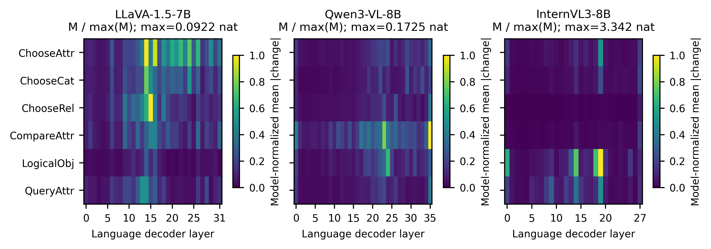
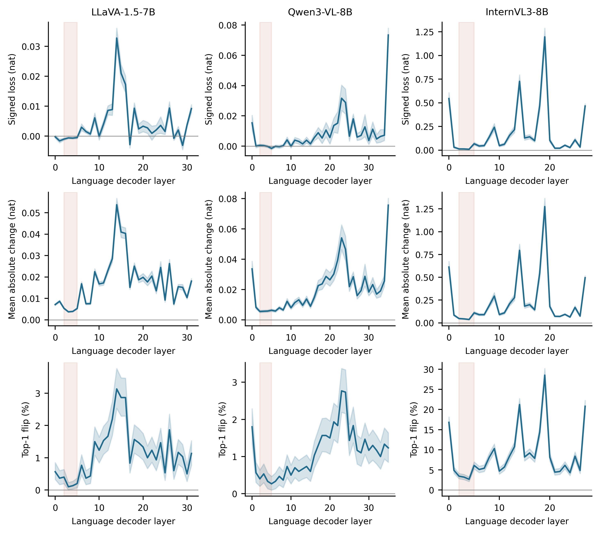
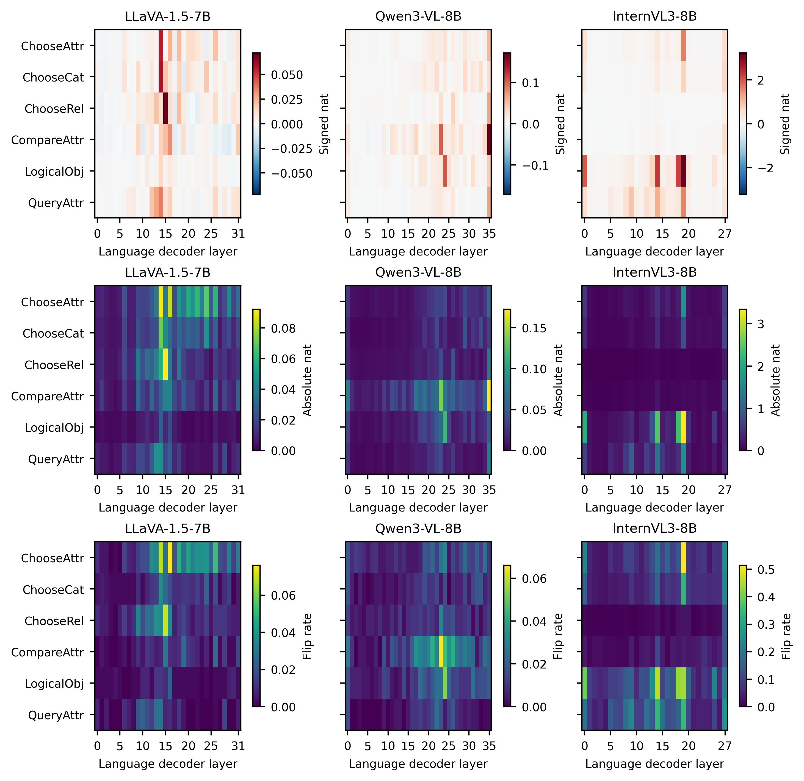
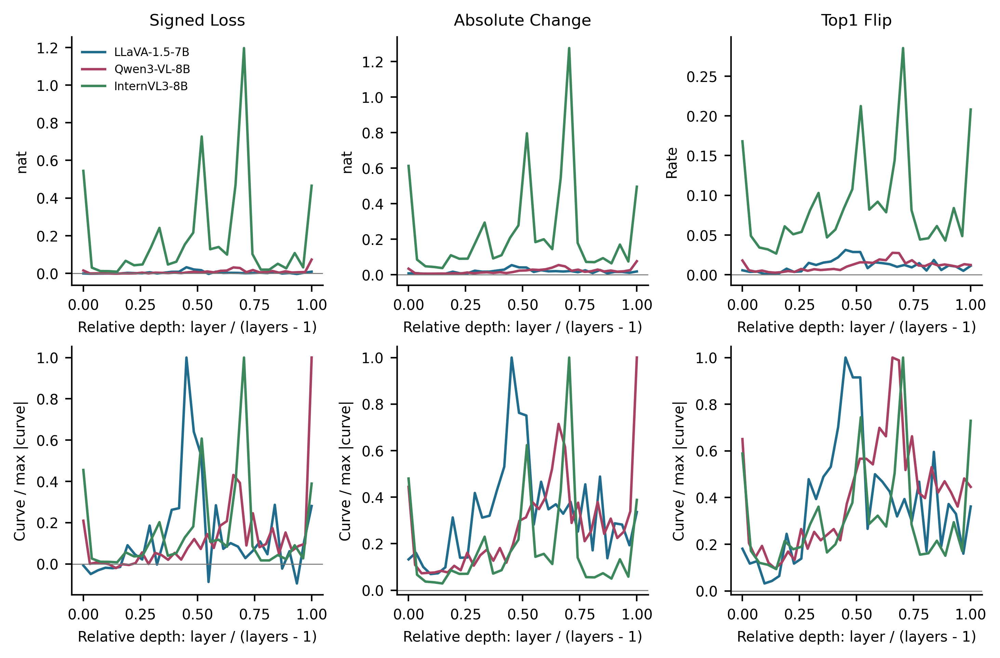

# 三模型同题 Layer-Attention Sensitivity：3,000题

## 首页结论

未发现Qwen旧图与其Signed指标原始数据不一致。旧热图展示 Mean Signed Loss，不能当作本轮要求的 Mean Absolute Change；这属于图表用途/指标区分，不能据此反称旧Signed图数值错误。旧120题全部原始Logits及4,320条指标已复算，损失方向、目标Token、层号、任务标签正确；GPU回归Logits精确一致。CPU不同线程的JS末位求和差异，通过8线程重放精确复现历史结果；不据此断言旧进程实际线程数，未放宽GPU正确性容差。

三模型均覆盖相同3,000题、六任务各500题，2409个Image SHA256簇。LLaVA严格复用并复算历史数据；Qwen和InternVL在物理GPU1顺序执行。

| 模型 | 绝对变化峰层 | 峰值nat | Signed峰层 | Signed峰值nat | L2–L5平均绝对变化nat |
|---|---:|---:|---:|---:|---:|
| LLaVA-1.5-7B | L14 | 0.053750 | L14 | 0.032769 | 0.004568 |
| Qwen3-VL-8B | L35 | 0.075686 | L35 | 0.073425 | 0.005804 |
| InternVL3-8B | L19 | 1.275208 | L19 | 1.196156 | 0.059171 |

**跨模型复现的是局部早层相对低敏感，而不是共同的中层峰。** 三模型的L2、L3、L4、L5单层平均绝对变化均低于各自全层层均值中位数；该中位数仅为描述性参照，不是预注册安全阈值。Qwen和InternVL并不复制LLaVA的全局峰位。

本轮只衡量单层、单Query、首Token分布变化；不能单凭此证明四层联合关闭不损害完整答案。官方Prompt、分词和视觉预算不同，LLaVA为FP16、另两者为BF16，差异不能纯粹归因于架构。值得将固定L2–L5作为后续独立完整答案验证候选，但本轮没有执行额外生成，也未证明非劣效。

主图为每模型独立归一化；各面板标明实际最大nat。真实绝对单位和独立95%区间见Figure 2及CSV。

## L2–L5逐层对照

| 模型 | L2 | L3 | L4 | L5 | 全层均值 | 层均值中位数 |
|---|---:|---:|---:|---:|---:|---:|
| LLaVA-1.5-7B | 0.005357 | 0.003722 | 0.003912 | 0.005282 | 0.017679 | 0.016786 |
| Qwen3-VL-8B | 0.005503 | 0.005647 | 0.005767 | 0.006300 | 0.020611 | 0.017644 |
| InternVL3-8B | 0.047104 | 0.043289 | 0.036905 | 0.109385 | 0.237133 | 0.126547 |

## 按任务峰位

| 模型 | 任务 | 绝对变化峰层 | Mean Absolute nat | Signed nat（同层） |
|---|---|---:|---:|---:|
| LLaVA-1.5-7B | ChooseAttr | L14 | 0.091002 | 0.056550 |
| LLaVA-1.5-7B | ChooseCat | L14 | 0.071337 | 0.059577 |
| LLaVA-1.5-7B | ChooseRel | L15 | 0.092203 | 0.071732 |
| LLaVA-1.5-7B | CompareAttr | L15 | 0.040914 | 0.021492 |
| LLaVA-1.5-7B | LogicalObj | L14 | 0.026692 | 0.014431 |
| LLaVA-1.5-7B | QueryAttr | L13 | 0.047706 | 0.029136 |
| Qwen3-VL-8B | ChooseAttr | L35 | 0.057365 | 0.055126 |
| Qwen3-VL-8B | ChooseCat | L29 | 0.045238 | 0.032669 |
| Qwen3-VL-8B | ChooseRel | L35 | 0.068636 | 0.068636 |
| Qwen3-VL-8B | CompareAttr | L35 | 0.172536 | 0.171511 |
| Qwen3-VL-8B | LogicalObj | L24 | 0.116560 | 0.108002 |
| Qwen3-VL-8B | QueryAttr | L35 | 0.071118 | 0.070932 |
| InternVL3-8B | ChooseAttr | L19 | 1.722856 | 1.627565 |
| InternVL3-8B | ChooseCat | L19 | 0.803280 | 0.714708 |
| InternVL3-8B | ChooseRel | L27 | 0.232690 | 0.232228 |
| InternVL3-8B | CompareAttr | L27 | 0.597764 | 0.586493 |
| InternVL3-8B | LogicalObj | L19 | 3.341722 | 3.219231 |
| InternVL3-8B | QueryAttr | L19 | 1.661291 | 1.588956 |

## 研究问题与解释边界

- LLaVA-1.5-7B：绝对变化峰L14（相对深度0.452）。L2–L5均值低于本模型层均值中位数。这四层中4/4层各自低于该参照。这是描述性参照，不是预注册低损害判据。
- Qwen3-VL-8B：绝对变化峰L35（相对深度1.000）。L2–L5均值低于本模型层均值中位数。这四层中4/4层各自低于该参照。这是描述性参照，不是预注册低损害判据。
- InternVL3-8B：绝对变化峰L19（相对深度0.704）。L2–L5均值低于本模型层均值中位数。这四层中4/4层各自低于该参照。这是描述性参照，不是预注册低损害判据。
- 三模型L2–L5平均单层绝对变化均低于各自层均值中位数，支持“局部早层P−1 Attention更新相对低敏感”的描述性跨模型现象。英文表述宜用 low sensitivity；若使用 redundancy，必须限定为此单步、单Query、单层干预端点，不暗示已证明多层安全省略。
- 真实量级：全层平均绝对变化最大为InternVL3-8B的0.237133nat，最小为LLaVA-1.5-7B的0.017679nat；比值13.41。模型归一化热图不能用于比较这种绝对量级。
- Qwen此前末层峰：本轮绝对变化峰L35、Signed峰L35；末层总体峰复现。
- InternVL此前L19峰：本轮绝对变化峰L19、Signed峰L19；L19总体峰复现。
- 峰位和量级不同应视为架构相关结果；不能为了复现LLaVA而平滑、重分段或删除极端题。极端题保存在extreme_cases.csv。
- 本轮Question ID、Image ID/SHA256及Gold严格相同，但模型官方Prompt、分词、视觉预算和精度不同。LLaVA为FP16/576视觉Token；Qwen为BF16/动态视觉Token/DeepStack；InternVL为BF16/单448图块/256视觉Token。因此跨模型差异不能单独归因于网络架构，模型自身Full目标Token和原始预测置信度也不必跨模型相同。各模型的Full Top-1概率与Margin记录在model_comparison.csv，不能忽略这种基线差异。
- 本轮不新增Attention Mass采集，也不把三个模型的Anchor/BOS解释成相同Token或相同机制。InternVL历史Start Anchor极低，不能据此构造共享BOS高Mass解释。
- 单层LogP曲线不证明多层联合关闭安全，也不证明最终答案Accuracy、物理跳层、K/V删除或GPU加速。历史Qwen中层窗口净Accuracy为0但有2损害/2纠正；InternVL L2–L5窗口Accuracy零翻转但有首Token和文本变化，都是端点不等价的实例。
- 是否支持“跨架构局部早层Attention更新低敏感”只能依据上述真实量级作描述性判断。即使三模型早层相对较低，也不使用本轮探索数据宣称L2–L5非劣效或普遍冗余。
- 如进入下一阶段，应固定L2–L5，用未参与本轮的Image-disjoint完整答案生成和预注册非劣效边界验证；本轮未执行这些额外实验。

## 任务差异与跨模型措辞

- LLaVA-1.5-7B：L13为QueryAttr的绝对变化峰；L14为ChooseAttr, ChooseCat, LogicalObj的绝对变化峰；L15为ChooseRel, CompareAttr的绝对变化峰。这些是探索性峰位，不是经过多重比较校正的任务差异检验。
- Qwen3-VL-8B：L24为LogicalObj的绝对变化峰；L29为ChooseCat的绝对变化峰；L35为ChooseAttr, ChooseRel, CompareAttr, QueryAttr的绝对变化峰。这些是探索性峰位，不是经过多重比较校正的任务差异检验。
- InternVL3-8B：L19为ChooseAttr, ChooseCat, LogicalObj, QueryAttr的绝对变化峰；L27为ChooseRel, CompareAttr的绝对变化峰。这些是探索性峰位，不是经过多重比较校正的任务差异检验。

建议论文表述：**Localized early-layer attention updates show low single-step sensitivity across heterogeneous VLMs, although global sensitivity profiles differ.** 不将本轮证据直接升级为已证明的redundancy；architecture-related形态差异仍与Prompt、精度和视觉预算等共同变化。

## 原生置信度与实际单位

| 模型 | Full Top-1平均概率 | Full平均Top-1/Top-2 Logit差 | 输入Token范围 | 视觉Token范围 |
|---|---:|---:|---:|---:|
| LLaVA-1.5-7B | 0.873124 | 3.554018 | 606–629 | 576–576 |
| Qwen3-VL-8B | 0.956565 | 8.018000 | 93–1169 | 64–1140 |
| InternVL3-8B | 0.879612 | 3.965417 | 319–339 | 256–256 |

Full Top-1 Margin在此明确定义为前两名原始Logit差，而非候选答案Margin或最终Accuracy。主Loss始终固定各模型自己的Full首Token，不将不同模型的分词Token强行对齐。

## 统计及正确性

每模型每层：Mean Signed、Mean Absolute、Median、P90/P95、Std、Top-1 Flip和JS。20,000次整图SHA256簇Bootstrap，seed=20261101，重采样簇后保持题目加权；普通描述性95%区间。未将不同层、Head或问题时间步当作独立图片，未作未经校正的确认性显著性声明。

所有主指标固定自身原生Full首Token argmax，FP32 LogSoftmax；绝对值逐题计算后再平均；负Signed保留。正式采集每题单独验证视觉重放精确一致，所有层采用独立空Cache。新增两模型的原始BF16完整词表Logits存资源目录且绑定SHA256；LLaVA复用历史FP16前向后以FP32保存的Logits。不提交权重或大型张量。

实现阶段保留了两次Smoke失败记录，均发生在正式条件采集前：首次Qwen模型加载处的inference-mode参数版本计数审计已修正；InternVL首次Smoke历史Full最大差0.0625来自输出头矩阵形状：原生HF生成设置logits_to_keep=1，初版直接Prefill遗漏该设置。独立InternVL addendum恢复原生设置后，历史Full、No-op、视觉重放Logits最大差全部为0，历史单层Loss精确匹配。未放宽容差、未修改权重/环境/样本/视觉预算；Qwen已完成的冻结源码及结果未改变。见internvl_native_addendum.json、protocol_attempt0.json和对应失败日志。

## 历史L2–L5完整答案端点（仅背景）

| 模型 | 历史题数 | Full Accuracy % | L2–L5 ΔAccuracy pp | 原对→错 | 原错→对 |
|---|---:|---:|---:|---:|---:|
| LLaVA-1.5-7B | 3000 | 87.567 | +0.100 | 20 | 23 |
| Qwen3-VL-8B | 240 | 86.667 | +0.000 | 0 | 0 |
| InternVL3-8B | 120 | 90.000 | +0.000 | 0 | 0 |

历史样本量、处理和预注册状态不同，不把这些结果并入本轮3,000题单层指标，也不把三模型历史窗口当作同题、独立的跨模型非劣效检验。

- Qwen3-VL-8B：正式执行3.322小时；进程显存峰值23986MiB；Allocated峰20077.0MiB；Reserved峰23670.0MiB。
- InternVL3-8B：正式执行2.903小时；进程显存峰值15732MiB；Allocated峰15286.6MiB；Reserved峰15418.0MiB。

GPU1释放审计见gpu1_release.json。本轮至此停止，不追加生成、来源Mask、训练或新数据。

## 图表下载

[Figure 1 PDF](figure1_cross_model_heatmap.pdf) / [Figure 2 PDF](figure2_raw_sensitivity_curves.pdf) / [Figure 3 PDF](figure3_six_task_raw_heatmaps.pdf) / [Figure 4 PDF](figure4_relative_depth.pdf)

矢量热图单元与曲线使用真实CSV直接绘制；PNG为400 DPI。具体定义见figure_captions.json，逐图绘图数据为figure1_plot_data.csv至figure4_plot_data.csv。
