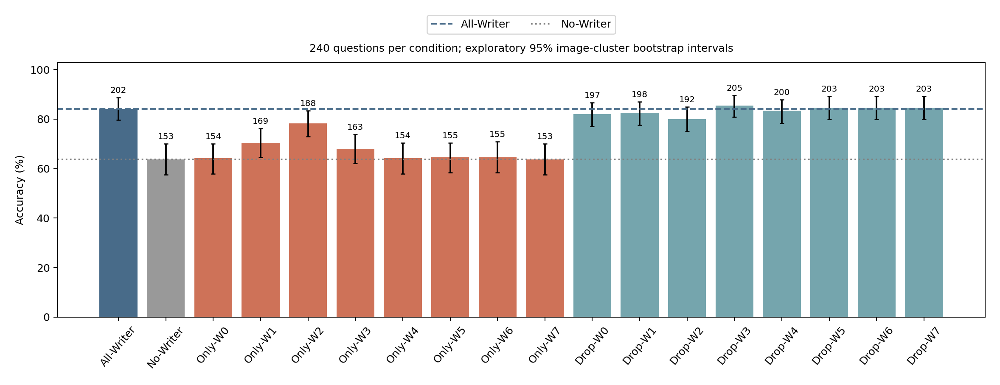
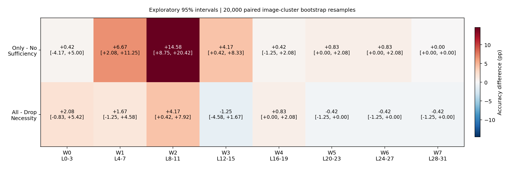
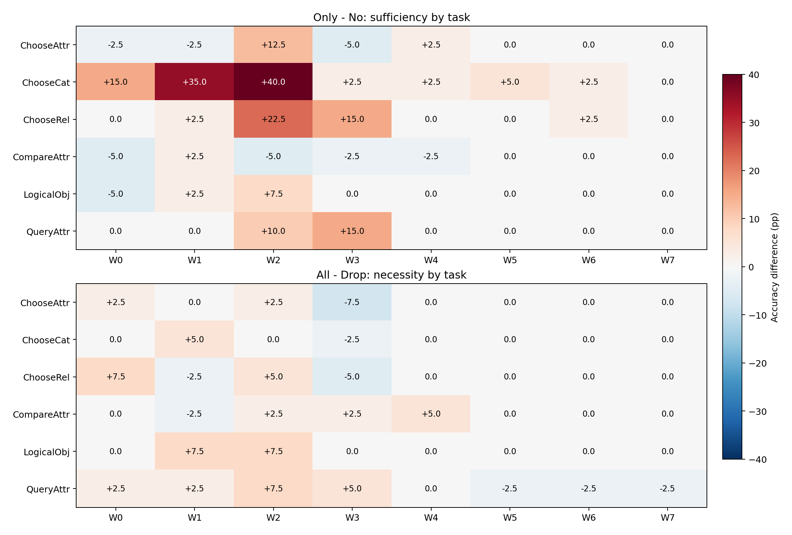

# Visual Write-Window Discovery：视觉写入窗口探索

**COMPLETE：240题×18条件共4320条主实验答案全部重新生成，另有40组×2端No-Writer换图控制80条；两者分开统计。**

## 核心回答

All-Writer 为 202/240（84.167%），No-Writer 为 153/240（63.750%）。单窗口中最高的增益来自 Only-W2：相对 No-Writer +14.583 pp，探索性95%CI [+8.750, +20.417]。

充分性增益区间完全高于0的窗口为：Only-W1, Only-W2, Only-W3。移除后损害区间完全高于0的窗口为：Drop-W2。这些是本批Hard-Mask控制下的功能敏感性证据，不是窗口普遍充分、无损、唯一或不可替代的证明；全部16项窗口比较均为探索性，未进行确认性多重比较校正。

## 完成后的科学判读

**没有发现一个四层窗口能够完整保留All-Writer的表现，但发现了以L8–L11为峰值的不均匀写入能力。** Only-W2为188/240（78.333%），相对No-Writer增加14.583 pp，95%CI [+8.750, +20.417]；它仍比All-Writer少14题，差值−5.833 pp，CI [−10.833, −0.833]，具体为25题受损、11题纠正。全部八个Only条件相对All的普通探索性区间均为负，因此本轮不支持“任意一个四层窗口就足够达到全层表现”。多个窗口联合开放是否足够尚未测试。

L4–L7（Only-W1）和L12–L15（Only-W3）也有部分充分性：相对No分别+6.667 pp [2.083, 11.250]、+4.167 pp [0.417, 8.333]。W0、W4–W7未显示同等强的总体增益，不能将其解释为没有视觉信息流。W7虽然完整答案和首Token Top-1与No-Writer相同，其完整Logits仍可变化，不能由Accuracy相同推导状态相同。

必要性证据同样在W2最强：All−Drop-W2为+4.167 pp [0.417, 7.917]，移除后15题受损、5题纠正，是八个窗口中唯一普通95%区间完全为正的净损害。**这是其他28层开放时的条件必要性线索，不是不可替代或唯一写入节点的证明。** Drop-W2仍有192/240（80.000%），比No-Writer高16.250 pp [9.583, 22.917]。因此其他层能承担相当一部分功能，且Only-W2和Drop-W2都未恢复All的202/240；这与分布不均、部分可替代并需要跨层协作的写入机制相容，尚未定位具体补偿中介。16项窗口比较未作确认性多重校正，边界性的区间尤其不应外推为确认结论。

任务差异也反对“W2普遍充分”：Only-W2相对No在ChooseCat为+40.0 pp、ChooseRel为+22.5 pp、QueryAttr为+10.0 pp；但CompareAttr为−5.0 pp。相对All，Only-W2在QueryAttr下降22.5 pp、CompareAttr下降7.5 pp。移除W2的损害则分布在ChooseAttr、ChooseRel、CompareAttr、LogicalObj及QueryAttr，而ChooseCat净变化为0。全部任务每类仅40题，这些差异为描述性。

两条说明性的反例同时在Only-W2和Drop-W2中出现：`001020372`问“长凳左边的斑马是黑还是白”，Gold与All均为White，两种条件都答Black；`02813015`问“男人在哪一侧”，Gold与All均为Right，两种条件都答Left。保留W2本身或只保留其他窗口，都不足以挽回这些题；这只是逐题协作现象的线索，不能据此证明某种确定交互结构。完整反例没有删去。

对Look Hard, Answer Cheap的机制贡献是：在答案阶段32层都不能直接读取Image Key时，部分中前层R读图仍能显著提高完整VQA准确率，说明视觉读取的功能作用在层间高度不均匀。最有希望的写入候选是L8–L11及其邻近窗口，但本轮没有证明只保留少数层就能无损，也没有证明任何窗口不可替代。后续“稀疏写入、轻量读取”应视为待独立验证的设计方向。本轮未运行任何多窗口联合、Activation Patching、跨模型、Router或Kernel实验。

## 协议与因果范围

所有18条件都在32层禁止P−1及每一个真实Decode Query直接读取原始576个Image Key，包括EOS预测。唯一变化是R可直接读Image Key的层集合。R包括图像后、P−1前的问题、模板、指令及空白。Image Query、其他文本边、BOS/Self、MLP、Residual、RoPE、KV保留；没有o_proj消融、物理跳算或KV删除。Hard Mask会使剩余连接重归一化。
“写入”在本文只是允许R直接访问原始Image Key的操作定义；其他层可传播已经写入的非图像状态，开放层的Image KV本身也已历经此前计算。结果不能定位唯一语义写入Token或把Accuracy差解释为信息量。
固定模型revision `b234b804b114d9e37bb655e11cbbb5f5e971b7a9`，FP16/Eager、Transformers4.49.0、Greedy、max_new_tokens=32、显式logits_to_keep=1；各条件从空真实KV独立生成。一份模型、单GPU串行。源码Commit `3b1950f9780676bac874d0a97b53341ab8c57ec7`。

## 各条件完整答案结果

|条件|正确/240|Accuracy|ΔAll pp|ΔNo pp|All对→错/错→对|首Token翻转vsAll|EOS/截断/空/重复|
|---|---:|---:|---:|---:|---:|---:|---|
|All-Writer|202|84.167%|+0.000|+20.417|0/0|0|240/0/0/0|
|No-Writer|153|63.750%|-20.417|+0.000|64/15|79|240/0/0/0|
|Only-W0|154|64.167%|-20.000|+0.417|60/12|72|240/0/0/0|
|Only-W1|169|70.417%|-13.750|+6.667|46/13|59|240/0/0/0|
|Only-W2|188|78.333%|-5.833|+14.583|25/11|36|240/0/0/0|
|Only-W3|163|67.917%|-16.250|+4.167|53/14|67|240/0/0/0|
|Only-W4|154|64.167%|-20.000|+0.417|62/14|76|240/0/0/0|
|Only-W5|155|64.583%|-19.583|+0.833|62/15|77|240/0/0/0|
|Only-W6|155|64.583%|-19.583|+0.833|62/15|77|240/0/0/0|
|Only-W7|153|63.750%|-20.417|+0.000|64/15|79|240/0/0/0|
|Drop-W0|197|82.083%|-2.083|+18.333|10/5|15|240/0/0/0|
|Drop-W1|198|82.500%|-1.667|+18.750|8/4|12|240/0/0/0|
|Drop-W2|192|80.000%|-4.167|+16.250|15/5|20|240/0/0/0|
|Drop-W3|205|85.417%|+1.250|+21.667|6/9|15|240/0/0/0|
|Drop-W4|200|83.333%|-0.833|+19.583|2/0|2|240/0/0/0|
|Drop-W5|203|84.583%|+0.417|+20.833|0/1|1|240/0/0/0|
|Drop-W6|203|84.583%|+0.417|+20.833|0/1|1|240/0/0/0|
|Drop-W7|203|84.583%|+0.417|+20.833|0/1|1|240/0/0/0|

## 窗口充分性与必要性

Only−No衡量仅开放该4层窗口在No-Writer背景下的功能增益；All−Drop衡量在其他28层开放背景下移除该窗口的净损害。二者背景不同，不能直接相加。CI跨0不证明无损或没有视觉信息流。

|窗口|层|Only−No pp [95%CI]|Only相对No 对→错/错→对|All−Drop pp [95%CI]|Drop相对All 对→错/错→对|
|---|---|---|---|---|---|
|W0|L0–L3|+0.417 [-4.167, +5.000]|14/15|+2.083 [-0.833, +5.417]|10/5|
|W1|L4–L7|+6.667 [+2.083, +11.250]|8/24|+1.667 [-1.250, +4.583]|8/4|
|W2|L8–L11|+14.583 [+8.750, +20.417]|10/45|+4.167 [+0.417, +7.917]|15/5|
|W3|L12–L15|+4.167 [+0.417, +8.333]|7/17|-1.250 [-4.583, +1.667]|6/9|
|W4|L16–L19|+0.417 [-1.250, +2.083]|2/3|+0.833 [+0.000, +2.083]|2/0|
|W5|L20–L23|+0.833 [+0.000, +2.083]|0/2|-0.417 [-1.250, +0.000]|0/1|
|W6|L24–L27|+0.833 [+0.000, +2.083]|0/2|-0.417 [-1.250, +0.000]|0/1|
|W7|L28–L31|+0.000 [+0.000, +0.000]|0/0|-0.417 [-1.250, +0.000]|0/1|

完整的每条件对All和No的差值与区间、首Token变化、signed LogP loss及损益见accuracy_summary.csv、paired_comparisons.csv及per_question.csv。全部比较使用同一组20,000次Image SHA256整簇配对Bootstrap抽样，seed=20261102，双侧百分位探索性95%CI。240题对应240个不同图像簇。

## 六任务结果

|条件|ChooseAttr|ChooseCat|ChooseRel|CompareAttr|LogicalObj|QueryAttr|
|---|---:|---:|---:|---:|---:|---:|
|All-Writer|82.5%|92.5%|80.0%|75.0%|97.5%|77.5%|
|No-Writer|70.0%|47.5%|60.0%|72.5%|87.5%|45.0%|
|Only-W0|67.5%|62.5%|60.0%|67.5%|82.5%|45.0%|
|Only-W1|67.5%|82.5%|62.5%|75.0%|90.0%|45.0%|
|Only-W2|82.5%|87.5%|82.5%|67.5%|95.0%|55.0%|
|Only-W3|65.0%|50.0%|75.0%|70.0%|87.5%|60.0%|
|Only-W4|72.5%|50.0%|60.0%|70.0%|87.5%|45.0%|
|Only-W5|70.0%|52.5%|60.0%|72.5%|87.5%|45.0%|
|Only-W6|70.0%|50.0%|62.5%|72.5%|87.5%|45.0%|
|Only-W7|70.0%|47.5%|60.0%|72.5%|87.5%|45.0%|
|Drop-W0|80.0%|92.5%|72.5%|75.0%|97.5%|75.0%|
|Drop-W1|82.5%|87.5%|82.5%|77.5%|90.0%|75.0%|
|Drop-W2|80.0%|92.5%|75.0%|72.5%|90.0%|70.0%|
|Drop-W3|90.0%|95.0%|85.0%|72.5%|97.5%|72.5%|
|Drop-W4|82.5%|92.5%|80.0%|70.0%|97.5%|77.5%|
|Drop-W5|82.5%|92.5%|80.0%|75.0%|97.5%|80.0%|
|Drop-W6|82.5%|92.5%|80.0%|75.0%|97.5%|80.0%|
|Drop-W7|82.5%|92.5%|80.0%|75.0%|97.5%|80.0%|

每类40题，任务差异为描述性，不作为独立确认检验；完整损益见task_accuracy.csv。

## No-Writer 图像独立性

历史冻结40组异图同文本且Gold不同的配对中，No-Writer答案随图改变 0/40，生成Token变化0/40，两端均正确 0/40。全部40组的每一步有效Logits使用torch.equal严格一致，最大差异0；首Token完整分布JS为0。不同Gold下两端不能同时正确。

该控制在正式主矩阵前通过，未按模型表现重选配对。它排除了该控制集中No-Writer通过未屏蔽图像路径形成回答的现象；不把No-Writer依靠语言先验的主实验正确题归为视觉理解。配对来自历史3000题冻结子集，任务不均衡，与主240题单独统计。

## 负面案例

全部相对All-Writer由对变错的记录保存于negative_cases.csv，不删除反例。以下按条件和题号固定排序展示前12条。

|条件|题号|问题|Gold|All-Writer|干预答案|
|---|---|---|---|---|---|
|Drop-W0|001020372|Is the zebra to the left of the bench black or white?|white|White|Black|
|Drop-W0|01938770|Which side of the picture is the man on?|left|Left|Right|
|Drop-W0|03135722|Is the girl to the left or to the right of the man that is eating a sandwich?|right|Right|Left|
|Drop-W0|04822990|Is this a keyboard or a computer mouses?|keyboard|Keyboard|Computer mouses|
|Drop-W0|0691748|On which side is the tray?|right|Right|Left|
|Drop-W0|07802104|Is the boy to the left or to the right of the cup on the left side?|right|Right|Left|
|Drop-W0|11697551|Is the skateboard to the left or to the right of the skateboarder that is wearing shoes?|right|Right|Left|
|Drop-W0|13223443|Is the bracelet orange or silver?|silver|Silver|Orange|
|Drop-W0|14381878|Is the woman to the left or to the right of the man that is wearing a shirt?|left|Left|Right|
|Drop-W0|17516402|Are there either men or women that are standing?|yes|Yes|No|
|Drop-W1|001020372|Is the zebra to the left of the bench black or white?|white|White|Black|
|Drop-W1|01938770|Which side of the picture is the man on?|left|Left|Right|

## 正确性、复用与资源

CPU全部测试及三道固定真实7B GPU Smoke通过，Smoke覆盖18条件。HF原生、自定义Native和No-op全部有效Logits同形状torch.equal。32层MLP正常，独立Cache存储与父Cache指纹、绝对位置、正常及异常Hook清理、输入和权重版本验证通过。实际Softmax后禁止概率严格为0；概率行和沿用历史0.002界限。每条正式生成记录每层每次真实Forward的作用范围和实际概率审计，全部检查点与原始首向量重新核验。
历史Handoff B语义相近，但主Manifest仅20/240题重合且旧LM Head路径未显式logits_to_keep=1，未复用。历史原生Full允许答案读Image Key，也不等同All-Writer。全部4320条主实验新生成，没有混入旧分数。
Manifest原样复用，实际SHA256 `258c32d470270829e126ae9abf3a030dbc1485b2f329fdfc326f4d6e9b3e686c`；保持原Question ID、Gold、图像SHA、Prompt IDs和Pixel Tensor哈希。该240题为历史复用探索样本，不是独立确认集。物理GPU2，UUID `GPU-a50cb044-679e-9a05-557d-4ddbd19ac3c6`；运行前实查空闲，未终止其他进程，退出后的资源状态见gpu_release.json。

大型原始首Token数组保存在服务器资源目录，检查点记录路径及SHA256；GitHub不包含这些数组。模型文件完整SHA256在冻结前与采集后核验。

## 图表

## 解释边界与停止

少数Only窗口若表现接近All，只能表明在这批样本和路径定义下可支持较多任务；没有预声明非劣效界限，不能宣称等价。多个Only有效且Drop损失小时，与可替代写入通路相容；若Only都显著落后All，则与跨层协作相容，但不能仅靠这些消融证明具体补偿中介机制。必要性是相对于其他窗口开放背景的条件必要性，不能声称不可替代的唯一层。
本轮仅提供视觉写入阶段的功能机制证据；未测得真实加速或显存收益。后续“稀疏写入、轻量读取”仍需独立样本验证。本轮不自动实施Activation Patching、跨模型、Router、Kernel或KV剪枝。

## ????CSV?????

?????????`first_divergence_all`????????None????????CSV??????Token????Python None??????????????????None?????????????Mask?Cache???????????delivery_reader_diagnostic.json??????????????check_delivery_csv.py???CSV???????????????????????????????GPU????????????????????delivery_read_only_validation.json?
